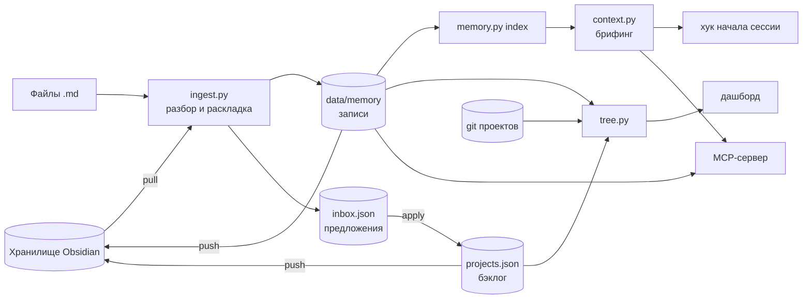

# ТЗ-01. Память портфеля, приём заметок, Obsidian и дерево роста

| | |
| --- | --- |
| Версия | 1.0, утверждена 2026-09-24 |
| Система | TaskTreker |
| Основание | запрос владельца портфеля: вынести память и кеш из контекста ассистента в систему |
| Схемы нумерации | ПАМ, ПРМ, ОБС, ДРВ, ОБН, ИНТ, КАЧ, БЕЗ |
| Статусы | ✅ реализовано · ◐ частично · ○ не начато |

## 1. Цель

Ассистент перестаёт быть хранилищем знания о проектах и становится его пользователем.
Знание, задачи и история решений лежат в системе. В контекст сессии попадает указатель,
а не содержимое, поэтому вход в работу стоит сотни токенов, а не десятки тысяч, и знание
не теряется между сессиями.

Измеримые результаты:

1. Брифинг сессии обходится минимум в десять раз дешевле, чем чтение всех данных подряд
   (ПАМ-11). Цифра считается системой и видна на дашборде.
2. Входящие заметки Markdown раскладываются по проектам правилами системы, а не рассуждением
   ассистента; точность раскладки по проекту на размеченном наборе — не ниже 85% (ПРМ-09).
3. Хранилище Obsidian и система обмениваются в обе стороны без ручной конвертации (ОБС).
4. Дашборд показывает, из какого запроса что выросло: корень, решения, задачи, реализация (ДРВ).
5. Ассистент в любом проекте начинает сессию с брифинга по этому проекту (ИНТ-03).

## 2. Термины

| Термин | Значение |
| --- | --- |
| Запись памяти | Файл `data/memory/<id>.md`: фронтматтер со свойствами и тело — одна единица знания |
| Вид записи | запрос, решение, требование, риск, итог, факт, источник, заметка |
| Брифинг | Упаковка состояния портфеля и указателя памяти в заданный бюджет токенов |
| Корень | Запись вида «запрос», из которой выросли решения и задачи |
| Предложение | Задача, найденная в заметке и ожидающая решения человека во входящих |
| Хранилище | Каталог заметок Obsidian пользователя |
| Выгрузка | Папка хранилища, которую система считает своей и перезаписывает |

## 3. Границы

Входит: хранение и выдача знания, приём Markdown, обмен с Obsidian, дерево работ на дашборде,
ручное обновление данных, подключение ассистента во всех проектах.

Не входит:

- **Поиск по смыслу.** Эмбеддинги и семантическая выдача — отдельный сервис-индексатор.
  Он читает хранилище, включая папку выгрузки TaskTreker, и не обращается к `data/` напрямую.
  TaskTreker ищет по словам и связям. Граница — ИНТ-08.
- **Облачные сервисы и сеть.** Всё работает локально на стандартной библиотеке Python.
- **Правка пользовательских заметок.** Система пишет только в свою папку выгрузки.

## 4. Архитектура

Слои и владельцы данных — в таблице «Правило номер один» регламента `CLAUDE.md`.
Новое правило этого ТЗ: **ни один модуль приёма не пишет в `projects.json`**, кроме переноса
галочек статуса (ОБС-05) и явной команды `apply`.

## 5. Требования

### 5.1. Память

| Код | Требование | Критерий приёмки | Статус |
| --- | --- | --- | --- |
| ПАМ-01 | Запись хранится файлом `data/memory/<id>.md`: Markdown с фронтматтером, совместимым с Obsidian | Файл открывается в Obsidian, поля читаются как свойства | ✅ |
| ПАМ-02 | Идентификатор стабилен: тот же заголовок того же проекта из того же источника даёт тот же id | Повторный приём файла не создаёт новых файлов записей | ✅ |
| ПАМ-03 | Восемь видов записей и три статуса: активна, устарела, заменена | Неизвестный вид становится «заметкой»; гейт ловит вид вне списка | ✅ |
| ПАМ-04 | Индекс памяти без тел: заголовок, вид, проект, связи, ключевые слова, дайджест до 220 символов, вес в токенах | Индекс растёт от числа записей, а не от их объёма | ✅ |
| ПАМ-05 | Брифинг укладывается в заданный бюджет и содержит: что требует решения, состояние проектов, верхушку бэклога, указатель памяти без тел | Брифинг с бюджетом N не длиннее N токенов по оценке системы | ✅ |
| ПАМ-06 | Брифинг по проекту: заданный проект раскрыт целиком, остальные — одной строкой, тревоги — его и портфельные | Брифинг проекта X не содержит бэклога проекта Y | ✅ |
| ПАМ-07 | Точечное чтение: по id — запись целиком, по словам — совпадения с дайджестами; тело режется по бюджету | Поиск по двум словам заголовка находит запись первой | ✅ |
| ПАМ-08 | Запись знания из командной строки и через MCP-сервер | Записанное видно в следующем брифинге | ✅ |
| ПАМ-09 | Устаревание без удаления: статус «устарела», причина дописывается в тело, файл остаётся | После устаревания файл на месте, в брифинге записи нет | ✅ |
| ПАМ-10 | Замена: запись получает статус «заменена» и ссылку на преемника, преемник — поле `supersedes` | Цепочка замен восстанавливается по полям записей | ✅ |
| ПАМ-11 | Экономия измеряется: брифинг сравнивается с полным чтением данных; на пустых данных процент не выдумывается | На пустом каталоге нет отрицательной экономии | ✅ |

### 5.2. Приём заметок

| Код | Требование | Критерий приёмки | Статус |
| --- | --- | --- | --- |
| ПРМ-01 | Разбор Markdown: фронтматтер, разделы 1–3 уровня, чекбоксы с состояниями, теги, викиссылки; блоки кода не разбираются | Решётка внутри блока кода не становится тегом | ✅ |
| ПРМ-02 | Вид куска — по явному указанию во фронтматтере или теге, иначе по признакам текста; признак в заголовке весит больше | Размеченный набор проходит порог ПРМ-09 по виду | ✅ |
| ПРМ-03 | Проект — по убыванию силы признака: аргумент, фронтматтер, папка проекта, папка проекта вне портфеля, имя файла, тег, викиссылка и прямое упоминание, словарь проекта. Теги или упоминания нескольких проектов — заметка портфеля, если один не назван втрое чаще остальных. Вес слова словаря — по числу проектов, в описании которых оно встречается; совпадение засчитывается, только если совпавших слов впятеро больше случайного ожидания для такой длины заметки и такого словаря | Заметка с полем `project` раскладывается с уверенностью 100%; профиль с тремя названными проектами уходит в «портфель» | ✅ |
| ПРМ-04 | Структура: корневая запись файла и записи разделов с `parent` и `root` на корень; документ можно подвесить под существующий запрос | Раздел висит в дереве под корнем своего файла | ✅ |
| ПРМ-05 | Задачи из чекбоксов и пунктов плана становятся предложениями во входящих, а не задачами бэклога | После приёма `projects.json` не изменился | ✅ |
| ПРМ-06 | Повторный приём не дублирует предложения: сверка с бэклогом, сделанным и входящими | Двойной приём файла даёт ноль новых предложений | ✅ |
| ПРМ-07 | Принятая задача продолжает нумерацию проекта и при пустом бэклоге: префикс и номер берутся из бэклога, сделанного, обоснования готовности, комментариев и поля `id_prefix` | Проект с закрытыми задачами 1–3 и пустым бэклогом получает задачу номер 4 со своим префиксом | ✅ |
| ПРМ-08 | Путь заметки участвует в раскладке: папки сопоставляются с ключом, именем и псевдонимами проекта (`aliases`). Где лежат папки проектов, задаёт `import.project_folders`; папка проекта, которого нет в портфеле, уходит в «портфель» с пометкой `foreign_project`, без угадывания по словам | Заметка из папки проекта попадает в него без фронтматтера; заметка из папки чужого проекта — в «портфель», отчёт обмена называет такие папки | ✅ |
| ПРМ-09 | Качество раскладки измеряется на размеченном наборе: точность проекта не ниже 85%, вида — не ниже 70%, ни одной заметки и ни одного раздела в чужом проекте | Тест набора падает ниже порога | ✅ |
| ПРМ-10 | Записи одного порядка по размеру: раздел длиннее 1500 токенов делится по подзаголовкам 4 уровня или абзацам на части с общим родителем | После приёма нет записи длиннее 1500 токенов, кроме неделимого абзаца | ✅ |
| ПРМ-11 | Жизненный цикл: записи исчезнувших из файла разделов и записи удалённых из хранилища файлов получают статус «устарела» | Удалённый раздел не попадает в брифинг, файл его записи на месте | ✅ |
| ПРМ-12 | Неуверенная раскладка (ниже 50%) перечисляется в отчёте для ручной проверки | Отчёт приёма показывает неуверенные файлы | ✅ |
| ПРМ-13 | Раздел наследует проект файла. Своему признаку он следует, только если у него явный тег проекта или сам файл не привязан (признаков нет либо названы несколько проектов, как в обзоре недели); словарь для разделов не работает. Задача из раздела уходит в проект раздела | Раздел заметки из папки проекта остаётся в проекте, даже если в нём назван другой; разделы обзора недели расходятся по своим проектам | ✅ |

### 5.3. Obsidian

| Код | Требование | Критерий приёмки | Статус |
| --- | --- | --- | --- |
| ОБС-01 | Настройка обмена в `data/obsidian.json`: путь, читаемые папки и теги, исключения, папка выгрузки, автообмен | Команда подключения записывает путь и предупреждает, если каталог не хранилище | ✅ |
| ОБС-02 | Чтение по хешу содержимого: неизменившаяся заметка повторно не разбирается | Второе чтение подряд разбирает ноль заметок | ✅ |
| ОБС-03 | Выгрузка: страница портфеля, страница проекта, дерево работ и записи памяти со ссылками между собой | Граф хранилища связывает проект с его записями | ✅ |
| ОБС-04 | Защита от петли: выгруженное помечено полем `tasktreker`, папка выгрузки исключена из чтения | Чтение сразу после выгрузки не создаёт ни одной записи | ✅ |
| ОБС-05 | Галочка в бэклоге выгруженной страницы меняет статус задачи; задачи не добавляются и не удаляются | Отмеченная задача после чтения имеет статус done | ✅ |
| ОБС-06 | Неизменившаяся выгружаемая заметка не перезаписывается | Повторная выгрузка пишет ноль файлов | ✅ |
| ОБС-07 | Правка человека в выгруженной заметке, кроме галочек, не теряется молча: копия сохраняется рядом, в отчёте предупреждение | Правка текста страницы проекта переживает выгрузку в файле-копии | ○ |
| ОБС-08 | Хранилище пользователя подключено: выбранные папки читаются, выгрузка идёт в свою папку, заметки пользователя не меняются | Первый полный обмен проходит, неуверенные раскладки разобраны | ○ |

### 5.4. Дерево роста

| Код | Требование | Критерий приёмки | Статус |
| --- | --- | --- | --- |
| ДРВ-01 | Модель: портфель, проект, корневые запросы с решениями, требованиями и задачами; фундамент; ветви без запроса; почки из входящих | Структура на тестовых данных совпадает с описанной | ✅ |
| ДРВ-02 | Задача привязывается к запросу полем `root`; приём и `apply` проставляют его сами | Принятая задача висит под своим запросом | ✅ |
| ДРВ-03 | Толщина ветви — вес поддерева в токенах: факт для проекта, оценка для задач | Ветвь с бо́льшим бэклогом толще | ✅ |
| ДРВ-04 | Дата появления узла, ветвь датируется самым ранним узлом, рост проигрывается по месяцам | В начале истории на ползунке узлов меньше, чем в конце | ✅ |
| ДРВ-05 | Реализация: коммиты проекта с номером задачи в сообщении становятся листьями под задачей, дата задачи — дата первого такого коммита | Коммит с номером задачи виден под ней | ○ |
| ДРВ-06 | Даты сделанного без собственной даты оцениваются по порядку в списке между первым и последним коммитом, признак оценки хранится в узле | При проигрывании фундамент растёт постепенно | ○ |
| ДРВ-07 | Широкие узлы: больше 25 детей — первые 25 и узел «ещё N»; глубокие ветви свёрнуты заранее | Проект со 100 записями не выводит 100 строк сразу | ◐ |
| ДРВ-08 | Управление: сворачивание, поиск с раскрытием пути, масштаб, перетаскивание, фильтр проекта, скрытие планов, переход к карточке | Все элементы работают без ошибок в консоли | ✅ |

### 5.5. Обновление данных

| Код | Требование | Критерий приёмки | Статус |
| --- | --- | --- | --- |
| ОБН-01 | Кнопка «Обновить данные» с режимами: быстро, полностью, обмен с Obsidian | Под сервером кнопка запускает сбор и перезагружает страницу | ✅ |
| ОБН-02 | Локальный сервер отдаёт один файл и принимает одно действие | Любой другой адрес — 404 | ✅ |
| ОБН-03 | Открытый файлом дашборд показывает команду и копирует её | На file:// кнопка не делает сетевых запросов | ✅ |
| ОБН-04 | Обновление одного проекта: пересканируется только его репозиторий, остальные слои — быстро; своя кнопка на карточке | Обновление проекта не сканирует чужие репозитории | ○ |
| ОБН-05 | Свежесть слоёв: время сбора токенов, репозиториев, памяти и обмена; слой старше суток помечен | Старый слой виден на дашборде | ○ |

### 5.6. Интеграция с ассистентом

| Код | Требование | Критерий приёмки | Статус |
| --- | --- | --- | --- |
| ИНТ-01 | Каталог данных переопределяется переменной окружения `TASKTREKER_DATA` | Тесты работают на временном каталоге и не трогают рабочие данные | ✅ |
| ИНТ-02 | Проект определяется по рабочему каталогу сессии, включая вложенные каталоги и рабочие деревья | Каталог рабочего дерева внутри проекта даёт этот проект | ✅ |
| ИНТ-03 | Хук начала сессии на уровне пользователя: в каталоге проекта — брифинг по нему до 1200 токенов, вне портфеля — одна строка | Сессия в проекте портфеля начинается с брифинга по нему | ◐ |
| ИНТ-04 | MCP-сервер на stdio без зависимостей: брифинг, чтение, поиск, запись и устаревание знания, входящие, приём, сводка, дерево проекта | Клиент получает список инструментов и выполняет каждый | ✅ |
| ИНТ-05 | Сервер передаёт клиенту протокол работы: данные системы не копируются в память ассистента, чтение точечное, новое знание пишется в систему | Ответ на initialize содержит протокол в поле instructions | ✅ |
| ИНТ-06 | Установка и снятие подключения на уровне пользователя одной командой | После установки инструменты доступны в любом проекте | ◐ |
| ИНТ-07 | Импорт авто-памяти ассистента из `~/.claude/projects/*/memory/*.md`; повторный импорт не дублирует | Записи авто-памяти видны в брифинге своего проекта | ○ |
| ИНТ-08 | Граница со смысловым поиском: внешний индексатор получает знание через хранилище, включая выгрузку памяти; TaskTreker не хранит эмбеддингов | Выгрузка памяти лежит в хранилище в читаемом виде | ◐ |

### 5.7. Качество

| Код | Требование | Критерий приёмки | Статус |
| --- | --- | --- | --- |
| КАЧ-01 | Юнит-тесты на стандартной библиотеке для памяти, приёма, входящих, дерева, брифинга, обмена, сервера, MCP | `py -m unittest discover -s tests` проходит | ✅ |
| КАЧ-02 | Гейт `pm.py check` запускает тесты и падает при их провале | Сломанный тест даёт код возврата 1 | ✅ |
| КАЧ-03 | Трассируемость: код требования стоит в коде рядом с реализацией | Доля кодов в коде равна доле реализованных требований | ✅ |
| КАЧ-04 | Первый запуск на пустых данных не падает ни в одной команде | Тест прогоняет команды на пустом каталоге | ✅ |
| КАЧ-05 | Закрытая задача не входит в остаток затрат | Отметка задачи сделанной уменьшает остаток проекта | ✅ |

### 5.8. Безопасность

| Код | Требование | Критерий приёмки | Статус |
| --- | --- | --- | --- |
| БЕЗ-01 | Сервер слушает только 127.0.0.1 и отклоняет чужой заголовок Host | Запрос с чужим Host — 403 | ✅ |
| БЕЗ-02 | Обновление — только POST со своим заголовком | POST без заголовка — 403 | ✅ |
| БЕЗ-03 | Память и рабочие данные не попадают в git | `data/memory/` в `.gitignore` | ✅ |
| БЕЗ-04 | Гейт ищет ключи в данных и в памяти | Ключ в записи памяти валит гейт | ✅ |
| БЕЗ-05 | Приём вычищает строки, похожие на ключи и токены, до записи в память и во входящие; вместо них — пометка вида ключа | После приёма заметки с ключом его нет ни в памяти, ни в выгрузке | ✅ |
| БЕЗ-06 | MCP-сервер не открывает сетевых портов и меняет `projects.json` только инструментом принятия предложений | Тест: инструменты записи не трогают бэклог | ✅ |

## 6. Декомпозиция

Размер задачи переводится в оценку затрат по калибровке портфеля: S — 1, M — 3, L — 8, XL — 20
коммитов. Задачи заведены в бэклог проекта TaskTreker под его нумерацией, с полем `root`
на запись исходного запроса; соответствие номерам этой таблицы указано в поле `why` задачи.

| № | Задача | Требования | Размер | Приоритет | Зависит от |
| --- | --- | --- | --- | --- | --- |
| Т1 | ТЗ, декомпозиция, фиксация в портфеле и в памяти | весь документ | S | 🔴 | — |
| Т2 | Изоляция каталога данных, набор юнит-тестов, тесты в гейте, остаток без закрытых задач | ИНТ-01, КАЧ-01, КАЧ-02, КАЧ-04, КАЧ-05 | L | 🔴 | Т1 |
| Т3 | Вычистка ключей и токенов при приёме | БЕЗ-05 | S | 🔴 | Т2 |
| Т4 | Раскладка по пути и псевдонимам, нумерация задач, деление крупных разделов | ПРМ-03, ПРМ-07, ПРМ-08, ПРМ-10 | M | 🔴 | Т2 |
| Т5 | Жизненный цикл записей: изменённые и удалённые заметки, замена записей | ПРМ-11, ПАМ-10 | M | 🔴 | Т2 |
| Т6 | Размеченный набор заметок и метрика качества раскладки | ПРМ-09, ПРМ-02 | M | 🟡 | Т4 |
| Т7 | Брифинг по проекту и определение проекта по каталогу | ПАМ-06, ИНТ-02 | M | 🔴 | Т2 |
| Т8 | MCP-сервер TaskTreker | ИНТ-04, ИНТ-05, БЕЗ-06, ПАМ-08 | L | 🔴 | Т7 |
| Т9 | Хук начала сессии и установка на уровне пользователя | ИНТ-03, ИНТ-06 | S | 🔴 | Т8 |
| Т10 | Импорт авто-памяти ассистента | ИНТ-07 | M | 🟡 | Т5 |
| Т11 | Реализация в дереве: коммиты, даты сделанного, широкие узлы | ДРВ-05, ДРВ-06, ДРВ-07 | M | 🟡 | Т2 |
| Т12 | Обновление одного проекта и свежесть слоёв | ОБН-04, ОБН-05 | M | 🟡 | Т2 |
| Т13 | Сохранность правок в выгруженных заметках | ОБС-07 | S | 🟢 | Т2 |
| Т14 | Подключение хранилища пользователя и разбор первой раскладки | ОБС-08, ПРМ-13 | M | 🔴 | Т3, Т4, Т5 |
| Т15 | Граница со смысловым поиском: контракт и задача индексатору | ИНТ-08 | S | 🟡 | Т14 |
| Т16 | Трассируемость требований в коде | КАЧ-03 | S | 🟡 | все |

Итого 16 задач: шесть малых, восемь средних, две крупные — 46 коммитов по калибровке.

## 7. Порядок работ

1. **Основа качества** — Т2. Без изоляции данных тесты писали бы в рабочий портфель,
   без тестов остальные задачи нельзя принимать.
2. **Приём готов к чужим данным** — Т3, Т4, Т5, затем Т6. Хранилище пользователя содержит
   сотни заметок и может содержать ключи: вычистка и жизненный цикл записей нужны до
   первого реального чтения.
3. **Подключение ассистента** — Т7, Т8, Т9. Центральная цель ТЗ: сессия в любом проекте
   начинается с брифинга, знание пишется в систему.
4. **Реальные данные** — Т14, Т10, Т15. Первый обмен с хранилищем и импорт авто-памяти.
5. **Дерево и дашборд** — Т11, Т12, Т13.
6. **Приёмка** — Т16, прогон гейта, слияние в ветку разработки.

## 8. Приёмка

Автоматически: `py tools/pm.py check` зелёный, включая тесты (КАЧ-02) и проверки памяти.

Руками, на рабочих данных:

1. `py tools/pm.py context` в каталоге проекта — брифинг по нему, внизу экономия не ниже 10×.
2. Новая сессия ассистента в любом проекте портфеля начинается с брифинга этого проекта.
3. Инструменты MCP-сервера видны ассистенту в любом проекте; записанное через него знание
   появляется в следующем брифинге.
4. Заметка из папки проекта в хранилище после обмена лежит в памяти этого проекта; её задача —
   во входящих; после принятия — в бэклоге и в дереве под исходным запросом.
5. Галочка на задаче в выгруженной странице проекта меняет её статус после обмена.
6. Вкладка «Дерево» проигрывает рост; коммит с номером задачи виден листом под ней.
7. Кнопка на карточке проекта обновляет только этот проект.

## 9. Решения, принятые при утверждении

| Вопрос | Решение |
| --- | --- |
| Что читать из хранилища | Четыре тематические папки пользователя, включая экспорт памяти ассистента; личные разделы не читаются. Конкретный список — в `data/obsidian.json`, в репозиторий не попадает |
| Писать ли в хранилище | Да, только в папку выгрузки `TaskTreker`; остальные заметки система не меняет |
| Дублирующий индексатор хранилища | Остаётся отдельным проектом под поиск по смыслу; граница — ИНТ-08 |
| Где подключать ассистента | Во всех проектах: MCP-сервер и хук начала сессии на уровне пользователя |

## 10. Риски

| Риск | Мера |
| --- | --- |
| Ключи из заметок попадут в память и дальше в выгрузку | БЕЗ-05 до первого чтения хранилища, БЕЗ-04 в гейте |
| Неверная раскладка сотен заметок засорит память чужих проектов | ПРМ-08: папки проектов и папки проектов вне портфеля; ПРМ-03: проверка словаря на случайность; ПРМ-13: разделы наследуют проект файла; порог ПРМ-09 с нулём ошибок по заметкам и разделам; отчёт ПРМ-12; разбор в Т14. Пробный прогон по реальному хранилищу до калибровки отправил в чужие проекты около 65 заметок из 206, после — ни одной |
| Брифинг в каждой сессии съест ту экономию, ради которой делался | Бюджет хука 1200 токенов, брифинг по проекту, а не по портфелю (ПАМ-06) |
| Правка выгруженной заметки молча потеряется | ОБС-07 |
| Хук или сервер сломается и помешает работе в чужом проекте | Хук молчит вне портфеля и никогда не завершается ошибкой; сервер снимается одной командой |
