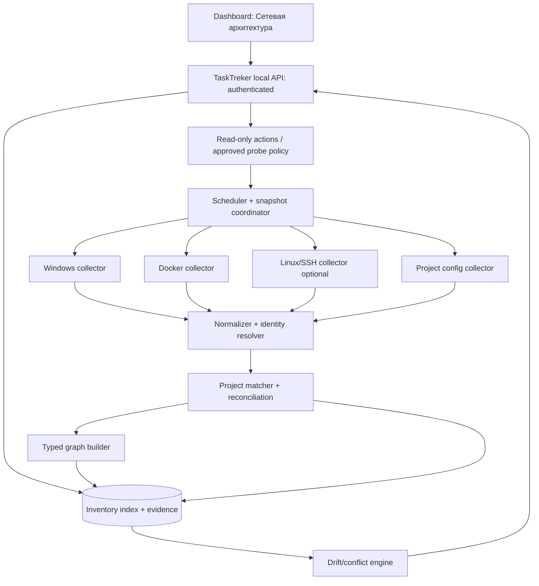
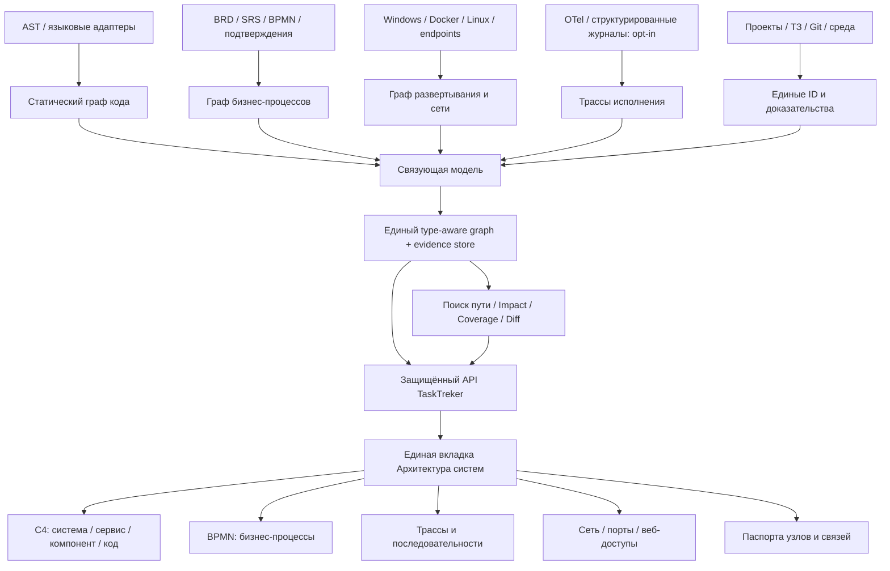

# ТЕХНИЧЕСКОЕ ЗАДАНИЕ TT-ARCH-001

## Единый модуль TaskTreker «Архитектура систем»: внутренние компоненты, бизнес-процессы, сетевая топология, порты, доступы и развертывание

**Редакция:** 2.0 — 8 ноября 2026 г. (расширена внутренняя архитектура, бизнес-процессы и межуровневая трассировка)  
**Статус:** ТЗ на реализацию; фактическая работоспособность новой функциональности **не подтверждена**.  
**Репозиторий:** https://github.com/islamdzuganov2-ship-it/SUPtracer  
**Область:** существующая система TaskTreker/SUPtracer; единый модуль, объединяющий внутреннюю архитектуру приложений, процессы, сеть и развертывание; **не** отдельное приложение и **не** второй реестр проектов.  
**Приоритет:** P0 — доверенная модель данных и безопасности, достоверные внутренние и сетевые связи, ручная/документальная модель бизнес-процесса; P1 — интерактивный граф C4/BPMN, путь процесса, влияние изменений, веб-доступы и команды; P2 — дополнительное инструментирование и расширенные языки/источники.  
**Основа:** TaskTreker 2.0 v1.2, TaskTreker 3.0, единое ТЗ 3.1, дополнения по безопасности и поагентной проверке реализации. При противоречиях применяются более строгие требования к безопасности, доказательствам, неизменности исходных данных и разрешениям владельца.

> **Назначение документа:** предоставить разработчику самодостаточные функциональные требования, модель данных, проектную архитектуру, сценарии интерфейса, правила обнаружения, ограничения безопасности, проверочные случаи и атомарный чек-лист. Реальные IP, процессы, владельцы портов, команды запуска, внутренние связи и бизнес-процессы конкретных проектов **не выдумываются**: они устанавливаются из разрешённых исходников, нормативных документов, конфигураций и фактической диагностики. **Цель — связать уровни «бизнес-процесс → шаг → функция/модуль → сервис → сеть/порт» с двусторонней навигацией и достоверностью каждого ребра.**

---

## 1. Цель и ожидаемый результат

Нужен единый управляемый модуль, который в разрезе **всего портфеля / одного проекта / одного приложения / одного бизнес-процесса / одной среды / одного хоста** показывает:

**Обязательное объединение трёх слоёв:** (1) *внутренняя архитектура* — системы, сервисы, компоненты, модули, классы, функции, внутренние API, события и данные; (2) *сеть и инфраструктура* — реальные и объявленные хосты, контейнеры, соединения, резервации, прокси, IP/порты, доступы и рецепты развертывания; (3) *бизнес-процессы и исполнение* — шаги, ветвления, связи с реализацией, ожидаемые и наблюдаемые маршруты вызовов.

Схемы поддерживают приближение, панорамирование, семантическое раскрытие уровней, выделение выбранных связей и целого пути бизнес-процесса; каждое ребро открывает подробную карточку с обратной ссылкой на то же место схемы.

Модуль должен также показывать:

1. Какие приложения и сервисы известны системе; где они развернуты: Windows-процесс, Windows-служба, Docker-контейнер, Docker Compose, Linux-процесс, systemd-сервис, reverse proxy, внешняя зависимость.
2. На каких **адресах, протоколах и портах** они **фактически слушают**, где порты **настроены**, где **зарезервированы**, а где **опубликованы через NAT/прокси**; кто владелец и насколько доказан факт.
3. Как устроены **внутренние и внешние связи**: UI → API → worker → БД / кэш / очередь / другие приложения / proxy; между хостами, контейнерами, сетевыми пространствами и проектами.
4. **Визуальную архитектурную схему** с выбираемыми узлами и рёбрами; переход с каждого узла/связи в **отдельную вкладку «Связи и интерфейсы»** на полное описание; обратная ссылка **точно на исходный элемент схемы**.
5. Отдельный каталог **точек веб-доступа**: фактические URL/схема/host/IP/порт/путь, область видимости и результаты проверки доступности (локально/LAN/VPN/извне — только при наличии соответствующей точки измерения).
6. Для каждого управляемого приложения — **проверенные команды** запуска, развертывания, проверки, просмотра журналов, остановки, перезапуска и отката, помеченные `Docker Compose`, `Docker CLI`, `PowerShell` или `другое / неизвестно`. Команда отображается только при подтверждённом источнике и полном контексте выполнения.
7. Историю изменений схемы и портов, обнаружение конфликтов и отклонений от ожидаемой конфигурации; возможность понять, **откуда взялась каждая связь**.

**Ожидаемое пользовательское действие:** выбрать `Проект → Архитектура систем`, перейти к `Внутренняя архитектура / Бизнес-процессы / Сеть`, увидеть связанные графы, увеличить и выделить конкретный маршрут, нажать на **любую** связь и получить назначение, исходный код/контракт/протокол/доказательства/риски, вернуться к выделенной связи и при необходимости открыть точку веб-доступа либо скопировать подтверждённую команду запуска определённого сервиса.

### 1.1 Не является целью

- Автоматическое сканирование произвольных IP-диапазонов и чужой инфраструктуры.
- Автоматическое открытие портов в Windows Firewall, NAT, маршрутизаторе или облаке.
- Предположение «слушает порт» = «доступен из интернета»; «Docker EXPOSE» = «порт опубликован»; «настроено» = «развернуто».
- Автоматический запуск/перезапуск/остановка приложений без отдельного осознанного разрешения владельца.
- Показ паролей, токенов, содержимого `.env`, приватных ключей, строк подключения со встроенными учётными данными.
- Полная реконструкция бизнес-смысла и всех внутренних зависимостей по одному снимку TCP-соединений или простому AST; если источник не позволяет установить связь, показывать `unknown`/`unmapped`, а не выдумывать.
- Самостоятельная замена существующих процессов `workflow.py`, `project_routes.py` и канонического хранения задач новым «параллельным тасктрекером».

---

## 2. Текущее состояние: ориентиры для первичного аудита (AS-IS)

На просмотренных ветках `main`, `разработка`, `тестирование`:

| Имеющаяся часть | Что можно использовать | Что нужно проверить до правки |
|---|---|---|
| `tools/project_routes.py` | Сопоставление путей и идентификаторов проектов; защита от ложного объединения похожих названий | Совпадение путей Windows, WSL, каталогов Compose, контейнерных меток и удалённых хостов; неоднозначные связи |
| `data/projects.json` / `data/workflow.json` через `tools/workflow.py` и `taskstate.py` | Канонический реестр проектов и задач | Схема проекта, способ безопасно зарегистрировать привязки ресурсов; миграции без потерь |
| `tools/serve.py` | Локальный HTTP API и действия доски | Реальная авторизация/CSRF; нельзя строить новые чувствительные API на `Host` + статическом заголовке |
| `tools/shell.html`, `build_dashboard.py`, `app.js`, `projview.js` | Текущий UI без обязательного большого фреймворка | Встраивание новой вкладки, поддержка `file://`, исключение секретов из статического HTML |
| `tools/ci.py`, `deploy.py`, `launcher.py` | Факт запуска/развертывания и журналы | Можно ли связывать запуск с фактическим PID/container ID, какие команды разрешены, где есть ложные PASS |
| `tools/memory.py`, `context.py`, MCP | История решений и вспомогательная аналитика | Как не выдавать чувствительную топологию агентам без разрешения |

**Подтверждённый пробел:** по просмотренным файлам не найден готовый отдельный агрегатор инвентаризации сетевых сокетов / OS port reservations / Docker endpoints / reverse proxy с отношениями графа и двусторонними deep-link. **Не считать доказанным отсутствие любого частного решения во всём репозитории**, пока исполнитель не завершит поиск в актуальных ветках.

**До доработок обязательна проверка HEAD всех трёх веток** и карта полезных изменений; нельзя затереть незлитые изменения в `разработка` или использовать устаревший статический HTML как единственную основу.

### 2.1 Точки интеграции с предыдущими ТЗ

- **Единое ТЗ 3.1, FR-017—FR-020:** компактный дашборд, глобальный фильтр проекта, детальная навигация, 100% сохранение информации, лёгкий Python + vanilla JS + CSS + SVG, offline/read-only режим и строгие полномочия.
- **Единое ТЗ 3.1: требования агентного конвейера и аналитики:** использовать уже имеющиеся BRD/SRS/RTM, ADR, тесты, историю задач и релизы как источники трассируемых процессов; не дублировать требования и не назначать LLM право окончательно подтверждать фактическую сетевую или внутреннюю связь.
- **FR-003 / FR-002:** авторизация и безопасные релизные ворота; новый модуль **не** превращается в обход разрешений.
- **FR-006—FR-009:** источники знаний, происхождение сведений, история и актуальность, восстановление после сбоев; факт из одного снимка не должен сохраняться как вечная истина.
- **FR-014—FR-016:** любые фоновые работы не вытесняют finish-first и не запускают лишние Claude/Codex-сессии.
- **FR-021—FR-024:** встроенный GGUF-worker работает без обязательного HTTP-порта; внутренние IPC-связи отображаются как IPC, а не как неизвестный TCP-сервис.
- **Агентный аудит:** новые диагностические данные доступны агентам только по проекту/роли; создание карт и проверка портов — преимущественно обычным кодом, не постоянной LLM.
- **Security Expansion:** принцип минимальных привилегий, маскирование конфиденциальных данных, запрет произвольных команд и неподтверждённого «успеха».

---

## 3. Обязательная терминология и модель достоверности

### 3.1 Статусы портов и доступа **не взаимозаменяемы**

| Статус / признак | Точное значение | Чего НЕ означает |
|---|---|---|
| `listening_observed` | ОС в момент снимка показывает локальный TCP `LISTEN` или UDP bound endpoint в данном сетевом пространстве | Доступность из браузера, из LAN или интернета |
| `connection_observed` | Зафиксировано существующее соединение/сетевое событие между адресами | Долговечную архитектурную зависимость без дополнительного подтверждения |
| `configured` | Порт/адрес объявлен в проверенном конфигурационном файле или настройке | Что процесс запущен и порт свободен |
| `reserved_os` | OS reservation/exclusion, HTTP.sys URL ACL и т. п. с конкретным типом | Что на порту существует слушающий процесс; URLACL не равен сокету |
| `reserved_project` | Порт или диапазон закреплён за проектом в политике TaskTreker | Что порт занят ОС или технически гарантирован другим процессам |
| `published` | Контейнерный порт опубликован через реальный binding Docker или определён действующий proxy mapping | Что любой удалённый клиент сможет подключиться |
| `exposed_declared` | Объявление `EXPOSE`/`expose` либо описание интерфейса | Что есть host binding |
| `reachable_verified` | Успешный пробный запрос с **указанной точки наблюдения**, протоколом и временем | Что доступно из всех сетей |
| `unreachable_verified` | Проба с указанной точки не удалась; приведены причина/ошибка и время | Что приложение не запущено или порт закрыт для всех |
| `stale` | Последнее наблюдение просрочено | Что ранее обнаруженное исчезло |
| `unknown` | Недостаточно прав, источников или сведений | Ошибку/отсутствие ресурса |

**Обязательное разделение:** `lifecycle` (running/stopped/unknown), `socket_state`, `configuration_state`, `reachability`, `evidence_quality`, `freshness` — независимые измерения. Не придумывать единственное поле `status` с взаимоисключающими значениями этих разных осей.

### 3.2 Сетевые идентичности

`(host_id, network_namespace_id, protocol, ip_family, bind_address, port)` — минимальный ключ конкретного bind. Дополнительно: `process_identity` (PID + время создания + путь процесса), `container_id` и `docker_daemon_id`, `compose_project/service`, `service_id`, `project_id`, `environment_id`, `listener_id`.

- TCP и UDP на одном номере порта — разные ресурсы.
- IPv4/IPv6 и `0.0.0.0` / `::` / `127.0.0.1` / адрес интерфейса различаются; влияние `dual-stack` устанавливать по факту платформы.
- Порт `127.0.0.1:8080` на Windows-хосте и `127.0.0.1:8080` в Linux-контейнере — не одна точка доступа.
- PID **переиспользуется**: PID без start time и хоста не определяет постоянный сервис.
- Внешний порт `443` reverse proxy не равен внутреннему порту приложения `8000`.
- Синтетические, но правдоподобные значения в примерах документа не использовать как реальные результаты обнаружения.

### 3.3 Точность отношений

Каждая связь получает `evidence_kind` = `observed_socket`, `observed_trace`, `runtime_metadata`, `declared_config`, `declared_docs`, `user_confirmed`, `inferred`, `unknown`; `source`, `observed_at`, `collector_id`, `confidence` (`verified`, `declared`, `inferred`, `unknown`), `expires_at` и ссылку на доказательство. `verified` устанавливается только проверяемыми правилами, **не свободным ответом LLM**.

---

## 4. Функциональные требования

### NET-FR-01. Инвентаризация окружений и хостов [P0]

1. Обнаруживать локальный Windows host и доступные зарегистрированные Docker contexts; отдельно представлять `Windows`, `Docker Engine/desktop VM`, `WSL2` (если реально имеется), `Linux remote` (только если источник подключён).
2. Проект, приложение и среда `dev/test/prod/unknown` — разные сущности; сервер или контейнер может обслуживать несколько проектов.
3. Для удалённых Linux/VPS подключение только по явной регистрации целевого хоста и безопасной аутентификации; без случайного сканирования сети.
4. Хранить `host_id`, псевдоним, OS, адреса интерфейсов, способ доступа, признак управляемости и возраст измерения. Отсутствующие права показывать явно.
5. Поддержать ручную привязку неизвестного приложения к проекту с аудиторским следом; новое измерение не должно без подтверждения перетирать подтверждённую ручную классификацию.

### NET-FR-02. Локальные TCP/UDP и процессы Windows [P0]

1. Собирать TCP listen и существующие соединения (по политике) из `Get-NetTCPConnection`; UDP endpoints — из `Get-NetUDPEndpoint` или проверенного аналога.
2. Сопоставлять PID с `Get-CimInstance Win32_Process` / службами Windows (`Win32_Service`) и датой запуска, насколько разрешено правами; сохранять отказ доступа как `unknown`.
3. Отделять слушающий socket от исходящего ephemeral client connection. По умолчанию основной каталог портов — входящие endpoints; исходящие соединения отображаются как связи с ограниченным временем наблюдения.
4. Обнаруживать службы со статусом `Stopped` и конфигурационным портом без ложного `listening_observed`.
5. Не требовать administrator для основного просмотра; для углублённых сведений показывать «требуются расширенные права» без скрытой эскалации.

### NET-FR-03. Резервации и перенаправления Windows [P0]

1. Собирать `netsh interface ipv4/ipv6 show excludedportrange` для TCP/UDP по доступным платформе режимам; хранить **диапазон**, стек и тип active/persistent.
2. Собирать `netsh http show urlacl`, `show sslcert`, `show servicestate` и `netsh interface portproxy show ...` по доступности и версии ОС.
3. Различать OS excluded port range, HTTP.sys URL reservation, TLS certificate binding, portproxy и порт, занятный процессом; выводить раздельные типы.
4. Плановые резервации проекта вести отдельно от ОС: `reserved_project`, `owner`, `reason`, `expires`, `protocol`, диапазон; не изменять OS reserved ranges без отдельного администраторского сценария.
5. Обнаруживать потенциальные пересечения по адресам/стекам/пространствам и отмечать `conflict_confirmed` только при доказанной несовместимости.

### NET-FR-04. Docker Engine / Compose / контейнерные сети [P0]

1. Обнаруживать Docker daemon/context, Compose-проекты, сервисы, контейнеры (в том числе остановленные), состояния, health, image id/digest, сети, aliases, опубликованные host ports, container ports, port protocol.
2. Для проекта Composer получать реальные runtime-данные из `docker compose ls`, `docker compose ps --all --format json`, `docker inspect`/Engine API; для «ожидаемого» — из Compose-конфигурации **без публикации переменных и секретов**.
3. Учитывать `publish` host IP/port → container IP/port и отдельно `expose`/Dockerfile `EXPOSE`; динамически назначенные host ports читать из runtime, не гадать по compose файлу.
4. Docker bridge/network aliases и Docker Desktop VM не приравнивать к физическому LAN-интерфейсу Windows.
5. Остановленный контейнер с портом в конфигурации отображать как `configured` + `stopped`, а не `listening`/`reachable`.
6. Отсутствие Docker Desktop/демона не должно приводить к ошибке всего модуля: источник `unavailable`, другой сбор продолжается.
7. Не подключаться к незаявленным Docker contexts и не монтировать Docker socket в недоверенные процессы/контейнеры.

### NET-FR-05. Linux / удалённые хосты [P1]

1. Поддержать чтение `ss -lntup`/`ss -lunp` или эквивалентного источника, `systemctl list-sockets`, состояния сервисов, сетевых интерфейсов, маршрутов и локального firewall в пределах разрешений.
2. Удалённая диагностика выполняется по зарегистрированному источнику (предпочтительно SSH с pinned host key/отдельным пользователем с правом чтения либо собственный read-only collector). Никакого пароля в профиле проекта.
3. При ограничениях прав данные помечаются `partial`, а не «всё свободно».
4. Для Linux-контейнерных namespace не объединять сокеты из разных пространств даже при одинаковом IP:port.
5. Для недоступного удалённого хоста сохранять последнюю проверенную топологию с отметкой `stale`, не выдавая её за текущую.

### NET-FR-06. Конфигурационная инвентаризация приложений [P0]

1. В разрешённых рабочих каталогах проектов искать явные конфигурации: `compose.yaml/docker-compose.yml`, Dockerfile, scripts запуска, известные настройки web-сервера/reverse proxy, `package.json` scripts, Python entrypoints, Windows services, systemd unit-файлы и заранее объявленные конфигурационные файлы.
2. Использовать сначала структурный парсинг и явные правила; распознавание портов произвольным регулярным выражением в любом файле не допускается как подтверждённое наблюдение.
3. Конфигурация `.env`/секретов не попадает ни в UI, ни в логи, ни в экспорт. Допускается только безопасное определение факта `env_required` и названий переменных при необходимости, по отдельной политике.
4. Любые порты из README/примеров/шаблонов маркировать `declared_docs`, а не `configured_runtime`.
5. Хранить ссылку на исходный файл/ревизию; конфигурационные пароли маскировать до сохранения индекса.
6. Не запускать код и `postinstall` при сканировании конфигураций; `docker compose config` может интерполировать секреты — использовать безопасные параметры и/или собственное извлечение с redaction, не сохранять полный вывод.

### NET-FR-07. Сопоставление сущностей с проектами [P0]

1. Основной `project_id` брать из существующего канонического реестра TaskTreker.
2. Источники атрибуции — user-confirmed mapping, project working directory, Compose labels (`com.docker.compose.project`, `.service`), исполняемый путь/рабочий каталог процесса, launch history TaskTreker, явная конфигурация.
3. При конфликте идентичностей не выбирать «похожее» имя автоматически: выставлять `ambiguous` с кандидатами и предлагать подтверждение владельца.
4. Один общий reverse proxy / БД / Docker network может относиться к **нескольким проектам**. Нельзя клонировать одну сущность как независимые процессы или скрыть межпроектные связи.
5. Неизвестные процессы помещать в `Неразобранные` и предоставлять фильтры «все хосты» / «без проекта»; при ручной привязке — audit trail.
6. Рабочие копии Git не должны ошибочно появляться как самостоятельные приложения.

### NET-FR-08. Граф архитектуры и типов связей [P1]

1. Формировать типизированный граф: `portfolio/project/environment/host/network/namespace/app/service/process/container/proxy/database/queue/cache/external_system/endpoint`.
2. Связи: `hosts`, `runs_as`, `belongs_to`, `depends_on`, `connects_to`, `publishes`, `routes_to`, `proxies_to`, `binds`, `reserves`, `uses_ipc`, `shares_network`, `exposes_endpoint`. Не подменять функциональный import сетевым вызовом.
3. Хранить направление, протокол, адрес назначения, порт, маршрут/путь, TLS, аутентификацию (факт/тип, но не секрет), цель, ожидание, факт, источник доказательства и актуальность.
4. Из одного порта TCP нельзя автоматически вывести конкретное HTTP API; HTTP/WS/gRPC/SSE определяется конфигурацией или безопасной протокольной проверкой.
5. Внешние SaaS/DB могут отображаться в схеме как документированные зависимости без утверждения, что они доступны сейчас.
6. Поддерживать связи внутри контейнерной сети и пересекающие host/container/remote/VPN/proxy границы, сохраняя промежуточные узлы при известных фактах.

### NET-FR-09. Интерактивная архитектурная схема [P1]

1. Подвкладка `Сеть и развертывание` внутри единого раздела `Архитектура систем` + фильтр всего портфеля/проекта/среды/хоста/состояния, режимы `обзор`, `приложение`, `сетевая публикация`.
2. Визуализация ориентированного графа с группировкой по проекту, среде, хосту и network namespace; панорама, масштабирование, `fit`, поиск, выделение пути, скрытие некритичных связей, легенда и доступный табличный аналог.
3. Узлы и **каждая отдельная линия/ребро** являются интерактивными с достаточной областью выбора; keyboard navigation, aria-label и доступная альтернатива.
4. Нажатие на ребро `edge_id` открывает отдельную вкладку `Связи и интерфейсы`, выбирает **именно эту связь**, сохраняет исходный проект/фильтры/масштаб/позицию диаграммы.
5. С карточки связи действие `Показать на схеме` возвращает к исходной схеме, выделяет ребро и центрирует его; работает после обновления страницы через deep link, Back/Forward браузера и при экспорте read-only HTML.
6. Нажатие на узел ведёт в `Паспорт приложения/сервиса`; из паспорта — к связанным рёбрам и обратно.
7. Схема должна показывать достоверность: сплошная подтверждённая связь, пунктирная объявленная/выведенная, явное `?` для неизвестной. Цвет — не единственный индикатор.
8. Не включать `mermaid securityLevel: loose` с произвольным пользовательским текстом. Для интерактива предпочтителен локальный SVG, созданный из безопасных данных с явными обработчиками по стабильным ID; Mermaid — для безопасного статического экспорта/документации.
9. При >100 узлах или >250 рёбрах не рисовать всё без группировки; ленивые подграфы и свёртка обязательны. Границы могут корректироваться по тестам производительности, не через угадывание.

### NET-FR-10. Отдельная вкладка «Связи и интерфейсы» [P1]

1. Для каждой связи иметь одну адресуемую карточку, независимо от того, показана ли она на текущем масштабе схемы.
2. Карточка: ID, обе стороны, проекты, среда, роль связи, протокол, source/destination address/port/path, путь через proxy/NAT, тип шифрования, требование аутентификации (без кредов), inbound/outbound, актуальный статус, уверенность, источник, последний результат проверки, дата/версия, ошибки, владелец и назначение.
3. Отдельно показывать `наблюдаемый факт`, `настроенное ожидание`, `обнаруженное расхождение` и `неизвестное`.
4. Кнопки `На схему`, `К исходнику`, `К журналу проверки`, `Открыть точку доступа` (только при подходящем URL) связаны конкретными ID, а не поиском по названию.
5. Для `edge_id` доступен стабильный маршрутизируемый идентификатор; если связь удалена, страница честно показывает `историческая/нет в последнем снимке` и историю изменений.

### NET-FR-11. Реестр «Веб-доступы» [P1]

1. Выделенная вкладка/подвкладка, не смешанная с каталогом всех TCP/UDP. Список **реальных и объявленных точек HTTP(S), WebSocket, UI, API, reverse proxy**, и только подтверждённых HTTP-подобных протоколов.
2. Колонки: проект/приложение/среда/хост; `type` (UI/API/admin/health/proxy); URL; host/IP и порт; bind; публичное имя DNS; локальный маршрут/контейнерный порт; видимость `loopback/LAN/VPN/public/configured-only/unknown`; путь доступа; источник; свежесть; результат проверок с точки `host/user/LAN/remote`; Docker/PowerShell.
3. URL формировать только при известной схеме и host; для IPv6 использовать `[IPv6]:port`; `0.0.0.0`/`::` — **bind**, не адрес для браузера; выбирать конкретную достижимую точку только если она установлена.
4. Если доступ идёт через домен + HTTPS reverse proxy, показывать именно внешний маршрут и отдельно upstream chain; не заменять URL на внутренний `container_ip:port`.
5. Для неизвестного протокола показывать `IP:port` как технический endpoint, **без** кнопки «Открыть в браузере».
6. Копирование адреса, фильтр, сортировка, поиск, групповое отображение разных точек доступа к одному приложению.
7. Результат HTTP probe допускает `2xx`, `3xx`, `401/403` как факт HTTP-ответа (с соответствующей семантикой), а не «всё исправно». `TLS error`, timeout, DNS error, connection refused, 5xx — разные результаты.

### NET-FR-12. Реестр команд развертывания и управления [P1]

1. Для проекта/сервиса показывать `deployment_mode = docker_compose | docker_cli | powershell | systemd | manual | unknown` и `capabilities = start/stop/restart/build/logs/status/health/rollback` по документированному источнику.
2. Команды **не выдумывать**, а брать из явно обнаруженного Compose-файла, подтверждённого launch script, Windows service, конфигурации проекта или пользовательской записи с происхождением.
3. У команды обязательны `cwd`, команда/аргументы, shell/платформа, условия (`requires_docker`, `requires_elevation`, env variables **by name only**), контекст/хост, риск, предварительные проверки, обратная/rollback команда если доказана, источник файла/ревизии.
4. Отдельные пометки `Docker Compose`, `Docker CLI`, `PowerShell`, `Linux / systemd`, `Не определено`. Если пользователь интересуется только Docker/PowerShell, остальные не скрывать как будто их не существует.
5. Действия `Показать` и `Копировать` разрешены владельцу; `Выполнить` **не входит в минимальный релиз**. При последующей реализации запуска — отдельная owner policy, allowlisted fixed command templates, предварительный просмотр, журналы, TTL разрешения, запрет произвольного shell/передачи параметров и внешний деплой по отдельному согласию.
6. Команда `docker compose up -d` не считается доказанной без правильного `cwd`, файлов `-f`, имени Compose-проекта и контекста. Не формировать «универсальный скрипт» для любого репозитория.
7. PowerShell-команды со специальными символами, путями с пробелами и аргументами должны быть корректно экранированы, без `Invoke-Expression` и непроверенного конкатенирования.
8. При отсутствии верифицированной команды показать `не определено`, инструкцию «нужен источник запуска», но не пустую фиктивную кнопку.

### NET-FR-13. Проверка работоспособности и маршрута доступа [P1]

1. Read-only probes для явно разрешённых endpoints: TCP connect, HTTP HEAD/GET по зарегистрированному безопасному пути, TLS handshake/цепочка/дата сертификата, DNS resolution; запрещены произвольные range scans.
2. Активные проверки выключены по умолчанию для неизвестных/удалённых целей; включаются владельцем на конкретный проект/endpoint/частоту и vantage point; ограничение timeout/concurrency/rate, журнал.
3. Проба с локального Windows-хоста не считается доказательством доступа «из интернета». Интернет-доступ — только при проверке из заранее доверенной внешней точки и соответствующих разрешениях; при отсутствии такой точки — `unknown`.
4. Проверять redirect chain с ограниченным числом переходов и запретом автоматического следования на неподтверждённые хосты/IP (SSRF защита).
5. Не посылать параметры авторизации и не выполнять опасные HTTP-запросы. `401/403` показывать как отвечающий закрытый endpoint.
6. Результаты probes не содержат body, cookie, токенов, приватных headers или строк подключения.

### NET-FR-14. Конфликты портов, drift и предупреждения [P1]

1. Сравнивать `declared_config ↔ observed_runtime ↔ project_reservation` с учётом namespace, протокола, IPv4/IPv6 и bind wildcard.
2. Сигналы: `port_collision`, `configured_not_listening`, `unknown_owner`, `unexpected_public_bind`, `missing_proxy_route`, `stale_observation`, `new_listener`, `lost_listener`, `orphan_container`, `shared_resource_dependency`, `insecure_http_exposure`, `missing_deployment_source`.
3. Не объявлять OS reservation конфликтом лишь потому, что число порта совпало с записью HTTP.sys: тип и условия резервирования должны учитываться.
4. В инциденте хранить историю, что изменилось, на каком хосте, какие проекты затронуты, proof, severity, статус `new/acknowledged/resolved/false_positive`; не удалять историю при следующем скане.
5. При критичной находке допускается создать предложение задачи в имеющемся backlog, но нельзя менять код, firewall, Docker или окружение автономно только из-за обнаруженного порта.

### NET-FR-15. Безопасность, разрешения и конфиденциальность [P0]

1. Все коллекторы по умолчанию `read-only` с минимальными привилегиями и явными allowlists каталогов/contexts/hosts.
2. Отдельные права: `view_summary`, `view_sensitive_topology`, `run_scan_local`, `run_scan_remote`, `manage_project_mapping`, `manage_project_reservations`, `manage_probe_policy`, `view_commands`, `execute_deployment` (последнее не включать в MVP).
3. Секреты, CLI environment и credentials исключать до персистентного хранения и до вывода в error/debug logs.
4. Не отправлять содержимое внутренней топологии внешним LLM, телеметрическим сервисам или облачным картографическим API без разрешения. Встроенная визуализация должна быть локальной.
5. Запрет сетевого SSRF (localhost, link-local, metadata endpoints и собственные управляющие порты) для произвольных пользовательских URL; разрешённые локальные health-check цели задаются отдельно и жёстко проверяются.
6. Никаких опасных действий по клику на диаграмму, никакого автоматического открывания неизвестных URL, JavaScript из сетевых метаданных или Mermaid loose-mode.
7. В существующем `serve.py` до добавления управляющих API исправить недостаточную авторизацию (`Host` и статический `X-TaskTreker`) как самостоятельный риск.
8. Процесс коллекторов/рендеринга ограничен по времени/памяти, защищён от слишком больших Docker-ответов/топологий, ошибок парсера и гонок сохранения.

### NET-FR-16. Снимки, история и происхождение [P1]

1. Собирать полные снимки по `snapshot_id`, `collector_version`, `host_id`, `started_at`, `finished_at`, `status`, `incomplete_sources`, `source_revisions`.
2. Показывать `последнее известное` и `сейчас обнаружено` отдельно; stale threshold по типу источника настраиваемый.
3. При повторном скане стабильные сущности не размножаются; history diff строится по устойчивым идентификаторам, а не случайным позициям в HTML.
4. Хранить только разрешённые доказательства, безопасные выдержки и hashes; объём raw-вывода ограничивать, retention настраиваемый с резервными копиями.
5. Все ручные подтверждения, переноcы связей между проектами и изменения политик аудитировать; последующие автоматические наблюдения не стирают audit trail.

### NET-FR-17. Экспорт, ссылки и совместимость Dashboard [P1]

1. Безопасный JSON/CSV экспорт по фильтрам, SVG/PNG архитектурной схемы и отдельный read-only HTML snapshot без активных операций.
2. Для каждой связи/узла стабильные прямые ссылки `#/network/<project-id>/diagram?node=<id>` и `#/network/<project-id>/connections/<edge-id>` или согласованный совместимый роутинг. Формат допускает URL encoding и не использует сырые IP как идентификатор.
3. Нажатие «назад на схему» возвращает выделение, проект, среду и viewport; прямой URL после обновления страницы восстанавливает страницу при наличии прав.
4. Экспорт offline не может обходить ограничения прав, содержать секреты или вводить фиктивную «доступность сейчас».
5. UI соответствует FR-017—FR-020: компактный обзор, детальные табы по требованию, подсветка ошибок/источников, loading/empty/stale/partial/error, клавиатура, светлая тема, без обязательного React/облачного CDN.

### NET-FR-18. Интеграция с агентами и релизным контуром [P1]

1. Без новых постоянно работающих LLM. Источники и граф собирает детерминированный Python collector.
2. Агент `Architect` может читать разрешённую схему проекта, `Security Reviewer` — выявленные риски, `DevOps` — зарегистрированный launch/runbook; роли не получают автоматически все IP другого проекта.
3. Контекст передавать точечно по `project_id`, `node_id`/`edge_id` и правам, с датой снимка и provenance.
4. После проверенного изменения конфигурации/релиза инициировать обновление соответствующего host/project, не просматривая весь портфель на каждый кодовый коммит.
5. В случае удаления Docker-контейнера или изменения портов откатить не код, а обновить наблюдение; решение о фактическом rollback деплоя остаётся отдельным контролируемым действием.

---

## 4A. Расширение функциональности: единая внутренняя архитектура и трассировка бизнес-процессов

> **Нормативное дополнение к NET-FR-01…18.** Пункты `ARCH-FR-01…18` имеют ту же обязательную силу, что и сетевые требования. Для пользователя это **один модуль «Архитектура систем»** с согласованными вкладками «Сеть», «Внутренняя архитектура», «Бизнес-процессы», «Связи», «Трассировки», «Веб-доступы», «Порты», «Команды», «Изменения». Не создавать отдельные независимые базы с дублирующими узлами/проектами.

### 4A.1. Что считать «полной архитектурой» (границы утверждения)

**Цель:** для выбранного проекта получить связанную карту от бизнес-действия пользователя до реализации и среды исполнения:

`Бизнес-процесс → шаг процесса → вход (UI/API/событие) → маршрут/обработчик → модуль/функция → прикладной компонент → сервис/процесс/контейнер → API/IPC/очередь/БД → сетевой endpoint/порт → среда/хост`.

«Полная» означает **полное представление всех обнаруженных и документированных сущностей в рамках явно заявленного охвата**. Она **не означает**, что статический анализ автоматически реконструирует каждую динамическую зависимость или что по портам можно восстановить бизнес-процессы. Каждая непокрытая область явно фиксируется, в том числе `unmapped`, `not_instrumented`, `unknown` и `no_source`; пользователь видит карту полноты, а не выдуманную непрерывную цепь.

**Три независимых, но связываемых слоя фактов:**

1. **Проектная модель (design / declared)** — документация, BPMN, спецификации, ADR, OpenAPI, конфигурация, подтверждения владельца;
2. **Статическая реализация (static evidence)** — исходники, AST, импорты, определения маршрутов и обработчиков, вызовы, конфигурация инъекции зависимостей, схемы данных на конкретном Git SHA;
3. **Наблюдаемое исполнение (runtime evidence)** — PID, контейнеры, sockets, журналы вызовов, OpenTelemetry spans, подтверждённые маршруты и проверки из определённой точки наблюдения.

Запрещено превращать факт `A импортирует B` в `A вызвал B в продакшене`; путь из проектной BPMN не равен фактическому исполненному trace. Противоречия сохраняются как `drift` с обеими версиями сведений.

### ARCH-FR-01. Единый межуровневый граф архитектуры [P0]

1. Расширить существующий `network_graph`, а не создавать параллельный граф. В одном хранилище узлов и связей должны сосуществовать проекты, среды, хосты, сети, сервисы, контейнеры, компоненты приложения, модули, пакеты, функции/классы, endpoints, события, потоки данных, операции и бизнес-процессы.
2. Все сущности имеют `entity_id`, `entity_type`, `project_ids`, `environment_id` при применимости, `version_ref`, `evidence_refs`, `lifecycle`, `freshness`, `visibility_policy`.
3. Должны поддерживаться связи на разных уровнях: `contains`, `implements`, `deployed_as`, `runs_on`, `imports`, `calls_static`, `calls_observed`, `handles_route`, `publishes_event`, `consumes_event`, `reads_data`, `writes_data`, `uses_database`, `uses_ipc`, `exposes_endpoint`, `flows_to`, `realizes_process_step`, `initiates`, `depends_on`.
4. Для каждой линии обязательны стабильный `relation_id`, направление, семантический тип, цель, обоснование, provenance, состояние, относящаяся версия и точное соответствие двум конечным узлам.
5. Отношения с разной семантикой не склеиваются: `module imports X`, `A calls B`, `A publishes event for B` и `A network-connects-to B` — **четыре разные связи**.
6. Разрешить несколько отношений между одними узлами, несколько проектов у общего сервиса, ветвления/циклы/асинхронные связи, связи без TCP-порта.
7. Модуль выдаёт `coverage` по уровням: что проверено, что неизвестно, какие процессы/порты/сервисы не сопоставлены.

### ARCH-FR-02. Обнаружение внутренней структуры приложений [P0]

1. На основе **разрешённых Git-репозиториев** построить статическую карту пакетов, модулей, классов, функций, обработчиков запросов, команд CLI, обработчиков событий, точек конфигурации, хранилищ и внутренних библиотек.
2. В первом этапе поддержать Python как основной язык текущего TaskTreker; для JavaScript/TypeScript выполнять анализ поддерживаемым парсером с версионностью и известными ограничениями. Для иных языков — отдельные адаптеры при наличии проекта, без выдуманных зависимостей.
3. Отличать: импорт модуля, вызов функции, регистрация HTTP-маршрута, обработчик очереди, чтение конфигурации, чтение/запись данных, создание процесса, сетевое обращение.
4. Каждый статический факт сохраняет `repo_id`, `commit_sha`, `file_path`, `symbol_id`, диапазон строк/позиций (при наличии), версию парсера, confidence class; не хранить произвольно большие фрагменты исходного кода и секреты.
5. Динамический импорт, отражение, плагины, генерация маршрутов, метапрограммирование и вызовы через неизвестные обёртки отмечаются как `dynamic_unresolved`, не притворяются найденными.
6. Отдельно учитывать конфигурационные зависимости (DI, registries, env by name only), UI-события, API handlers, background jobs, IPC и scheduler tasks.
7. Не выполнять код приложения ради статического анализа и не устанавливать зависимости автоматически; лимиты по размерам, времени и файловому охвату, исключение `.venv`, `node_modules`, `dist`, `build`, временных папок, с управляемыми исключениями.
8. Поддерживать частичный пересбор графа по `git diff` и стабильность идентификаторов при неизменном символе.

### ARCH-FR-03. Архитектурная декомпозиция и масштабирование уровней C4 [P1]

1. Представлять архитектуру на уровнях `Портфель/ландшафт → Система/контекст → Приложения и хранилища (containers в терминологии C4) → Компоненты → Код/символы → Исполнение/сеть`.
2. **Геометрический zoom** (изменение масштаба изображения) и **семантический drill-down** (смена уровня детализации) должны работать независимо: увеличение схемы не обязано автоматически загружать тысячи функций.
3. Узел с внутренней структурой раскрывается внутри схемы и/или кнопкой `Показать состав`; при уходе на нижний уровень сохранять breadcrumb, исходный объект, фильтры, версии, viewport.
4. Уровень `Код` показывать только для выбранного компонента или ограниченного подграфа; не пытаться рисовать весь репозиторий одновременно.
5. Узлы с общими зависимостями, библиотеки и shared-сервисы не копировать физически, допускать логические ссылки и границы ответственности.
6. Сопоставление уровней статической архитектуры и deployment/runtime открывается из одного и того же узла по стабильному ID.
7. Поддержать разные независимые представления одного графа: C4 context/container/component, зависимости/вызовы, deployment/network, data flow, process, runtime sequence.
8. Показать владельца компонента, технологию, исходный код, контракт, критичность, последнее изменение, тесты и источники данных, если они подтверждены.

### ARCH-FR-04. Привязка архитектуры к существующим проектам и релизам [P0]

1. Проекты брать исключительно из канонического реестра SUPtracer (`project_id`); не сливать похожие имена.
2. Привязать архитектурный снимок к `repo_id`, `branch`, полному `commit_sha`, `environment_id`, сборке/образу, времени коллекции; схема ветки `разработка` не становится автоматически схемой запущенного `main`.
3. Для одного проекта разрешить несколько приложений, несколько процессов и окружений, несколько репозиториев при подтверждённой конфигурации.
4. Факт «на таком Git SHA определена функция» и факт «в Docker реально запущен такой образ» связывать только при установленной идентичности образа/артефакта или явно подтверждённом mapping.
5. При отсутствии информации о релизе компонент виден в статической карте, но не получает флаг `deployed_verified`.
6. Обеспечить сопоставление архитектурного элемента с существующими требованиями `FR/NFR`, задачами, ADR, тестами, релизами TaskTreker без дублирования этих сущностей.

### ARCH-FR-05. Единый справочник и модель бизнес-процессов [P0]

1. Ввести объект `BusinessProcess` с `process_id`, именем, целью, владельцем/ролью, границами, событием запуска, входом, ожидаемым результатом, связью с `project_id`, версиями, критичностью и источником определения.
2. Поддержать процессы, полученные из подтверждённого BRD/SRS/BPMN/тестов, и вручную зарегистрированные владельцем; извлечённое ИИ описание всегда `proposed` до проверки.
3. Шаг `ProcessStep`: `step_id`, `process_id`, название/назначение, actor, `step_type`, входные и выходные бизнес-данные, условие перехода, вызываемая операция/сервис, expected outcome, error/compensation behavior, evidence.
4. Сохранять последовательности, альтернативные исходы, циклы, таймеры, параллельные ветви, ожидание очереди, внешние вызовы и компенсирующие операции. Поддержать `exclusive/inclusive/parallel` шлюзы при BPMN/эквивалентной модели.
5. Сохранять связь `BusinessProcess ↔ requirement/use_case ↔ step ↔ code/service/endpoint ↔ test_case` с проверкой ссылочной целостности.
6. Не выводить «полный бизнес-процесс» из одного REST endpoint или совпадения имени функции: если процесса нет в источниках, он `not_documented`; сервис показывается без вымышленного бизнес-смысла.
7. Возможность отметить шаг/процесс `draft`, `approved`, `deprecated`, `observed_partial` и явно показать расхождение между утверждённым маршрутом и фактическим исполнением.
8. Для процессов без технической реализации (ручные действия, внешняя служба) показывать отдельные бизнес-узлы с корректным `not_automated`.

### ARCH-FR-06. Визуальные схемы бизнес-процессов [P1]

1. Отдельная вкладка `Бизнес-процессы`: реестр процессов с фильтрами проект, среда, критичность, активность, покрытие, владелец, связь с требованиями.
2. У каждого процесса диаграмма уровня BPMN 2.0.2 или строго документированного ограниченного подмножества: start/end events, tasks, gateways, sequence flows, swimlanes по ролям/системам, async send/receive, error/timeout, compensation при наличии источника.
3. Пользователь выбирает шаг → видит связанные API/модули/функции/сервисы и фактические трассировки, если есть; из любого технического узла возвращается к конкретному `step_id`.
4. Выделение пути от старта до результата, выбор ветки сценария и условий её прохождения; при нескольких допустимых маршрутах не выдавать один как единственный.
5. Поддержать поиск процесса по UI-действию, endpoint, событию, модулю, сущности данных или требованию; показывать все подтверждённые совпадения и нерешённые связи.
6. Каждому процессу предоставить паспорт: цель, вход, выход, бизнес-правила, альтернативы, ошибки, ручные шаги, ответственные роли, связанные модули, проверенные сценарии, последние изменения.
7. Повторяемое взаимодействие с диаграммой: масштабирование, панорама, fit-to-screen, мини-карта, раскрытие вложенных подпроцессов, точечное выделение `step_id`, сохранение состояния и deep link.
8. Не хранить бизнес-данные клиента, персональные сведения или payload в описаниях шагов; хранить метаданные/схемы и безопасные примеры без реальных идентификаторов.

### ARCH-FR-07. Прослеживание бизнес-процесса до реализации [P0]

1. Обязателен запрос «Покажи, **какой код и какие сервисы реализуют шаг X процесса Y**»: результат — связный или частично связный путь из типизированного графа с доказательством **каждого** перехода.
2. Связи `step -> handler/route -> symbol -> component -> service -> runtime instance -> endpoint -> port` проверяются отдельно, без склейки сомнительных мест.
3. Маршрут может включать синхронные HTTP/gRPC, брокеры сообщений, фоновую обработку, CLI, встроенные библиотеки, IPC, БД/кэш, webhooks и внешние системы.
4. Если от `step` до `port` нельзя построить подтверждённую непрерывную цепь — отображать **частичный путь** и точное отсутствующее звено: `no route mapping`, `no runtime image identity`, `not instrumented`, `remote not accessible` и т. п.
5. Поддержать два режима: `ожидаемый маршрут` по документации/кодовой модели и `наблюдаемый путь` по телеметрии. Их необходимо уметь сравнивать, не смешивая признаки доказательства.
6. «Какие бизнес-процессы затронет изменение функции / endpoint / порта / контейнера?» — обратный обход графа с отображением прямых, косвенных и неопределённых зависимостей.
7. Отдельно отображать точки изменения среды и границы доверия: пользователь → frontend → API → worker → очередь → DB → внешний сервис.
8. Результаты обхода привязывать к `version_ref` и снимку; не использовать текущую карту для объяснения трассировки двухмесячной давности без исторической версии.

### ARCH-FR-08. Фактические трассировки исполнения [P1, opt-in]

1. Предусмотреть подключение существующих источников трассировок **с минимально инвазивным адаптером**: OpenTelemetry OTLP/JSON, существующие структурированные логи с `trace_id/correlation_id`, заранее интегрированные APM; не требовать обязательного внедрения нового большого observability стека для статического MVP.
2. Сохранять `trace_id`, `span_id`, `parent_span_id`, `service.instance.id`, `service.name`, `operation`, `start/end/duration`, `status/error`, время, host/instance и ссылку на конфигурационную версию; атрибуты только по allowlist.
3. Поддерживать W3C Trace Context (`traceparent` / `tracestate`) в инструментах, где это применимо; отсутствие propagation отражать как **разрыв трассы**, а не восстанавливать догадкой.
4. Для очередей/асинхронных операций учитывать `span links`, message/correlation keys и возможную задержку; не делать ложный parent-child для независимых сообщений.
5. Для конкретного `process_instance_id` показывать исполненную последовательность, waterfall/таймлайн с временами, ветвлениями, ошибками и повторными попытками; если процессный ID отсутствует, показывать технический trace без заявления, что он связан с бизнес-экземпляром.
6. Различать `instrumented`, `observed`, `partially_instrumented`, `not_instrumented`, `sampled_out`, `unknown`; отсутствие span не означает, что код не выполнялся.
7. Поддержать sampling, retention, limits на размер/частоту, offline ingestion; не хранить сырые payload, access tokens, PII, SQL с параметрами, содержимое HTTP body и чувствительные заголовки.
8. Установка инструментирования только по отдельному разрешению на выбранном приложении; модуль просмотра не вправе самопроизвольно менять конфигурацию исполняемых сервисов.

### ARCH-FR-09. Конструктор маршрутов и выделение связей [P1]

1. Поддержать в каждом представлении режимы `выделить 1 связь`, `выделить компонент`, `показать входящие`, `показать исходящие`, `показать соседей N уровней`, `найти путь A → B`, `найти все подтверждённые пути`, `изобразить процесс`, `показать влияние изменений`.
2. Отдельный переключатель типов отношений: функциональные вызовы, импорты, события, операции с данными, контейнерные сети, сетевые публикации, реализация бизнес-шагов.
3. Пользователь может выбрать несколько узлов/рёбер и закрепить подсветку; остальные элементы приглушаются, но остаются доступными. Не удалять скрытые рёбра из данных.
4. При выборе бизнес-процесса автоматически подсветить сопоставленные модули и сервисы; при выборе runtime trace — фактически зафиксированный путь, с отличием от `declared`.
5. Алгоритм пути учитывает направленность и тип отношений, а также временной снимок. Не строить фиктивные пути через `contains`/`imports` как будто это сетевые вызовы: обход допускается по явно выбранным семантическим правилам.
6. Для циклического графа иметь ограничение глубины, количества путей и тайм-аут поиска; выводить `partial due to budget` вместо бесконечного расчёта.
7. Для многослойных схем поддержать `focus`, `fit selected`, `mini-map`, `search`, `breadcrumb`, `hide/show layers`, `expand/collapse`, контекстную панель, доступ с клавиатуры.
8. На рёбрах и узлах должна работать **двусторонняя** навигация `схема ↔ карточка связи ↔ код/требование ↔ процесс ↔ трассировка ↔ схема` с сохранением проекта/снимка/выделения/масштаба.
9. Предусмотреть `compare mode`: две ревизии/две среды, добавленные/удалённые/изменённые узлы и отношения, изменение пути процесса и новых внешних сетевых выходов.

### ARCH-FR-10. Подробный паспорт модуля, компонента и зависимости [P1]

1. У каждого объекта есть отдельная вкладка/карточка: ID, имя, тип, назначение, роль в системе, владельцы, проект, среда, родитель, источник, код/файл/символ, входные и выходные интерфейсы, состояние, зависимые объекты, используемые данные, риски, требования, тесты и дата актуальности.
2. У каждой связи есть отдельный паспорт независимо от сетевого или внутреннего характера: `edge_id`, source, target, тип, направление, кратное использование, протокол (если есть), контракт API/метод/route (если есть), payload **schema** (не значения), синхронность, retries/timeouts, транзакция/идемпотентность, авторизация, источник и наличие наблюдения.
3. Из паспорта любого элемента/отношения возвращаться на исходный уровень/снимок/выделение; если элемент в архивной ревизии — показывать архив, не «потерян».
4. Для импортов и внутрипроцессных функций поля IP/порт не обязательны и должны отображаться `not_applicable`, не `unknown`.
5. Ошибка/отказ компонента сопровождается списком возможных последствий для входящих бизнес-процессов (как графовая гипотеза) с разграничением подтверждённых и косвенных зависимостей.

### ARCH-FR-11. Data flow и хранилища [P1]

1. Показывать потоки **типов данных** между UI/API/module/worker/DB/queue/cache/external systems; учитывать чтение, запись, публикацию/подписку, преобразование и хранение.
2. Для связей с БД отображать доказанные схемы/таблицы/коллекции/репозитории, а не содержимое записей; таблицы с персональными данными показывать по RBAC и без значений.
3. Различать `logical data model` (по SRS/ADR) и `physical data model` (миграции и runtime introspection при разрешении).
4. Учитывать транзакционные границы, outbox/eventual consistency, retries, dead-letter queues только если установлены источником; неполные связи помечать.
5. Из шага бизнес-процесса доступны ожидаемые вход/выход данных и зависимости от data objects; из data object — список использующих процессов и модулей.

### ARCH-FR-12. Связь с требованиями, задачами и тестами [P0]

1. У каждого бизнес-процесса, шага и критичного компонента при наличии источника связать `BR/FR/NFR/SR/UC/TC`, ADR, проектную задачу, тест-кейс, релиз и code commit.
2. Не требовать 100% выдуманного покрытия: визуально отражать `covered`, `partially_covered`, `not_mapped`, `not_applicable`, `unknown`, а также причину.
3. Из карточки требования показывать связанные технические элементы и процессы; из карты — связанные критерии приёмки и доказательства CI.
4. Из изменения кода или конфигурации определять **кандидатов** для регрессии по затронутым процессам; подтверждение влияния требует актуальных версий и доказательства ребёр.
5. Не разрешать подменить фактический PASS теста текстовым подтверждением агента; требования общего ТЗ 3.1 и Security Expansion имеют приоритет.

### ARCH-FR-13. Анализ изменений и рисков [P1]

1. Сравнивать версии `commit A → B`, среды `dev → test`, и снимки `runtime t1 → runtime t2` **отдельными диффами**, не смешивая причины изменений.
2. Находить удалённые/переименованные маршруты API, изменённые функции/модули, новые зависимости, исчезнувшие связки `step → implementation`, новые внешние адреса/порты и неожиданное изменение назначения listener.
3. Если символ переименован, ID lineage корректируется через проверенную карту переименования; без неё старый и новый символ — разные сущности, а не обязательный автоматический merge.
4. Возможность выделить «Что затронуто этим релизом»: требования, процессы, UI entrypoints, тесты, сервисы, контейнеры, endpoints, хосты.
5. Вывод `impact_report` содержит `confirmed`, `possible`, `unmapped` и обоснование каждой цепочки. Модель не вправе объявить `no impact`, если не найдено сопоставление.
6. Сигналы архитектурного drift/нарушения политики могут создавать **предложения** задач, но не выполнять самовольные операции на инфраструктуре.

### ARCH-FR-14. Источники, достоверность, ручные подтверждения [P0]

1. Каждый факт содержит `evidence_id`, `source_kind` (`design_doc`, `source_ast`, `config`, `runtime_socket`, `otel_span`, `log`, `owner_confirmed`, `inferred_llm`), `source_uri`, `source_revision`, `captured_at`, `expiry_at` по политике, `collector_version`.
2. Достоверность показывать категориями `observed_verified`, `static_confirmed`, `declared_approved`, `inferred_unverified`, `unknown`; **не** присваивать произвольные проценты уверенности без калибровки.
3. Ответ LLM служит только гипотезой или черновиком модели. Повышать до `verified` только с проверяемым источником и соответствующей процедурой проверки.
4. Разрешить владельцу вручную связывать `step ↔ implementation` и подтверждать логическую архитектуру; история изменений, автор, дата и основание обязательны. `owner_confirmed` не равен `runtime_observed`.
5. Исторические факты остаются доступными с версией; просроченный факт не выдаётся как текущий.
6. Нельзя прятать недоказанные зоны — доля непокрытых узлов, шагов и трасс должна отображаться в UI.

### ARCH-FR-15. Разграничение доступа, приватность и безопасные трассы [P0]

1. Дополнительные сведения о модулях, процессах, схеме данных, архитектуре сервисов и бизнес-процессах считаются чувствительными метаданными; доступ — по проекту, среде, роли, операции и типу данных.
2. Неавторизованный просмотр любого вложенного `node_id`, `edge_id`, `process_id`, `trace_id` должен запрещаться **на уровне API**, даже если пользователь подставил прямой URL.
3. Не допускать traversal через исходные пути; чтение исходника только из разрешённого checkout/revision; UI не должен выдавать произвольный файл по request path.
4. Графовые операции не должны делать скрытых запросов к произвольным host/port без разрешения; SSRF и сетевые проверки регулируются NET-FR-15.
5. В трассировках маскировать user/account/session identifiers, access tokens, cookies, SQL parameters, query strings с секретами, HTTP headers (кроме allowlist), request/response bodies; хеширование идентификаторов только по выбранной политике.
6. Сбор трассировки не должен менять исполнение без явно включённого инструментария; запрещено автоматически внедрять прокси/MITM, перехват TLS и включать дебаг на production.
7. Экспорт SVG/HTML/BPMN/JSON/CSV проходит строгий контроль прав и redaction; пользовательский текст экранируется, SVG не содержит исполняемых скриптов и внешних загрузок.
8. Агенты могут читать только разрешённый slice контекста; автоматический AI-анализ топологии не запускается на каждом обновлении.

### ARCH-FR-16. Поиск, фильтрация и UX крупного графа [P1]

1. Сортировка по проекту/среде/приложению/слою; быстрый поиск по компоненту, функции, endpoint, бизнес-процессу, требованию, типу отношения и точке доступа.
2. Схема поддерживает `Ctrl/Shift` множественный выбор, выделение связанного подграфа, фильтры по риску, критичности, доказанности и актуальности.
3. Вся архитектура на одном экране **не отрисовывается принудительно**: при превышении нагрузки интерфейс показывает кластеры, категории и ленивое раскрытие, доступ к полному перечню через таблицу/поиск/экспорт.
4. Для связи и компонента предоставлять режим `изолировать` — показать только выбранное и его подтверждённые входящие/исходящие, а также `вернуть общий вид`.
5. Клик по линии/узлу/шагу и элементы клавиатурной навигации работают на всех уровнях, независимо от того, установлен ли SVG рендерер; доступен текстовый эквивалент.
6. Панель состояния показывает уровень (`C4-L2`, `Компоненты`, `Runtime`, `BPMN`), выбранный `project_id`, версию и происхождение данных, выбранный элемент, применённые фильтры, охват.
7. Все области отображения используют один объект состояния навигации: `project`, `environment`, `revision`, `view`, `focus`, `selected_ids`, `path_id`, `viewport`; deep link не должен вести к объекту другого проекта через устаревший контекст.

### ARCH-FR-17. API, экспорт и синхронизация представлений [P1]

1. Все новые страницы и API возвращают **проекции одной модели**, а не свои независимые карты. Одна связь должна иметь одинаковый ID и описание во всех вкладках.
2. API отдает версии схемы, поддерживает cursor pagination/ограничения глубины, права/ACL, snapshot и stale status; в случае недоступности источников возвращает `partial` с причинами.
3. Экспорт C4-представления, BPMN-совместимой модели/диаграммы, SVG/JSON/CSV, описаний элементов и отчёта о покрытии; экспорт не вправе смешивать модельно ожидаемые и фактические связи.
4. Невозможность корректного импорта/экспорта BPMN-функций сверх реализованного подмножества должна сопровождаться явным предупреждением, а не беззвучной потерей условий/ветвлений.
5. Для отчёта по бизнес-процессу — список шагов, технических зависимостей, неразобранных узлов и доступных трасс.
6. Совместимость с историческими `network edge_id`: миграция должна сохранять старые deep links или предоставлять таблицу редиректов.

### ARCH-FR-18. Наблюдаемость и достаточность работы модуля [P1]

1. Считать время построения статического графа, количество найденных и непокрытых узлов/связей, время поиска пути, причины неполноты, число трасс, размер хранилища и влияние на ресурсы рабочей станции.
2. Статическое сканирование — инкрементально; трассы — с лимитами/retention; отрисовка больших схем — по подграфам; не вытеснять текущую локальную GGUF-генерацию без явного решения владельца.
3. Если статический анализатор языка/библиотека схем недоступны, система сохраняет network layer и существующие виды; `not_supported` не равен `complete`.
4. У каждой вкладки обязателен режим `источники / известные ограничения`; владелец должен видеть, какие сведения необходимо добавить, чтобы получить более полный маршрут.
5. Выполнять диагностическую самопроверку `capabilities` (`static_python`, `static_js`, `network_windows`, `docker`, `otel_import`, `bpmn_import` и т. д.), не выдумывая поддержку.

### 4A.2. Приоритеты и минимальная полезная поставка

- **P0 (фундамент):** единый идентифицированный граф, статический анализ Python, нормализация компонент/модулей, бизнес-процессы с документированными шагами, трассировка `step → component → service → port` с честными пробелами, ACL и provenance, интеграция с существующими проектами.
- **P1 (ценность для пользователя):** многоуровневые C4-представления, интерактивный zoom и focus, выделение пути, BPMN-диаграммы, анализ влияния изменений, импорт трасс, детальные карточки, единые deep links во всех вкладках.
- **P2 (расширение):** дополнительные языки, более широкий набор инструментирования, автоматическая адаптация бизнес-отображения при подтверждённых новых источниках. Никакого требования «выделенный ИИ должен реконструировать весь смысл из кода».

---

## 5. Каноническая модель данных (предлагаемая схема, не существующие записи)

**Правило:** существующий `project_id` — ссылка на канонический проект. Сетевая инвентаризация хранит только собственные объекты и внешние идентификаторы; `projects.json` и `workflow.json` остаются источником истины о задачах.

### 5.1 Сущности

| Объект | Ключ / главные поля | Примечание |
|---|---|---|
| `Host` | `host_id`, `os`, `aliases`, `interfaces`, `trust_zone` | Windows/WSL/VM/VPS; IP может меняться |
| `Environment` | `env_id`, `project_id`, `kind`, `host_ids` | dev/test/prod/unknown |
| `Application` | `app_id`, `name`, `project_ids`, `owner`, `repository_ref` | Логическая бизнес-единица |
| `ServiceInstance` | `instance_id`, `app_id`, `host_id`, `namespace_id`, `runtime`, `lifecycle`, `process_identity/container_id` | Экземпляр развертывания |
| `PortBinding` | `binding_id`, `protocol`, `family`, `bind_ip`, `host_port`, `container_port`, `namespace_id`, `owner_instance_id` | Факт и ожидание раздельно |
| `PortReservation` | `reservation_id`, `reservation_type`, `scope`, `port_start/end`, `protocol`, `owner_project`, `source` | OS/system/project |
| `AccessEndpoint` | `endpoint_id`, `scheme`, `hostname`, `ip`, `port`, `path`, `visibility`, `reachability`, `vantage` | Внешние и внутренние пути доступа |
| `GraphNode` | `node_id`, `kind`, `entity_ref`, `label`, `project_ids` | Визуальное представление сущности |
| `GraphEdge` | `edge_id`, `kind`, `source_node_id`, `target_node_id`, `layer`, `protocol`, `address/port/path`, `evidence_refs` | Устойчивая связь и её карточка |
| `ProbeResult` | `probe_id`, `endpoint_id`, `vantage_id`, `method`, `outcome`, `observed_at`, `duration_ms` | Только фактическая точка наблюдения |
| `CommandRecipe` | `recipe_id`, `app_id`, `instance_id`, `mode`, `operation`, `cwd`, `argv/template`, `source_ref`, `verified` | Не произвольный shell |
| `Snapshot` | `snapshot_id`, `source_ids`, `status`, `partial_reason`, `taken_at`, `schema_version` | Атомарный набор измерений |
| `Finding` | `finding_id`, `type`, `severity`, `resource_refs`, `evidence`, `status` | Drift/conflict/security |
| `Evidence` | `evidence_id`, `source_type`, `source_locator`, `timestamp`, `hash`, `sanitization` | Без секретов |

### 5.2 Пример записи связи — **синтетический**, только для проверки структуры

```json
{
  "edge_id": "edge-example-001",
  "source_node_id": "node-ui-example",
  "target_node_id": "node-api-example",
  "project_ids": ["example-project"],
  "kind": "connects_to",
  "layer": "http",
  "direction": "outbound",
  "protocol": "tcp",
  "application_protocol": "https",
  "destination": {"hostname": "api.example.invalid", "port": 443, "path": "/v1"},
  "auth": {"required": true, "mechanism": "unknown"},
  "runtime_observed": false,
  "configured": true,
  "confidence": "declared",
  "evidence_refs": ["evidence-example-001"],
  "last_observed_at": null,
  "status_reason": "Найдено в конфигурации; сетевой вызов не наблюдался"
}
```

### 5.3 Источники хранения

Рекомендуемый вариант — **SQLite как отдельный индекс инвентаризации** (`data/ops/network_inventory.sqlite`, не обязательное имя) со схемой, версиями и WAL; JSON snapshots/экспорт как переносимые производные артефакты. Если в существующем проекте уже есть согласованный слой хранения индекса, расширить его вместо создания второго хранилища идентичностей. Возможна миграция без удаления исходных записей. Секреты не должны попадать в SQLite, WAL или резервные копии.

Отдельно хранить **ручную классификацию** (`owner-confirmed`) и **автоматические наблюдения** (с TTL); merge только с правилами разрешения конфликтов, чтобы новый сбор не перезаписал ручные назначения.

---

## 5A. Расширение модели данных: уровни, бизнес-процессы, исходный код и реальные трассы

> Следующие таблицы дополняют раздел 5. **Существующие** сущности `Project`, `App`, `Service`, `Host`, `Endpoint`, `Edge` не дублируются. Новые поля/коллекции — проектная модель для реализации, а не утверждение о наличии таблиц в текущем TaskTreker.

### 5A.1. Сущности и ключи

| Сущность | Минимальные поля | Правила |
|---|---|---|
| `ArchitectureEntity` | `entity_id`, `kind`, `project_ids[]`, `parent_id?`, `name`, `display_name`, `version_ref`, `evidence_refs[]`, `visibility`, `status` | Физические и логические уровни, общий узел между проектами не дублируется |
| `SourceRepository` | `repo_id`, `project_id`, `vcs_url?`, `checkout_root`, `branch`, `commit_sha`, `scan_policy` | Сканирование только по разрешённому корню; разные SHA — разные факты |
| `CodeSymbol` | `symbol_id`, `repo_id`, `commit_sha`, `language`, `file_path`, `qualified_name`, `kind`, `start_line`, `end_line`, `parent_symbol_id?` | ID зависит от семантического символа и версии; rename lineage отдельный |
| `Interface` | `interface_id`, `kind` (http/grpc/event/cli/ipc/db/other), `contract_ref?`, `owner_entity_id`, `input_schema_ref?`, `output_schema_ref?` | Никогда не сохранять живые payload в schema |
| `ArchitectureRelation` | `relation_id`, `source_id`, `target_id`, `type`, `direction`, `evidence_refs[]`, `revision_ref?`, `last_observed_at?` | Разные семантические связи между одинаковыми узлами раздельны |
| `BusinessProcess` | `process_id`, `project_ids[]`, `name`, `purpose`, `actor_ids[]`, `entry_event`, `outcome`, `criticality`, `version_ref`, `approval_status`, `source_ref` | Бизнес-смысл только из BRD/BPMN/подтверждения владельца |
| `ProcessStep` | `step_id`, `process_id`, `type`, `label`, `actor_id?`, `input_data_refs[]`, `output_data_refs[]`, `rules[]`, `implementation_refs[]` | Шаг может быть ручным и не иметь сервисной реализации |
| `ProcessFlow` | `flow_id`, `from_step_id`, `to_step_id`, `condition_ref?`, `flow_kind`, `order?`, `source_ref` | Циклы/ветвления/параллельность не теряются |
| `ProcessImplementationMapping` | `mapping_id`, `step_id`, `entity_id`, `relation`, `evidence_refs[]`, `validation_status`, `source_version` | Именно эта сущность связывает бизнес и технологический уровни |
| `TraceRecord` | `trace_id`, `source_id`, `captured_at`, `service_context`, `schema_version`, `sampled`, `retention_until` | Техническая трасса не равна бизнес-экземпляру |
| `SpanRecord` | `trace_id`, `span_id`, `parent_span_id?`, `links[]`, `entity_id?`, `operation`, `start/end`, `status`, `attributes_allowlist` | Parent-child только по фактам; очереди через `links`, если так записано |
| `ProcessInstance` | `instance_id`, `process_id?`, `trace_refs[]`, `started_at`, `finished_at?`, `outcome?`, `mapping_status` | Создаётся только при корреляции по явному business/correlation id |
| `GraphViewState` | `view_id`, `project_id?`, `environment_id?`, `revision_ref?`, `layer`, `focus_id?`, `selected_ids[]`, `highlight_path_id?`, `viewport`, `filters` | Ссылки воспроизводимы без привязки к текстовым именам |
| `EvidenceRecord` | `evidence_id`, `source_kind`, `source_uri`, `source_revision`, `collector_version`, `captured_at`, `status`, `expires_at?` | Версионность и ограничение видимости наследуются |
| `CoverageReport` | `project_id`, `revision_ref`, `unmapped_steps[]`, `unmapped_routes[]`, `unmapped_components[]`, `unknown_links[]`, `available_capabilities[]` | Неполнота должна быть объяснима пользователю |

**Инвариант идентичности:** `component_id != process_id != deployment_instance_id != endpoint_id`. Логический `service` может иметь несколько экземпляров и один endpoint; несколько сервисов могут делить proxy/host. Модули и функции не имеют IP/порта, пока не установлена связь через сервис/процесс/endpoint.

### 5A.2. Иллюстративный пример процесса — не данные реального проекта

```json
{
  "schema_version": 1,
  "process": {
    "process_id": "demo.process.submit_order",
    "project_ids": ["demo"],
    "name": "Оформление заказа (синтетический пример)",
    "approval_status": "declared_approved",
    "source_ref": "demo-spec@abc123"
  },
  "steps": [
    {"step_id": "demo.step.open", "type": "user_task", "label": "Открыть форму"},
    {"step_id": "demo.step.submit", "type": "service_task", "label": "Отправить заявку"},
    {"step_id": "demo.step.persist", "type": "service_task", "label": "Сохранить запись"},
    {"step_id": "demo.step.finish", "type": "end_event", "label": "Получен результат"}
  ],
  "flows": [
    {"flow_id": "demo.f1", "from_step_id": "demo.step.open", "to_step_id": "demo.step.submit"},
    {"flow_id": "demo.f2", "from_step_id": "demo.step.submit", "to_step_id": "demo.step.persist"},
    {"flow_id": "demo.f3", "from_step_id": "demo.step.persist", "to_step_id": "demo.step.finish"}
  ],
  "implementation_mappings": [
    {
      "step_id": "demo.step.submit",
      "entity_id": "demo.code.orders.submit_order",
      "validation_status": "static_confirmed",
      "evidence_refs": ["demo.source.ast.101"]
    }
  ],
  "unmapped": ["demo.step.persist"],
  "explanation": "Сохранение пока не сопоставлено с кодом; связь с БД не выдумывается"
}
```

### 5A.3. Единая модель состояния архитектурного ребра

```json
{
  "relation_id": "demo-rel-012",
  "source_id": "demo.code.orders.submit_order",
  "target_id": "demo.service.order_api",
  "type": "implemented_by_service",
  "scope": {"project_id":"demo","environment_id":"dev","revision_ref":"git:abc123"},
  "evidence_refs": ["demo.source.ast.101", "demo.owner.map.15"],
  "verification": "static_confirmed",
  "runtime_observation": "not_instrumented",
  "network_protocol": null,
  "port": null,
  "notes": "Демонстрационная функциональная связь, не сетевой вызов"
}
```

### 5A.4. Историчность и согласованность

- `projects.json` и `workflow.json` остаются каноническими хранилищами портфеля/задач; архитектурные индексы и trace-хранилище могут быть отдельной SQLite БД, **но не источником истины о статусе задач**.
- Держать `snapshot_id`, `project_id`, `source_revision`, `observed_at`, `scope`, `completeness`, `errors[]` для каждого результата. Идемпотентные пересборы без удвоения одинаковых узлов.
- Проектная модель, статический code graph, runtime graph и traces хранятся как слои и объединяются проекцией, а не неуправляемым «одним статусом». Фильтры `только подтверждённые`, `только план`, `только наблюдение`, `сравнение` обязательны.
- Индексация результатов не должна содержать персональных данных или полных дампов запросов. Большие исходники читаются по отдельному разрешённому URI на текущем checkout/revision.

---

---

## 6. Архитектура исполнения модуля



**Исполнительные модули — предложение по именам, не существующий код:**

- `tools/network_inventory.py` — агрегатор снимков/ошибок/сохранения;
- `tools/network_windows.py` — Windows TCP/UDP/OS reservations/services;
- `tools/network_docker.py` — Docker, Compose, published ports, namespaces;
- `tools/network_linux.py` — локальный Linux / явно зарегистрированный SSH источник;
- `tools/network_config.py` — безопасные декларативные конфигурации;
- `tools/network_identity.py` — сопоставление проектов/экземпляров;
- `tools/network_graph.py` — типизированный граф и доказательства;
- `tools/network_access.py` — URL endpoints и проверки из конкретной vantage-point;
- `tools/network_recipes.py` — проверенный каталог команд;
- `tools/network_policy.py` — permissions/probes/allowlists;
- `tools/network_api.py` — безопасный API / сериализация;
- `tools/networkview.js`, `tools/networkview.css` — вкладки и интерактивный SVG.

**Перед созданием файлов** исполнитель обязан проверить текущий модульный стиль и возможность объединить компоненты без избыточного числа файлов. Файлы модуля именуются по реальным границам ответственности, а не ради соблюдения примера.

### 6.1 Сбор и нормализация

`collect → normalize → resolve identity → associate project → reconcile → graph → findings → persist snapshot → API`, без LLM. Каждый источник изолирован по timeout; сбой Docker не отменяет снимок TCP и не стирает успешные предыдущие данные.

**Режимы:** `manual_refresh` (кнопка), `on_deploy` (точечный), `scheduled` (опциональный). При первоначальной установке — только ручной безопасный сбор, без постоянного частого опроса. Периодизация — настройка владельца, по умолчанию без remote probes.

### 6.2 Реконсиляция

- `configured` из версионированного источника + `observed` из runtime → `configured_and_observed`; сравнивать bind, протокол, namespace, host.
- Порт есть только в Compose → `configured_only`; порт есть в системе, но не привязан к проекту → `observed_unassigned`.
- Proxy mapping формирует отдельные рёбра, **не** склеивает внешний и внутренний endpoint в одну точку.
- При `localhost` у контейнера не делать вывод о доступности с Windows-хоста.
- Две привязки к одному порту на разных хостах/network namespaces не конфликтуют; wildcard и dual-stack требуют отдельных проверок.
- Факты внешней доступности проверяются из отдельно указанной точки; отсутствие публичного IP интерфейса не доказывает недоступность через NAT/туннель.
- Любая недоказуемая часть цепочки `client → DNS → ingress → proxy → host → container → service` показывается как непроверенная.

### 6.3 Порядок источников и устойчивость

Источники **не заменяют** друг друга; при выводе текущего состояния приоритет фактов: актуальный runtime/probe (для текущего статуса), подтверждённая конфигурация (для ожидаемого), документ (для намерения), inference (для гипотезы). При конфликте показывать **оба значения** и finding, а не уничтожать одно другим. 

---

## 6A. Архитектура реализации внутреннего анализа и маршрутов процессов



**Технические решения:**

1. Базовый сборщик **без LLM**: read-only code parser, config parser, existing network collectors и import telemetry. LLM можно использовать для предложения семантического соответствия шагов процессам, но только как `candidate_mapping`, требующий проверяемого подтверждения.
2. Первый поддерживаемый набор: Python AST для внутреннего TaskTreker, явные конфигурации запуска, вручную или из документа зарегистрированные процессы, static graph, интеграция с Windows/Docker портами. Далее — JS/TS, BPMN импорт, трассы OTel.
3. Для Python указывать, какие функции фактически извлечены из `ast`, но **не заявлять** достоверное построение interprocedural call graph при динамических вызовах без дополнительных доказательств.
4. Для OpenTelemetry использовать существующие `trace_id/span_id` и семантические атрибуты, раздельно обрабатывать parent и links; сбор по разрешённому adapter. Нет телеметрии — статическая карта продолжает работать.
5. Всё вычисление путей — по ограниченной по размеру, направленной типизированной проекции. Графовые запросы не запускают процессы, не пробивают порты и не обращаются к незарегистрированным серверам.
6. Сохранить `SnapshotCoordinator` сетевого модуля; добавить `StaticCodeCollector`, `ProcessDefinitionCollector`, `TraceImportAdapter`, `CrossLayerResolver`, `ImpactAnalyzer`, `ArchitectureViewProjection`. Прежде чем создавать новые файлы — аудит существующих архитектурных модулей и повторное использование.
7. На ресурсоограниченном ПК ограничить memory/cpu/static-scan concurrency; не запускать одновременно тяжёлую AST индексацию нескольких больших репозиториев и локальную GGUF-генерацию, если это нарушает текущую WIP/ресурсную политику.

### 6A.1. Разделение «проектный путь» / «фактический путь» / «влияние изменений»

| Режим | Источник | На экране | Недопустимый вывод |
|---|---|---|---|
| `planned_process_path` | BPMN + подтверждённые step mappings + код/контракты | Ожидаемые шаги, ветвления, техническая реализация | «Именно этот маршрут исполнялся сегодня» |
| `static_implementation_path` | AST + конфигурация + source/commit | Возможный путь вызовов/взаимодействий | «Динамические участки выполнены» |
| `observed_execution_path` | OTel/trace logs + runtime inventory | Зафиксированные spans/edges в конкретное время | «Это весь бизнес-процесс», если часть не instrumented |
| `impact_path` | Изменённые элементы + reverse dependency graph | Возможные и подтверждённые затронутые процессы и узлы | «Ничего не затронуто», если есть unmapped |

**Семантические правила обхода:** `calls_static/calls_observed` разрешены для code/execution; `imports` не равен вызову; `contains/implements/deployed_as` разрешены как переход между уровнями, но не называются сетевыми рёбрами; `flows_to` разрешён только в графе бизнес-шагов; `uses_ipc/publishes_event/consumes_event` имеют отдельные обозначения. В отчёте путь размечается по каждому переходу `logical`, `call`, `deployment`, `network`, `runtime`.

---

---

## 7. Схемы интерфейса и навигация

### 7.1 Вкладки

**Единая точка входа:** `Архитектура систем` в верхней навигации существующего Dashboard. Сетевая архитектура не исчезает — она становится одним из взаимосвязанных представлений.

```text
Портфель | Доски | Дашборд | Проекты | Дерево | АРХИТЕКТУРА СИСТЕМ
                                                    |
   [Все проекты] [Приложение] [Среда] [Git SHA/Снимок] [Поиск]
                                                    |
   [Обзор] [Внутренняя архитектура] [Бизнес-процессы]
   [Трассировки] [Сеть и развертывание] [Связи и интерфейсы]
   [Веб-доступы] [Порты и резервации] [Команды] [История]
```

**Все вкладки используют общий `project_id`, выбранный объект, версию и идентификаторы связей**. Deep link из бизнес-процесса к модулю, сервису, endpoint и порту обязателен. Подробные правила перечислены в `§7A`.

### 7.2 Вкладка «Схема»

**Требуемая интерактивная структура:** контейнер проекта → среды → хосты / сети → экземпляры сервисов → endpoints и направленные связи. У каждого ребра и узла уникальный `data-edge-id`/`data-node-id`, логический URI, клавиатурный фокус. На линии hover/focus — краткая подсказка (назначение, порт, provenance); click/Enter → `Связи и интерфейсы` с `edge_id`.

```text
┌──────────────────────── Проект X / DEV ──────────────────────────┐
│  Браузер клиента                                                 │
│      │ HTTPS :443   [E-001]                                     │
│      ▼                                                           │
│  Reverse proxy [host] ──[E-002] HTTP :8000──▶ API [container]   │
│                                                    │             │
│                                      [E-003] TCP :5432           │
│                                                    ▼             │
│                                              Database            │
│                                                                  │
│  Связи: E-001 / E-002 / E-003 кликабельны на схеме.              │
└──────────────────────────────────────────────────────────────────┘
```

*Схема выше иллюстративная. В реальном UI проект, host, address/port и связь показываются только по данным инвентаризации.*

### 7.3 Вкладка «Связи и интерфейсы»

Выбор `E-002` отображает описание **конкретного ребра**, а не сервиса в целом:

```text
Связь E-002  |  [На схему ⇦]  [Источник]  [Проверки]
Исходный узел: Reverse proxy           Целевой: API
Маршрут: proxy → API                   TCP, HTTP, upstream :8000
Конфигурация: подтверждена             Live test: неизвестно
Среда: dev                             Снимок: timestamp
Защита: proxy/TLS termination описать по источнику
Почему существует: проверенная конфигурация reverse proxy
Доказательства: path + commit/revision + collector + timestamp
Риски: ... / не обнаружены / не проверены
```

Нажатие `На схему` ⇒ возвращается **проект X**, **ранее выбранный снимок**, **предыдущее положение карты**, **приближение**, выделяется `E-002`. Прямая ссылка на `E-002` работает в другой вкладке браузера и после перезагрузки, если объект доступен и есть права.

### 7.4 Вкладка «Веб-доступы»

| Проект | Приложение | Где слушает | Как открыть | Порт | Проверка | Запуск |
|---|---|---|---|---|---|---|
| Пример | UI | `127.0.0.1:8080` | `http://127.0.0.1:8080/` | TCP 8080 | Не проверено | PowerShell |
| Пример | API в Docker | `0.0.0.0:18000 → container:8000` | Только после подтверждения host reachability | TCP 18000/8000 | Не проверено | Docker Compose |
| Пример | Сайт через proxy | HTTPS `site.example.invalid:443` | Ссылка только после подтверждения домена/маршрута | TCP 443 | Не проверено | Docker Compose/другое |

Все строки **исключительно демонстрационные** и не относятся к реальным пользовательским приложениям. Для реальных сервисов не показывать «Открыть» без известного протокола и пригодного адреса.

### 7.5 Вкладка «Команды»

| Приложение | Режим | Операции | Доказанный источник | Политика |
|---|---|---|---|---|
| X | Docker Compose | `up`, `down`, `ps`, `logs` | существующий compose-файл, cwd и context | Только просмотр/копирование |
| Y | PowerShell | `Start-Service`, `Get-Service`, `Stop-Service` | подтверждённое имя Windows-службы | Только просмотр/копирование |
| Z | Unknown | Нет подтверждённых команд | отсутствует | Не выдумывать |

У каждого рецепта кнопка «Подробности» показывает `cwd`, `platform`, `shell`, аргументы, prerequisites, источник, проверку и обратное действие. Нельзя скрывать отличия `docker compose` от обычного `docker run`; Docker/PowerShell метки не заменяют корректное описание реального механизма запуска.

---

## 7A. Интерфейс «Архитектура систем» — схема вкладок, UX и связанные переходы

**В существующей верхней навигации** добавляется единственный пункт `Архитектура систем`; вкладка `Сетевая архитектура` из первоначального ТЗ становится её разделом. Все прежние требования `NET-FR-01…18` и функции остаются обязательны.

```text
Портфель | Доски задач | Дашборд | Проекты | Дерево | АРХИТЕКТУРА СИСТЕМ
                                                   |
 Фильтр: [Все проекты] [Приложение] [Среда] [Git SHA / Снимок] [Слой] [Поиск]
                                                   |
 [Обзор] [Внутренняя архитектура] [Бизнес-процессы] [Трассировки]
 [Сеть и развертывание] [Связи и интерфейсы] [Веб-доступы]
 [Порты] [Команды Docker / PowerShell] [История и изменения]
                                                   |
   СХЕМА (сетка, zoom, pan, fit, мини-карта, выделение пути, слои)
                           |                                |
       [Паспорт узла / модуля]          [Паспорт связи / бизнес-шага]
                           |                                |
             [Код / контракт / trace / требование / другой слой]
                           +---- [Вернуться на схему с тем же выделением]
```

### 7A.1. Вид «Внутренняя архитектура»

- Слева: дерево `Система → сервисы → компоненты → модули → классы/функции`; сверху уровни `C4 L1/L2/L3/L4` и `Фактическая инфраструктура`.
- Центр: интерактивный граф с группировкой границ проекта/процесса/контейнера, стрелками направлений, подписями типа ребра, группировкой множественных линий, **zoom/pan/fit/mini-map**.
- Справа: карточка выбранной сущности или связи со ссылкой на строку кода, API/интерфейс, требования и бизнес-шаги.
- Действия: `Выделить связь`, `Показать входящие`, `Показать исходящие`, `Раскрыть на уровень глубже`, `Свернуть`, `Найти путь между`, `Только вызовы`, `Только данные`, `Только сеть`, `Сравнить версии`, `Открыть на схеме`.
- Связи могут отображаться одновременно с разными типами линий и легендой; цвет не единственный сигнал статуса. Неизвестный/неподтверждённый участок виден, а не исчезает.

### 7A.2. Вид «Бизнес-процессы»

```text
[Реестр: оформить заказ] [Поиск бизнес-действия] [Выбор версии/среды]

Бизнес:         (Старт) ──▶ [Заполнить форму] ──▶ [Подтвердить] ──▶ {Успешно?}
                                                                  ├──▶ [Готово]
                                                                  └──▶ [Ошибка]
                      ↑ выбрать шаг и выделить его реализацию
Код:              UI handler ──▶ API route ──▶ Business service ──▶ Repository
Рантайм:        Browser ──HTTPS──▶ proxy ──HTTP──▶ container ──TCP──▶ DB

Панель: [Шаг процесса] [Связанные функции] [Trace] [Тесты] [На общую карту]
```

**Пример только для объяснения интерфейса; реальные маршруты строятся исключительно по данным конкретного проекта.** Если в процессе присутствует ручное действие, оно остаётся ручным и не получают фиктивный код/порт.

### 7A.3. Вид «Трассировки»

- Список `trace_id` / `business process instance` по выбранным периодам, среде, статусу и процессу; если бизнес-корреляции нет, разделять технические traces и процессы.
- Waterfall по времени: родительские spans, асинхронные links, сервисы, ошибки, retries, latency, контекст `service.name/instance`, аннотация отсутствующих spans.
- Выбор span подсвечивает соответствующую связь `calls_observed` и узел на карте; возврат из схемы открывает исходный span и время.
- Возможность сравнить planned path и runtime trace, обнаружить наблюдаемые отличия и разрывы с источниками.

### 7A.4. Вид «Связи и интерфейсы» — **единая карточка для любого типа ребра**

Карточка связи указывает `ID`, `контекст проекта`, `source → target`, вид семантики (`вызов функции`, `публикация события`, `обработка HTTP`, `зависимость`, `сетевая публикация`, `операция с данными`, `бизнес-переход`), входной/выходной контракт, ожидаемый и наблюдаемый статус, ссылку на исходник или документ, тип доказательства, версию, дату, owner, возможные проблемы, связанные тесты и шаги процессов.

- Отсюда доступны действия: **«На внутреннюю схему»**, **«На сетевую схему»**, **«В бизнес-процесс»**, **«К трассировке»**, **«К исходному коду»** — только при существующей подтверждённой привязке.
- Нажатие «На схему» обязано восстановить не только объект, но и `project_id`, `view`, `revision`, `selected relation_id`, `viewport`. Разные представления ссылаются на один и тот же `relation_id` с сохранением семантики.
- Если edge исчез в новой ревизии, дать переход на историческую версию и разъяснить `removed_in_revision`, а не показывать 404 без контекста.

### 7A.5. Сценарии пользователя — обязательные

1. **«У меня занят порт 8080»** → вкладка Порты → выявленный bind / Docker publish / reservation → процесс/проект → кнопка `На сетевую схему` → карточка связи → команды Docker/PowerShell (только подтверждённые).
2. **«Что внутри приложения?»** → проект → внутренняя схема C4 → выбранный сервис → раскрыть компоненты → выбрать модуль → посмотреть его функции и входящие/исходящие зависимости → исходник.
3. **«Как выполняется бизнес-операция?»** → поиск процесса → BPMN → выбор ветки → выделить маршрут реализации → переход на сетевые сервисы и порты → при наличии OTel открыть исполненный trace → возврат к конкретному шагу процесса.
4. **«Что сломается, если поменять модуль?»** → поиск компонента → `Показать влияние` → upstream callers → бизнес-шаги и процессы → регрессионные тесты → отчёт с `unknown` зонами.
5. **«Разработка vs тест»** → одинаковый проект → две версии и среды → различия модулей, портов, зависимости, пути бизнес-процессов, источники и время наблюдения.
6. **«Почему эта связь на картинке?»** → click по ребру → паспорт → конкретный источник/строка кода/конфиг/trace/span → `На схему` возвращает к выделенному ребру и прежнему масштабу.
7. **«Как запустить именно это приложение?»** → карточка сервиса → подтверждённый Compose/PowerShell recipe с `cwd`/контекстом → копирование; самовольного запуска нет.
8. **«Какие процессы зависят от БД/таблицы?»** → data node → обратные связи → сервисы → шаги процессов → статус покрытия и регрессии.

### 7A.6. Deep links и сохранение состояния

Проектные примеры маршрутов UI (не утверждение о существующих URL):

- `#/architecture?project=<id>&view=internal&revision=<sha>&node=<node_id>`
- `#/architecture?project=<id>&view=relations&relation=<relation_id>&return_view=internal`
- `#/architecture?project=<id>&view=processes&process=<process_id>&step=<step_id>`
- `#/architecture?project=<id>&view=traces&trace=<trace_id>&span=<span_id>`
- `#/architecture?project=<id>&view=network&focus=<service_id>&relation=<relation_id>`

Маршруты в итоговой системе должны быть URL-encoded и валидироваться по server-side ACL. Положение viewport можно передавать компактно в URL или сохранять в локальном UI state, не включать туда секреты. Back/Forward/reload/открытие новой вкладки/ссылка коллеге при подходящих правах — обязательные тесты.

---

---

## 8. Контракт API — предложение для интеграции с текущим `serve.py`

Все маршруты ниже — **проектные, не существующие**. Использовать безопасную авторизацию владельца, локальный bind, ограничение размера ответа, фильтры проекта и прав.

| Метод | Путь | Смысл |
|---|---|---|
| `GET` | `/api/network/summary?project=...` | Сводка по проекту/портам/рискам |
| `GET` | `/api/network/hosts` | Зарегистрированные источники и свежесть |
| `GET` | `/api/network/apps?project=...` | Приложения и экземпляры |
| `GET` | `/api/network/ports?project=...` | Сокеты, публикации, резервации, ожидания |
| `GET` | `/api/network/graph?project=...&snapshot=...` | Nodes + edges + provenance |
| `GET` | `/api/network/edges/{edge_id}` | Карточка связи с доказательствами |
| `GET` | `/api/network/endpoints?project=...` | Веб-доступы |
| `GET` | `/api/network/commands?app=...` | Только подтверждённые recipe и источник |
| `GET` | `/api/network/history?project=...` | Изменения снимков, находки |
| `POST` | `/api/network/scan-local` | Авторизованный read-only сбор, без remote scan |
| `POST` | `/api/network/probe` | Только на ранее разрешённом endpoint, по политике |
| `POST` | `/api/network/mapping` | Подтверждение привязки владельцем |
| `POST` | `/api/network/reservations` | Только собственная плановая резервация TaskTreker |

Контракт ошибок: `401 unauthenticated`, `403 forbidden`, `404 not_found`, `409 conflict`, `422 invalid_scope`, `429 rate_limited`, `503 source_unavailable`; источник недоступен ⇒ для других источников возвращается успешный **частичный** снимок с `partial=true`, а не некорректный `200 full`. Никаких произвольных путей к файлам/команд в аргументах API.

Рекомендованная структура ответа для графа:

```json
{
  "schema_version": 1,
  "project_id": "example-project",
  "snapshot_id": "example-snapshot",
  "generated_at": "2026-11-08T00:00:00Z",
  "partial": true,
  "missing_sources": ["example-remote-host"],
  "nodes": [{"node_id": "node-example", "kind": "service", "label": "Example API"}],
  "edges": [],
  "findings": [],
  "source_policy": "sanitized"
}
```

---

## 8A. Дополнительные защищённые API — внутренняя архитектура и процессы

Методы дополняют `/api/network/*`; предпочтительно сохранить общий префикс `/api/architecture/*` в новой проекции, реализованной поверх того же реестра, а старые `/api/network` оставить совместимыми. Конкретные URL — проектные.

| HTTP | Путь | Назначение |
|---|---|---|
| GET | `/api/architecture/capabilities` | Список доступных анализаторов, источников и ограничений |
| GET | `/api/architecture/entities?project=&layer=&revision=` | Типизированные узлы, ограниченный срез |
| GET | `/api/architecture/graph?project=&view=&level=&focus=&revision=` | Граф/подграф для схемы, source/evidence |
| GET | `/api/architecture/relations/{id}` | Один паспорт внутреннего или сетевого ребра |
| GET | `/api/architecture/symbols?repo=&revision=&module=` | Статическая структура кода, ссылки на определения |
| GET | `/api/architecture/processes?project=&status=` | Реестр бизнес-процессов |
| GET | `/api/architecture/processes/{id}` | Процесс, шаги, gateway/flow, подтверждения |
| GET | `/api/architecture/processes/{id}/implementation` | Техническая привязка шагов, coverage, разрывы |
| GET | `/api/architecture/paths?from=&to=&mode=&revision=` | Ограниченный семантический поиск связей |
| GET | `/api/architecture/impact?entity=&revision=` | Влияние изменения на процессы/код/сервисы |
| GET | `/api/architecture/traces?project=&period=&process=` | Реестр трасс без чувствительных payload |
| GET | `/api/architecture/traces/{id}` | Одна трасса, spans, allowed attributes |
| GET | `/api/architecture/compare?left=&right=&view=` | Diff двух ревизий/окружений по политике |
| GET | `/api/architecture/coverage?project=&revision=` | Непокрытые шаги, маршруты, узлы, причины |
| POST | `/api/architecture/scan-source` | Авторизованная read-only индексация allowlisted repo/revision |
| POST | `/api/architecture/mapping-proposal` | Предложение ручной привязки (не автоутверждение) |
| POST | `/api/architecture/mapping-approve` | Подтверждение владельцем/уполномоченным лицом с аудитом |
| POST | `/api/architecture/import` | Одобренный импорт BPMN / OTel-файла из ограниченного источника |

**Защита API:** никаких запросов с произвольными `file_path`, `cmd`, URL/host, SQL или root path по клиентским параметрам; только ID разрешённого источника и серверные правила доступа. Все `GET` фильтруются ACL до сериализации. Передача `project_id` в query не является авторизацией. Обязательны лимиты pagination, graph depth, path count, retention, caching и контроль затрат.

### 8A.1. Стандарты экспорта / источники

- Многоуровневый структурный вид C4 не обязывает выбирать конкретный renderer: поддерживать семантику `context/container/component/code`, deployment и dynamic diagrams в проектных форматах и экспорт JSON/SVG.
- Процессы: BPMN 2.0.2 или явное поддерживаемое подмножество с предупреждением при неподдерживаемом элементе; импорт BPMN XML — только безопасным XML parser без внешних сущностей.
- Трассы: OpenTelemetry и совместимая W3C Trace Context correlation; стандарт не даёт автоматической связи `span ↔ business process` без отдельного mapping.

---

---

## 9. Запуск и развертывание: операционные требования

### 9.1 Обнаружение verified команд

1. Источник известен (`compose.yaml`, зарегистрированный PS script, SCM service, systemd unit) и текущая рабочая папка доказана.
2. Парсер выделяет реальную модель запуска: имя сервиса/Compose-проекта, context/host, файлы `-f`, профиль, переменные **как обязательные ключи**, но не значения.
3. Для команд строится `start`, `status`, `logs`, `stop`, `restart`; для `deploy`/`build`/`rollback` рецепт только при наличии проверенной процедуры. Нельзя утверждать, что команда `down` является безопасным откатом.
4. UI показывает `Verified source`, `Declared, not executed`, `Unknown`, `Last tested` как раздельные атрибуты.
5. В локальной первой версии **только просмотр и копирование**; массовый запуск запрещён.

### 9.2 Примеры диагностических команд (не рецепты запуска конкретного проекта)

**Windows PowerShell — чтение состояния:**

```powershell
Get-NetTCPConnection -State Listen |
  Select-Object LocalAddress, LocalPort, OwningProcess, State
Get-NetUDPEndpoint |
  Select-Object LocalAddress, LocalPort, OwningProcess
Get-CimInstance Win32_Service |
  Select-Object Name, State, ProcessId, PathName
netsh interface ipv4 show excludedportrange protocol=tcp
netsh interface ipv6 show excludedportrange protocol=tcp
netsh http show urlacl
netsh http show sslcert
netsh interface portproxy show all
```

**Docker — чтение состояния:**

```powershell
docker context ls
docker compose ls --all --format json
docker ps --all --format json
# Для разрешённого контейнера, ID берётся из discovery:
docker inspect <container-id>
# Для известного Compose-проекта из подтверждённого cwd:
docker compose ps --all --format json
```

*Предупреждение:* полный `docker inspect` может содержать env/secrets; реализация обязана выбирать безопасные поля **до** сохранения вывода и запретить сырой вывод в UI/LLM. Использование угловых скобок в примере означает placeholder, не команду для слепого запуска.

**Пример отображения команды запуска — только после обнаружения Compose источника:**

```powershell
# Рецепт формируется для конкретного verified cwd/context/compose файла,
# а не запускается автоматически модулем инвентаризации.
docker compose -f .\compose.yaml up -d
```

**Пример PowerShell для зарегистрированной Windows-службы:**

```powershell
Get-Service -Name 'VerifiedServiceName'
# Только после подтверждения service_name и прав владельца:
Start-Service -Name 'VerifiedServiceName'
```

Код приложения должен брать действительное имя службы и compose-файл из проверенного источника, не из текста LLM.

### 9.3 Интеграция с CI/DevOps

TaskTreker может фиксировать после успешного разрешённого запуска `deployment_id`, команду (без чувствительных аргументов), исполнитель, время, `run_id`, `Git SHA`, health result, найденные порты. Релизный DoD/CI существующего конвейера остаётся самостоятельным и не заменяется фактом `TCP port open`.

---

## 10. Технические и нефункциональные ограничения

- **Встраивание:** лёгкий локальный UI (vanilla JS/SVG, без внешнего CDN и отдельного постоянного серверного продукта); использовать текущую систему вкладок и API. Статический `file://` snapshot — только безопасное read-only представление.
- **Предельные нагрузки для тестового профиля:** минимум 10 проектов, 4 хоста, 50 сервисов, 300 endpoints/bindings, 200 nodes, 500 edges; целевые p95 открытия фильтрованного графа ≤2 с и открытия карточки связи ≤300 мс на заранее записанном fixture. Эти значения **проектные требования, не измеренные факты**, подлежат фиксации на тестовом компьютере.
- **Сбор:** локальный read-only Windows scan ≤15 с p95 на тестовом fixture, Docker read-only scan ≤20 с p95 при работающем демоне; remote отключён по умолчанию. Значения подлежат корректировке только после согласованного нагрузочного теста, не умолчательно.
- **Ограничение ресурсов:** одновременно один полный инвентаризационный сбор, bounded parallel collectors, rate-limited probes, SQLite WAL и тайм-ауты; не запускать LLM ради периодического сканирования. Система не должна мешать локальному GGUF-worker на 16 ГБ ОЗУ / 8 ГБ VRAM.
- **Доступность:** отдельный collector падает — partial result, не crash TaskTreker. Ошибка DB migration — откат/восстановление, прежний UI работоспособен.
- **Безопасность UI:** escape текста, безопасные href и strict CSP; не вставлять в SVG непроверенный HTML. Данные локальной архитектуры не должны попадать в внешние сервисы автоматически.
- **Актуальность:** метки времени в ISO 8601 с timezone; фильтр `live / stale / configured / unverified`, корректная обработка времени последнего успешного probe.
- **Идентичность:** по возможности не хранить персональные данные владельцев процессов; отображать минимально необходимое. История команд и конфигураций не сохраняет токены.
- **Совместимость:** старые табы, данные проектов, память, токены и контракты MCP не изменяются семантически; новые поля — миграциями и обратимыми feature flags.

---

## 10A. Дополнительные нефункциональные требования архитектурной визуализации

1. **Масштабирование:** типичный обзор проекта не должен требовать вывода всех функций; загрузка только выбранного уровня и ограниченного подграфа. Проверять fixture `500 узлов/1500 отношений` и `10000 символов кода` с лимитами, а не обещать универсальное быстрое отображение.
2. **Ресурс:** на целевой Windows машине (16 ГБ RAM, GPU 8 ГБ) сбор и UI не должны отнимать GPU у локального кодового агента; статический парсер и graph query — CPU/memory bounded, фоновые проверки ограничиваются scheduler.
3. **Статический анализ:** не запускать приложения для изучения исходников, не доверять парсерам неограниченные внешние пути и чрезмерно большие файлы, сообщать unsupported language.
4. **Трассы:** optional, bounded ingestion и retention; приложения без инструментирования сохраняют полезную статическую/сетевую карту; отсутствие трасс не является релизным дефектом static-only MVP.
5. **Достоверность:** пользователь всегда может открыть источник доказательства и увидеть статус, когда оно было получено; `unknown` и `unmapped` не прятать.
6. **Доступность:** управление схемами с клавиатуры, таблица компонентов/отношений/шагов как функциональная альтернатива, заметные выбранные объекты, aria-label, масштабирование без потери текста.
7. **Надёжность:** повторные/прерванные сборы идемпотентны, миграции и feature flag обратимы, ошибки одного анализатора не выводят из строя сетевую архитектуру.
8. **Согласованность:** каждый linked элемент имеет стабильный ID на уровне версии и архивный resolver; ссылки between views работают после Back/Forward/reload и offline экспортов по разрешённому срезу.
9. **Проверяемость:** для каждого пункта acceptance сохранить тест, входной fixture, фактический output, Git SHA и среду; не закрывать пункт по скриншоту одной картинки.
10. **Статические ресурсы:** для визуализации не обязательно вводить тяжелый web framework; допускается проверенный локальный renderer с безопасной загрузкой, но размер и нагрузка обосновываются. Никаких внешних JS CDN в локальном режиме.

---

---

## 11. Проверки безопасности и модели угроз

**Особо защищаемые данные:** внутренняя адресация, topology, ports, имена служб, пути процессов, deployment commands, настройки proxy, информация о доступности интерфейсов управления. Эти сведения сами по себе могут быть чувствительными. Отдельный доступ к ним не означает права на запуск.

| Угроза | Обязательный контроль |
|---|---|
| Агент видит сеть чужого проекта | Server-side project ACL; фильтр до сериализации, отдельная роль |
| Сырая env секция попадает в индекс | Redaction до персистенции, negative tests по canary секретам |
| UI позволяет выполнить опасный shell | Никакого произвольного command execution; MVP read-only commands |
| Мошеннический URL/redirect до внутреннего metadata service | SSRF deny-by-default, проверенные allowlisted endpoints и redirect-hop |
| Поддельная «доступность извне» из localhost probe | Разделение vantage point и network zone; fail-unknown |
| Подмена/заражение схемы через имя контейнера или label | HTML/SVG escaping, validating IDs/hrefs, никаких event handler strings из metadata |
| Подложный граф из LLM | Данные только из коллекторов/проверенных деклараций; inference помечено |
| Бесконечный scan/зависший Docker | Тайм-аут, cancellation, ограничение размера, partial outcome |
| Удалённое сканирование без разрешения | Только зарегистрированные хосты и явное разрешение владельца |
| OS/Firewall privilege escalation | Read-only default, без UAC/sudo/autofix |

**Специальные случаи:** NAT, portproxy, Docker proxy, WSL, IPv6 dual stack, internal-only service, HTTP.sys/shared listener PID4, service mesh, Unix sockets/named pipes, SSH tunnels и reverse proxies. Неподтверждённый сценарий **не** превращать в зелёный статус.

---

## 11A. Дополнительная модель угроз и доверия для внутренней архитектуры

| Угроза | Последствие | Обязательная проверка |
|---|---|---|
| Чужой проект через `node_id/trace_id` | Утечка топологии, API, алгоритмов и бизнес-операций | Direct-object access denied server-side для всех сущностей |
| Исходник/документ с prompt injection | Агент или парсер принимает содержимое проекта за инструкции | Source contents untrusted; AI proposal never auto-authorizes |
| Поддельная телеметрия | Ложное подтверждение исполнения процесса | Проверка источника, времени, формата, разграничение observed vs claimed |
| Чувствительные spans / SQL / headers | PII, токены и бизнес-данные в index/export | Allowlist span attributes + redaction before persist |
| ZIP/XML bomb / XXE BPMN | Чтение локальных файлов, memory/resource exhaustion | Safe XML parse, DTD disabled, file-size/depth/time limits |
| Renderer XSS SVG/BPMN/label | Исполнение JS в интерфейсе пользователя | Text-only injection, escaping, forbidden SVG events/external href |
| Устаревшая версия кода | Ложный вывод о действующей реализации | Full commit SHA + env snapshot, stale highlighting |
| Бесконечный graph traversal | Зависание UI/сканера, вытеснение агента | Ограничение depth/path/count/time + cancellation |
| Ошибочный путь бизнес-операции | Неверные решения о релизе или изменении | Evidence per hop, `unknown gaps`, candidate impact, approval |
| Подменённая команда запуска | Произвольная shell операция под видом рецепта | Read-only verified recipe, не выполнять из graph UI |

---

---

## 12. Порядок реализации и границы работ

**Этап 0 — AS-IS аудит и совместимость.** Проверить все ветки, текущие данные проектов и API, доступность Docker/Windows collector, возможности read-only. Составить карту existing/reuse/gap, feature flag `network_architecture_enabled=false`.

**Этап 1 — модели и безопасные коллекторы.** Схемы Host/PortBinding/Reservation/Service/Evidence; Windows TCP/UDP+OS reservations, Docker read-only, частичные ошибки, проектная атрибуция.

**Этап 2 — граф и связи.** Реконсиляция runtime/config, типизированные графовые узлы/рёбра, карточки связи, доказательства, навигация ID.

**Этап 3 — UI.** Новая вкладка, интерактивная схема, вкладка связей с двусторонними deep-link, порты/резервации, каталог веб-доступов, фильтры по проекту/хосту.

**Этап 4 — verified runbooks.** Чтение Compose/PowerShell источников, команды в отдельных карточках, проверки контекста, копирование без исполнения.

**Этап 5 — проверка доступности/история/безопасность.** Разрешённые probes, история и drift, redaction, ACL, тестовые сценарии, performance.

**Этап 6 — опциональное расширение.** Remote Linux/SSH/VPS, дополнительные host adapters, автоматические деликатные пробы, экспорты, связь с DevOps/агентным контуром. Не делать частью P0, если отсутствует подтверждённый запрос на управляемые remote environments.

**Каждый этап завершается** кодом, тестом, evidence ссылкой на актуальный Git SHA и проверкой обратной совместимости. На время реализации не нужно постоянно держать отдельный LLM-агент мониторинга портов.

---

## 12A. Поэтапность: адаптация исходного сетевого ТЗ к единой архитектуре

**E0–E7** из первоначального документа сохраняются; из них не удалять сбор портов, адреса доступов и команды Docker/PowerShell. Добавляются **E8–E11**, причём их задачи связываются со сквозной моделью и могут реализовываться параллельно безопасным независимым исправлениям E0–E7. Запрещена преждевременная разработка P1-UI при отсутствии P0 provenance, ACL и идентичности.

| Этап | Область | Результат |
|---|---|---|
| E8 | Статическая архитектура и единый граф | Доказанные модульные связи на Git SHA, версии, C4 проекции, покрытие |
| E9 | Бизнес-процессы и сопоставление | Процессы/шаги/ветви и путь `шаг → код → сервис → endpoint` с разрывами |
| E10 | Интерактивный UI и impact | C4 drill-down + BPMN + многоуровневая подсветка + навигация карточек |
| E11 | Трассировка, сравнения и сквозная приёмка | Импорт OTel/trace, реальный путь, diff, защита и демонстрация end-to-end |

### 12A.1. Обязательные выходные артефакты реализации

- Реестр AS-IS: какой существующий архитектурный анализ уже имеется, где код/тесты, что переиспользовано/частично/отсутствует.
- Типизированная модель и версии схемы, описания collectors и trace adapters.
- Тестовые fixture: **реальная проверяемая внутренняя структура SUPtracer** + **синтетический многоуровневый сервисный проект** с HTTP, queue, DB, бизнес-ветвлениями и заранее известными разрывами.
- C4 и BPMN представления, обратные ссылки и access endpoints на синтетических данных, автоматизированные UI-тесты.
- Отчёт покрытия `step → code → runtime → port` и runtime trace без перепутывания expected/observed.
- Контроль безопасного экспорта, профили ресурсов, feature flag, миграция и rollback.

---

---

## 13. Нерешённые вопросы для подтверждения владельцем (НЕ БЛОКИРУЮТ read-only MVP)

1. **Периметр v1:** только локальный Windows + Docker Desktop или сразу включить подключённые VPS/Linux? **Принято проектное допущение:** локальный Windows/Docker P0—P1, VPS/SSH — P2 с отдельной регистрацией.
2. **Операции:** достаточно «показать/скопировать» команды или нужен реальный запуск из панели? **Допущение:** MVP read-only, запуск по отдельной утверждённой политике в следующей версии.
3. **Публичные адреса:** проверять доступность из LAN/VPN/интернета? **Допущение:** сначала локальная проверка, удалённые vantage points только при явном разрешении и наличии источников.
4. **Границы проектов:** как отображать общие Docker сети, прокси и БД нескольких проектов? **Допущение:** единый ресурс с несколькими project links, без дублирования физического объекта.
5. **Хранение истории:** сколько снимков оставлять? **Допущение:** настраиваемое retention, начальная политика определяется в этапе 0 по объёму и чувствительности данных.
6. **Ручные топологии:** разрешить добавление документированной связи, не наблюдаемой в runtime? **Допущение:** да, с маркером `declared_docs` или `user_confirmed`, не выдавать за наблюдённую.

---

## 13A. Дополнительные вопросы владельцу — не блокируют реализацию базового read-only контура

1. Требуется ли динамическое подключение к работающим приложениям для **живой телеметрии**, или достаточно импорта трасс и просмотра? **Принято по умолчанию:** безопасный импорт/чтение, инструментирование — отдельно согласуемое расширение.
2. Есть ли утверждённые BPMN/BRD с реестром процессов? **По умолчанию:** включить ручной реестр и извлечение процесса из подтверждённого ТЗ, не реконструировать бизнес-смысл полностью автоматически.
3. Какие репозитории и языки, кроме Python/JS/TS, входят в начальный охват? **По умолчанию:** Python основной, JS/TS по обнаружению, остальные через адаптеры.
4. Нужны ли real-time traces между разными VPS/хостами? **По умолчанию:** только зарегистрированные источники с отдельным разрешением и без открытого удалённого сканирования.
5. Нужно ли владельцу вручную редактировать BPMN и связи? **По умолчанию:** подтверждение/ручная привязка возможны; полноценный визуальный BPMN-редактор — отдельный P2 scope после проверки пользы.
6. Нужен ли из интерфейса **запуск** приложения/бизнес-процесса? **По умолчанию:** только копирование подтверждённых команд, просмотр и анализ; выполнение бизнес-операций запрещено.
7. Требуется ли полное хранение trace payload для расследований? **По умолчанию:** нет, хранить безопасные метаданные и ссылки на внешний источник.

---

---

## 14. Официальные технические источники для исполнителя

- Microsoft, `Get-NetTCPConnection`: https://learn.microsoft.com/en-us/powershell/module/nettcpip/get-nettcpconnection
- Microsoft, `netsh interface` (excludedportrange, portproxy): https://learn.microsoft.com/en-us/windows-server/administration/windows-commands/netsh-interface
- Microsoft, `netsh http` (URLACL / SSL / service state): https://learn.microsoft.com/en-us/windows-server/administration/windows-commands/netsh-http
- Microsoft, `Get-NetFirewallPortFilter`: https://learn.microsoft.com/en-us/powershell/module/netsecurity/get-netfirewallportfilter
- Docker, `docker container ls`: https://docs.docker.com/reference/cli/docker/container/ls/
- Docker, `docker compose ls`: https://docs.docker.com/reference/cli/docker/compose/ls/
- Docker, `docker compose ps`: https://docs.docker.com/reference/cli/docker/compose/ps/
- Docker, `docker compose config`: https://docs.docker.com/reference/cli/docker/compose/config/
- Linux `ss` man page: https://github.com/iproute2/iproute2/blob/main/man/man8/ss.8
- Mermaid security model: https://mermaid.js.org/config/usage

**Особое замечание:** `docker compose config` способен раскрыть интерполированные конфиденциальные значения, поэтому нельзя безусловно писать сырой вывод команды в журналы/файлы/модельный контекст. Информация об открытом порте также **не** является доказательством, что он доступен через сетевой экран/маршрутизатор.

---

## 14A. Нормативные внешние ориентиры для разработчика

- **C4 model — уровни и динамические схемы:** https://c4model.com/diagrams и https://c4model.com/abstractions
- **BPMN 2.0.2 — описание процессов:** https://www.omg.org/spec/BPMN/2.0.2
- **OpenTelemetry — spans и трассы:** https://opentelemetry.io/docs/concepts/signals/traces/
- **OpenTelemetry — семантические атрибуты:** https://opentelemetry.io/docs/specs/semconv/general/trace/
- **W3C Trace Context:** https://www.w3.org/TR/trace-context/

**Архитектурное правило:** C4 отвечает на вопрос «из чего состоит система», BPMN — «какие бизнес-действия и условия она реализует», trace — «что действительно исполнялось для конкретного запроса». В единой карте уровни связаны, но не подменяют друг друга.

---

## 15. Атомарный чек-лист реализации (все пункты исходно НЕ ПРОВЕРЕНЫ)

**Правило зачёта:** отметить `[x]` можно только при наличии пути реализации, команды/лога успешного теста, ссылки на конкретный Git SHA и проверки отсутствия регрессии. Если задача уже решена в существующем коде — **не переписывать**, пометить `REUSED` и приложить доказательство. При частичном покрытии — `PARTIAL` и точечная доработка.

### E0 — аудит AS-IS, ветки, безопасность

- [ ] **TTN-001 [P0]** Повторно получить HEAD main/разработка/тестирование и составить карту расхождений без cherry-pick наугад. **Доказательство:** снимок SHA + список конфликтующих файлов.
- [ ] **TTN-002 [P0]** Найти все уже имеющиеся функции чтения портов, service discovery, Docker, network и конфигураций. **Доказательство:** таблица existing/reuse/partial/missing с путями и тестами.
- [ ] **TTN-003 [P0]** Проверить проектную схему, aliases и правила project_routes для paths/working copies. **Доказательство:** fixture с несколькими одинаковыми именами.
- [ ] **TTN-004 [P0]** Проверить модель авторизации локального API и запланировать устранение слабого Host/X-TaskTreker контроля. **Доказательство:** отдельный негативный тест неавторизованного доступа.
- [ ] **TTN-005 [P0]** Снять read-only capabilities Windows: версия ОС, PowerShell, CIM, NetTCPIP, права. **Доказательство:** машинный отчёт capability без секретов.
- [ ] **TTN-006 [P0]** Снять read-only Docker capabilities: daemon/context/compose/version, без автозапуска Docker. **Доказательство:** протокол наличия/отсутствия Docker.
- [ ] **TTN-007 [P0]** Проверить реальные привязки проектов к Docker Compose и сценариям PowerShell. **Доказательство:** примеры доказанных и неразобранных сопоставлений.
- [ ] **TTN-008 [P0]** Установить существующую реализацию Dashboard и безопасную схему добавления новой вкладки. **Доказательство:** план интеграции без переписывания интерфейса.
- [ ] **TTN-009 [P0]** Зафиксировать модель секретов и разрешения к инфраструктуре и агентам. **Доказательство:** матрица прав и классификации сведений.
- [ ] **TTN-010 [P0]** Сделать резервные копии данных и выключенный feature flag нового модуля. **Доказательство:** проверенный restore/rollback тест.

### E1 — модель данных и сбор Windows

- [ ] **TTN-011 [P0]** Определить идентификаторы Host/Namespace/Process/Service/PortBinding/Reservation/Endpoint. **Доказательство:** schema + tests stable identity.
- [ ] **TTN-012 [P0]** Реализовать отдельные свойства lifecycle/socket/config/reachability/freshness. **Доказательство:** тест исключения ложного универсального статуса.
- [ ] **TTN-013 [P0]** Собрать TCP LISTEN с адресом, портом, PID, временем и исходным источником. **Доказательство:** fixture Windows/IPv4/IPv6.
- [ ] **TTN-014 [P0]** Собрать UDP bindings как отдельный класс, не маркируя как TCP LISTEN. **Доказательство:** fixture UDP.
- [ ] **TTN-015 [P0]** Сопоставить PID с созданием процесса, образом, cwd по разрешению, службами. **Доказательство:** PID reuse + missing permissions tests.
- [ ] **TTN-016 [P0]** Собрать Windows OS excluded port ranges и dynamic port ranges с отдельными типами. **Доказательство:** fixture диапазонов и статусов.
- [ ] **TTN-017 [P0]** Собрать HTTP.sys URLACL/sslcert/servicestate без приравнивания к socket. **Доказательство:** fixture URLACL without listener.
- [ ] **TTN-018 [P0]** Собрать portproxy mappings, сохранить listen/connect стороны. **Доказательство:** fixture portproxy TCP.
- [ ] **TTN-019 [P0]** Добавить ручные project reservations с историей/TTL без изменения netsh. **Доказательство:** тест привязки и сохранения.
- [ ] **TTN-020 [P0]** Обеспечить отсутствие прав администратора без катастрофического сбоя. **Доказательство:** partial snapshot + reason.
- [ ] **TTN-021 [P0]** Ограничить срок, объём, частоту, ресурсы коллекторов; safe cancellation. **Доказательство:** timeout/oversize tests.

### E2 — Docker/Compose, конфигурации, связь с проектами

- [ ] **TTN-022 [P0]** Обнаружить Docker contexts и daemon identity без подключения к неразрешённым контекстам. **Доказательство:** fixture multiple contexts.
- [ ] **TTN-023 [P0]** Собрать список running и stopped containers и их health. **Доказательство:** fixture container states.
- [ ] **TTN-024 [P0]** Сопоставить host binding, container port, protocol, network namespace. **Доказательство:** fixture NAT mapping and wildcard.
- [ ] **TTN-025 [P0]** Различить EXPOSE, Compose expose и реальный publish. **Доказательство:** negative false-publication test.
- [ ] **TTN-026 [P0]** Обнаружить Compose labels, project, service, networks, aliases. **Доказательство:** fixture Compose identity.
- [ ] **TTN-027 [P0]** Обрабатывать Docker daemon unavailable без стирания старой карты. **Доказательство:** partial/stale test.
- [ ] **TTN-028 [P0]** Читать проектные конфигурации только из зарегистрированных каталогов и по allowlist. **Доказательство:** traversal/symlink escape tests.
- [ ] **TTN-029 [P0]** Не логировать env/secrets из inspect/compose/config даже на ошибках. **Доказательство:** canary secret scan tests.
- [ ] **TTN-030 [P0]** Привязать процессы и контейнеры к каноническим project_id; неоднозначные — unassigned. **Доказательство:** project attribution fixture.
- [ ] **TTN-031 [P1]** Сделать модель shared resources, поддержать связи с несколькими проектами. **Доказательство:** fixture shared proxy/database.
- [ ] **TTN-032 [P1]** Добавить ручное подтверждение project attribution с аудиторским следом. **Доказательство:** manual confirmation persistence test.
- [ ] **TTN-033 [P1]** Отделить read-only структуру приложения от runtime с названиями UI/API/worker/db/cache. **Доказательство:** fixture with all component types.

### E3 — типизированный граф и доказательства

- [ ] **TTN-034 [P1]** Составить реестр типов узлов/рёбер и source references. **Доказательство:** schema/enum and invalid type tests.
- [ ] **TTN-035 [P1]** Строить сеть контейнеров/хостов с промежуточными proxy/NAT nodes. **Доказательство:** fixture with full chain.
- [ ] **TTN-036 [P1]** Строить логические внутренние компоненты приложения по подтверждённым декларациям. **Доказательство:** fixture component topology.
- [ ] **TTN-037 [P1]** Поддержать IPC named pipes/Unix sockets и отсутствие TCP порта. **Доказательство:** fixture GGUF IPC.
- [ ] **TTN-038 [P1]** Сохранять confidence/evidence/source timestamp на каждом ребре. **Доказательство:** negative no-evidence verified test.
- [ ] **TTN-039 [P1]** Сверять config/runtime/probe без уничтожения противоречивых данных. **Доказательство:** drift fixtures.
- [ ] **TTN-040 [P1]** Сделать стабильные node_id/edge_id при повторном сборе. **Доказательство:** two consecutive snapshots equality.
- [ ] **TTN-041 [P1]** Не принимать code import как доказательство live сетевого вызова. **Доказательство:** false-edge negative test.
- [ ] **TTN-042 [P1]** Сохранить исторические связи после удаления контейнера/сервиса. **Доказательство:** historical edge navigation test.
- [ ] **TTN-043 [P1]** Нормализовать IPv6/localhost/wildcard и host/container addresses. **Доказательство:** mixed families fixture.

### E4 — UI и двунаправленная навигация

- [ ] **TTN-044 [P1]** Добавить таб Сетевая архитектура, не нарушив старые вкладки. **Доказательство:** UI smoke old/new tabs.
- [ ] **TTN-045 [P1]** Добавить общий project/environment/host/source/snapshot фильтр. **Доказательство:** URL and selection parity tests.
- [ ] **TTN-046 [P1]** Реализовать схему с группировкой host/network/application и направлениями. **Доказательство:** snapshot fixture render.
- [ ] **TTN-047 [P1]** Поддержать интерактивный клик/клавиатуру на каждом узле. **Доказательство:** node deep link test.
- [ ] **TTN-048 [P1]** Поддержать интерактивный клик/клавиатуру на каждом ребре. **Доказательство:** edge deep link test.
- [ ] **TTN-049 [P1]** Открывать вкладку Связи и интерфейсы на правильном edge_id. **Доказательство:** edge detail ID test.
- [ ] **TTN-050 [P1]** Возвращать со связи на схему с выбранным ребром и viewport. **Доказательство:** bidirectional nav test.
- [ ] **TTN-051 [P1]** Восстанавливать deep link после reload/Back/Forward. **Доказательство:** history and reload test.
- [ ] **TTN-052 [P1]** Реализовать масштабирование, fit, поиск, legend и graph/table parity. **Доказательство:** keyboard+zoom+search tests.
- [ ] **TTN-053 [P1]** Поддержать lazy cluster при крупной схеме. **Доказательство:** 200 nodes / 500 edges fixture.
- [ ] **TTN-054 [P1]** Показывать observed/declared/inferred/unknown без цвета как единственного признака. **Доказательство:** accessibility snapshot.
- [ ] **TTN-055 [P1]** Сделать read-only статический экспорт с работающими ссылками и безопасной санитизацией. **Доказательство:** file:// offline browser smoke.

### E5 — веб-доступы и запуск/развертывание

- [ ] **TTN-056 [P1]** Вынести веб endpoints в отдельную вкладку с сортировкой и копированием. **Доказательство:** UI table test.
- [ ] **TTN-057 [P1]** Отделить bind IP от пригодного URL; учесть IPv6 bracket notation. **Доказательство:** IPv6 and wildcard tests.
- [ ] **TTN-058 [P1]** Показывать DNS/proxy path и upstream как разные endpoints. **Доказательство:** proxy route fixture.
- [ ] **TTN-059 [P1]** Разделить HTTP status, TLS, DNS, TCP, timeout и health. **Доказательство:** probe classifier unit tests.
- [ ] **TTN-060 [P1]** Дать доступную ссылку только при подтверждённом URL/protocol. **Доказательство:** unknown scheme test.
- [ ] **TTN-061 [P1]** Создать каталог проверенных deployment recipe на основе источников. **Доказательство:** recipe provenance test.
- [ ] **TTN-062 [P1]** Различать Docker Compose/Docker CLI/PowerShell/Linux/Unknown. **Доказательство:** tag classifier fixture.
- [ ] **TTN-063 [P1]** Внести параметры cwd/context/compose files/service и source revision. **Доказательство:** invalid recipe rejected test.
- [ ] **TTN-064 [P1]** Корректно обрабатывать пробелы/кавычки в PowerShell путях без Invoke-Expression. **Доказательство:** quoting security test.
- [ ] **TTN-065 [P1]** Реализовать только просмотр и копирование рецептов в MVP. **Доказательство:** no execution capability test.
- [ ] **TTN-066 [P1]** Не выдавать запуск/rollback если не доказан реальный способ запуска/отката. **Доказательство:** unsupported recipe test.
- [ ] **TTN-067 [P1]** Добавить переход от access endpoint и recipe к app/host/edge на схеме. **Доказательство:** multiway link test.

### E6 — безопасность, probes, история, drift

- [ ] **TTN-068 [P0]** Применить owner authentication и server-side ACL ко всем network API. **Доказательство:** auth matrix tests.
- [ ] **TTN-069 [P0]** Разделить view vs collect vs remote probe vs edit mapping vs execute privileges. **Доказательство:** permission boundary tests.
- [ ] **TTN-070 [P0]** Запретить раскрытие чувствительных деталей в статическом HTML и raw exports. **Доказательство:** secret canary + RBAC tests.
- [ ] **TTN-071 [P0]** Запретить произвольные shell-команды/файловые пути через network API. **Доказательство:** injection/traversal tests.
- [ ] **TTN-072 [P0]** Исключить HTML/SVG XSS при label/URL, не отключать безопасность Mermaid. **Доказательство:** malicious label tests.
- [ ] **TTN-073 [P0]** Запретить непроверенные HTTP probes и SSRF redirects вне allowlist. **Доказательство:** SSRF multi-hop fixture.
- [ ] **TTN-074 [P1]** Реализовать ручную probe политику по endpoint/vantage + timeout/rate. **Доказательство:** probe unauthorized test.
- [ ] **TTN-075 [P1]** Отделить vantage local/LAN/VPN/external и unknown Internet reachability. **Доказательство:** false-reachability test.
- [ ] **TTN-076 [P1]** Хранить историю снимков и нормализованные изменения. **Доказательство:** snapshot differ test.
- [ ] **TTN-077 [P1]** Сигнализировать collisions/port drift/orphan/unexpected bind/stale. **Доказательство:** deterministic findings fixtures.
- [ ] **TTN-078 [P1]** Вести trace audit manual mappings/reservations и policy changes. **Доказательство:** audit immutability test.
- [ ] **TTN-079 [P1]** Проверить resource budget при недоступности нескольких источников. **Доказательство:** performance and cancellation tests.

### E7 — интеграция и выпуск

- [ ] **TTN-080 [P1]** Добавить post-deploy refresh только для затронутых ресурсов. **Доказательство:** no-global-rescan test.
- [ ] **TTN-081 [P1]** Открыть разрешённый network context агентам Architect/Security/DevOps по проекту. **Доказательство:** cross-project ACL test.
- [ ] **TTN-082 [P1]** Связать findings с предложением задачи, но не с самовольным изменением окружения. **Доказательство:** suggest-only negative test.
- [ ] **TTN-083 [P1]** Сделать отчёт диагностики с unknown/partial вместо ложной полноты. **Доказательство:** completeness semantics test.
- [ ] **TTN-084 [P1]** Добавить migration/rollback и сохранность проектов/памяти/досок. **Доказательство:** database migration round trip.
- [ ] **TTN-085 [P1]** Добавить JSON/CSV/SVG/HTML sanitized exports. **Доказательство:** schema export test.
- [ ] **TTN-086 [P1]** Добавить общую telemetry времени сборов/расхода/ошибок/источников. **Доказательство:** metrics capture fixture.
- [ ] **TTN-087 [P1]** Проверить Windows-only без Docker, Windows+Docker, Docker stopped, remote offline. **Доказательство:** scenario test matrix.
- [ ] **TTN-088 [P1]** Проверить smoke в main, разработка и тестирование с учётом актуальных веток. **Доказательство:** actual checks by SHA.
- [ ] **TTN-089 [P1]** Включить feature flag только после прохождения обязательных проверок. **Доказательство:** release evidence + rollback plan.

### Шаблон записи факта по каждой микрозадаче

```text
TTN-XXX / NET-FR-XX
Статус: NOT_CHECKED | REUSED | PARTIAL | MISSING | IMPLEMENTED | VERIFIED | BLOCKED
AS-IS: файл:строки, текущий контракт, наблюдаемое поведение
GAP: что именно не соответствует ТЗ
TO-BE: какой результат обязателен
Change: список изменённых файлов и краткое объяснение; если REUSED — "без правки"
Evidence: тест/команда, лог, timestamp, host, snapshot_id, Git SHA
Regression: подтверждение прохождения смежных тестов
Open issues: что осталось неизвестным и почему
```

---

## 16. Негативные и интеграционные критерии приёмки (тесты без галочек заранее)

### Достоверность портов и ресурсов

- [ ] **NET-AC-001.** IPv4 127.0.0.1:порт TCP LISTEN отображается как loopback, а не публичный доступ.
- [ ] **NET-AC-002.** 0.0.0.0/:: показываются только как bind wildcard, не как браузерный URL.
- [ ] **NET-AC-003.** IPv6 endpoint отображается корректно; URL использует квадратные скобки вокруг IPv6.
- [ ] **NET-AC-004.** TCP и UDP с одинаковым номером порта не объявляются конфликтом.
- [ ] **NET-AC-005.** Сокеты с одинаковыми адресом/портом в разных namespace/хостах не считаются одной службой.
- [ ] **NET-AC-006.** Процесс с переиспользованным PID не связывается ошибочно с прежним экземпляром.
- [ ] **NET-AC-007.** Остановленная Windows-служба не получает флаг listening без runtime наблюдения.
- [ ] **NET-AC-008.** Неизвестное имя владельца или недостаток прав отображается как unknown/partial.
- [ ] **NET-AC-009.** OS excluded range без socket не маркируется как работающий процесс.
- [ ] **NET-AC-010.** HTTP.sys URLACL/sslcert не является доказательством listening.
- [ ] **NET-AC-011.** Portproxy отображает два адреса (listener и target), а не несуществующую прямую связь.
- [ ] **NET-AC-012.** Заявленная проектная резервация не превращается в OS reservation без действий администратора.
- [ ] **NET-AC-013.** Порт из README или комментария не выдаётся как live.
- [ ] **NET-AC-014.** Исходящее ephemeral TCP соединение не записывается как слушающий сервер.

### Контейнеры, конфигурации, соответствие проектам

- [ ] **NET-AC-015.** EXPOSE без ports-публикации не отображается как доступный порт Windows-хоста.
- [ ] **NET-AC-016.** Настройка Compose опубликованного порта сопоставляется с фактическим host port.
- [ ] **NET-AC-017.** Контейнер с динамически назначенным host port берёт его из runtime.
- [ ] **NET-AC-018.** Остановленный контейнер виден как configured/stopped, без verified listening.
- [ ] **NET-AC-019.** Отсутствующий Docker daemon не стирает сведения Windows и помечает Docker источник как unavailable.
- [ ] **NET-AC-020.** Разные Compose-проекты с сервисом api не склеиваются в одно приложение.
- [ ] **NET-AC-021.** Общий reverse proxy подключён к двум проектам как один физический объект.
- [ ] **NET-AC-022.** Неизвестный владелец контейнера остаётся unassigned, не определяется по похожему названию.
- [ ] **NET-AC-023.** Секрет из docker inspect/env не появляется в SQLite/HTML/export/log.
- [ ] **NET-AC-024.** Путь вне проекта, включая symlink traversal, не сканируется.
- [ ] **NET-AC-025.** Существующий Git worktree проекта не превращается в дополнительное приложение.

### Граф, связи и навигация

- [ ] **NET-AC-026.** Внутренний API ↔ DB отображается как отдельный протокольный edge, если связь подтверждена.
- [ ] **NET-AC-027.** Назначение edge сопровождается направлением, портом, протоколом, source/target и доказательством.
- [ ] **NET-AC-028.** Proxy/NAT hops представлены отдельно, если информация о них доступна.
- [ ] **NET-AC-029.** IPC worker без TCP отображён типом uses_ipc, без фиктивного порта.
- [ ] **NET-AC-030.** Импорт Python-библиотеки не доказывает сетевого вызова.
- [ ] **NET-AC-031.** Неподтверждённая связь маркируется inferred/declared, не verified.
- [ ] **NET-AC-032.** Каждая связь имеет стабильный edge_id после повторного сбора.
- [ ] **NET-AC-033.** Клик на видимое ребро открывает карточку именно выбранного edge_id.
- [ ] **NET-AC-034.** Нажатие На схему возвращает к тому же проекту/снимку/viewport и подсвечивает ребро.
- [ ] **NET-AC-035.** Кнопки браузера назад/вперёд сохраняют пользовательскую навигацию.
- [ ] **NET-AC-036.** Прямая ссылка на карточку связи работает после перезагрузки страницы.
- [ ] **NET-AC-037.** Удалённый endpoint остаётся доступным как исторический объект с честным статусом.
- [ ] **NET-AC-038.** Большой граф группируется, а не выводит 500 пересекающихся связей без навигации.
- [ ] **NET-AC-039.** Схема доступна с клавиатуры и имеет текстовый/табличный эквивалент.
- [ ] **NET-AC-040.** Подставленный в label HTML/JS не исполняется.

### Веб-доступы, развертывание, доступность

- [ ] **NET-AC-041.** Таблица веб-доступов фильтруется по одному проекту, не теряя shared ingress.
- [ ] **NET-AC-042.** HTTP/HTTPS URL указан только при установленной схеме/host/порте.
- [ ] **NET-AC-043.** Неизвестный TCP protocol не получает кнопку Открыть в браузере.
- [ ] **NET-AC-044.** Веб-доступ через DNS/proxy показывает отдельные upstream звенья.
- [ ] **NET-AC-045.** HTTP 401/403 отображается как ответ с авторизацией, не как full health pass.
- [ ] **NET-AC-046.** Локальный успешный probe не отмечает endpoint доступным из интернета.
- [ ] **NET-AC-047.** Некорректный TLS/redirect/DNS/timeout классифицируется отдельно.
- [ ] **NET-AC-048.** Действие probe отклонено, если endpoint/точка наблюдения не разрешены.
- [ ] **NET-AC-049.** Docker Compose recipe без verified cwd/source/context не показывается как готовый запуск.
- [ ] **NET-AC-050.** PowerShell recipe сохраняет корректное quoting для путей с пробелами.
- [ ] **NET-AC-051.** Операции запуска/остановки не выполняются из MVP UI.
- [ ] **NET-AC-052.** В карточке команды есть доказанный источник и тип Docker/PowerShell/other.
- [ ] **NET-AC-053.** Неизвестная команда не подменяется догадкой модели.

### Безопасность, история и выпуск

- [ ] **NET-AC-054.** Неавторизованный GET чувствительной топологии запрещён.
- [ ] **NET-AC-055.** Неавторизованный POST scan/mapping/reservation/probe запрещён.
- [ ] **NET-AC-056.** Роль агента одного проекта не видит IP скрытого чужого проекта.
- [ ] **NET-AC-057.** Web/HTML/SVG/JSON экспорт после redaction не содержит canary секретов.
- [ ] **NET-AC-058.** Произвольная shell-строка через API не исполняется.
- [ ] **NET-AC-059.** Network probe не следует редиректу на незарегистрированный/запрещённый IP.
- [ ] **NET-AC-060.** Снимок частично недоступного remote host не трактуется как полный.
- [ ] **NET-AC-061.** Повторный снимок не дублирует стабильные узлы, рёбра и связи.
- [ ] **NET-AC-062.** Drift фиксируется как finding с evidence и historical diff.
- [ ] **NET-AC-063.** После миграции исходные projects.json/workflow.json сохраняют смысл и поля.
- [ ] **NET-AC-064.** Откат версии модуля восстанавливает прежний UI и состояние задач.
- [ ] **NET-AC-065.** Отсутствие Docker/remote не приводит к падению всего TaskTreker.
- [ ] **NET-AC-066.** Система измеряет длительность сканирования и не блокирует агентную разработку.
- [ ] **NET-AC-067.** Новая вкладка работает на Windows в локальном и безопасном статическом режимах.
- [ ] **NET-AC-068.** Каждый релиз имеет SHA, тесты, исполнителя и обоснование оставшихся ограничений.

**Контроль полноты базовой сетевой части:** 89 атомарных пунктов TTN и 68 тестов NET-AC. Дополнительные внутренние/процессные требования, задачи и критерии приведены в §18–20. Все пункты исходно не проверены.

---

## 17. Итоговые ворота приемки

- [ ] **NET-GATE-01.** Все `P0` вопросы AS-IS имеют подтверждённый ответ и отклонения устранены или блокируют выпуск.
- [ ] **NET-GATE-02.** Подтверждена безопасная авторизация; topology, commands и endpoints не доступны неавторизованным клиентам.
- [ ] **NET-GATE-03.** Имеется read-only наблюдение local Windows TCP/UDP/reservations и Docker (если Docker установлен).
- [ ] **NET-GATE-04.** Результат каждого endpoint хранит separate bind/config/publication/reachability и provenance.
- [ ] **NET-GATE-05.** Сопоставление с проектами использует канонический project_id и не дублирует shared resources.
- [ ] **NET-GATE-06.** Существуют отдельные вкладки схема, связи, веб-доступы, порты, команды и история.
- [ ] **NET-GATE-07.** Каждое ребро открывается по клику/клавиатуре в отдельной вкладке и возвращается назад на то же выделение.
- [ ] **NET-GATE-08.** Существуют корректные deep links для node/edge в server UI и безопасной offline копии.
- [ ] **NET-GATE-09.** Команды запуска Docker/PowerShell происходят из подтверждённых источников, имеют cwd/context, не выполняются автоматически.
- [ ] **NET-GATE-10.** Публичная доступность не заявлена без внешней точки проверки; stale/partial/unknown корректно показываются.
- [ ] **NET-GATE-11.** Pass каждого ключевого NET-AC подтверждён выполнением теста, а не описанием исполнителя.
- [ ] **NET-GATE-12.** Старые проекты, задачи, память, интеграции и Dashboard продолжают работать без потери данных.
- [ ] **NET-GATE-13.** Сняты показатели нагрузки на Windows машине, нет заметного влияния на локальный LLM-worker.
- [ ] **NET-GATE-14.** Существует план отключения/отката нового модуля с подтверждённой процедурой восстановления.

**Релиз:** `READY` допускается только если обязательные проверки возвращают `passed` на текущем SHA; `skipped/unknown/partial` не заменяет PASS там, где политика требует доказательства. Раздел `Архитектура систем` не включается в production Dashboard до выполнения P0 и обязательных P1 ворот, включая NET-GATE-15…24.


---

## 18. Дополнительный атомарный чек-лист внутренней архитектуры и процессов

**Формат:** `[ ]` означает `NOT TESTED`, в том числе если есть предположение о реализации. Для закрытия нужно указать `AS-IS source`, `GAP`, `commit_sha`, тест, результат, артефакт и regression. Нельзя помечать пункт `[x]` по факту наличия промпта, файла или текста.**

### E8 — статическая архитектура и объединение графов

- [ ] **TTN-090 [P0]** Аудировать существующие модули архитектурного анализа во всех актуальных ветках; не переписывать корректные. **Доказательство:** AS-IS таблица с файлами, тестами и reused/partial/missing.
- [ ] **TTN-091 [P0]** Утвердить совместимую единую схему узлов/рёбер для портов, кода, сервисов, процессов и данных. **Доказательство:** JSON schema + fixture validation.
- [ ] **TTN-092 [P0]** Добавить строгие типы import/call/event/deployment/network/business-flow и правила переходов между слоями. **Доказательство:** schema reject test для несоответствующего edge.
- [ ] **TTN-093 [P0]** Реализовать стабильные ID архитектурных узлов и связей, устойчивые к повторному сканированию. **Доказательство:** two-snapshot equivalence test.
- [ ] **TTN-094 [P0]** Внедрить provenance каждой внутренней связи и ссылку на файл/позицию/commit_sha. **Доказательство:** source-location fixture + проверка SHA.
- [ ] **TTN-095 [P0]** Зафиксировать области сканирования по project_id/repo_id; запретить выход за checkout. **Доказательство:** path traversal и symlink fixture.
- [ ] **TTN-096 [P0]** Реализовать read-only Python AST коллектор модулей/пакетов/классов/функций. **Доказательство:** Python fixture с ожидаемой структурой.
- [ ] **TTN-097 [P0]** Разделить AST импорт и вызов функции; динамические участки пометить unresolved. **Доказательство:** вызов через getattr и import negative test.
- [ ] **TTN-098 [P0]** Найти явные HTTP маршруты/CLI команды/background jobs и связать с обработчиками. **Доказательство:** fixture routes/actions с исходниками.
- [ ] **TTN-099 [P0]** Не выполнять произвольный project code при анализе; исключать временные и тяжёлые каталоги. **Доказательство:** canary execution + exclusion fixture.
- [ ] **TTN-100 [P0]** Связать code symbols с existing project routes, приложением и сервисом только при подтверждении. **Доказательство:** confirmed vs ambiguous mapping tests.
- [ ] **TTN-101 [P0]** Зафиксировать отдельные версии design, Git SHA и runtime snapshot без ложного deployment. **Доказательство:** snapshot/version mismatch fixture.
- [ ] **TTN-102 [P1]** Создать адаптер JS/TS парсинга либо подтверждённый статус unsupported по доступным проектам. **Доказательство:** JS/TS parser fixture / capability test.
- [ ] **TTN-103 [P1]** Добавить интерфейсы HTTP/event/IPC/database и различать schema от payload. **Доказательство:** multi-interface fixture.
- [ ] **TTN-104 [P1]** Добавить поддерживаемые reference links BRD/SRS/ADR/FR/TC к компонентам и функциям. **Доказательство:** cross-reference integrity test.
- [ ] **TTN-105 [P1]** Обеспечить инкрементальную пересборку static graph по Git diff. **Доказательство:** same SHA unchanged + one-file-changed tests.
- [ ] **TTN-106 [P1]** Добавить detection orphan modules, unbound entrypoints и unknown dependencies. **Доказательство:** coverage counts fixture.
- [ ] **TTN-107 [P1]** Сохранить shared components/resources для разных проектов без создания дубликатов. **Доказательство:** two-project shared-service fixture.
- [ ] **TTN-108 [P1]** Сделать C4 projections L1/L2/L3/L4 с лимитами раскрытия. **Доказательство:** C4 fixtures + count limit test.
- [ ] **TTN-109 [P1]** Ввести историю переименований символов без бездоказательного автоматического merge. **Доказательство:** rename lineage test.
- [ ] **TTN-110 [P1]** Протестировать 10 тысяч символов и лимит CPU/RAM без GPU. **Доказательство:** bounded scan performance log.
- [ ] **TTN-111 [P1]** Проверить миграцию сетевых edge_id и старые deep links. **Доказательство:** existing network fixtures and migration test.

### E9 — бизнес-процессы и связи шагов с реализацией

- [ ] **TTN-112 [P0]** Определить схему BusinessProcess/ProcessStep/ProcessFlow и проверку ссылочной целостности. **Доказательство:** schema fixtures start/step/end.
- [ ] **TTN-113 [P0]** Создать реестр процессов с project_id, версиями, owner, источником и approval state. **Доказательство:** CRUD только под authorization, read fixture.
- [ ] **TTN-114 [P0]** Поддержать ручной шаг без кода или сетевого порта. **Доказательство:** manual step fixture.
- [ ] **TTN-115 [P0]** Разделить утверждённое определение процесса и предложение LLM. **Доказательство:** proposal cannot be verified test.
- [ ] **TTN-116 [P0]** Поддержать ветвления, условия, циклы и параллельные шлюзы. **Доказательство:** branch/loop/parallel fixtures.
- [ ] **TTN-117 [P0]** Поддержать async и external activities, ошибки и компенсирующие переходы. **Доказательство:** queue/timeout/compensation fixtures.
- [ ] **TTN-118 [P0]** Зафиксировать соответствие шаг → entrypoint/handler/code symbol. **Доказательство:** mapping source/revision fixture.
- [ ] **TTN-119 [P0]** Зафиксировать соответствие code/component → service → runtime instance → endpoint → port. **Доказательство:** full cross-layer chain fixture.
- [ ] **TTN-120 [P0]** Выводить разрывы chain отдельными reason codes, без выдумывания edge. **Доказательство:** broken link negative fixtures.
- [ ] **TTN-121 [P0]** Различить маршрут проектный и статически возможный без утверждения фактического исполнения. **Доказательство:** planned/static classifier unit test.
- [ ] **TTN-122 [P0]** Обеспечить обратный поиск процессов из API route, symbol, event и database. **Доказательство:** reverse mapping fixture.
- [ ] **TTN-123 [P0]** Обеспечить связи с требованиями BR/FR/NFR/UC/TC и source revision. **Доказательство:** traceability count fixture.
- [ ] **TTN-124 [P1]** Добавить загрузку BPMN 2.0.2 безопасным XML парсером и описание поддержанного подмножества. **Доказательство:** BPMN fixture + unsupported warning.
- [ ] **TTN-125 [P1]** Реализовать экспорт процесса с ветвлениями без потери семантики. **Доказательство:** BPMN round-trip supported subset.
- [ ] **TTN-126 [P1]** Добавить карточку процесса и карточку шага с актором, условиями, ошибками, выходом. **Доказательство:** UI/test content fixture.
- [ ] **TTN-127 [P1]** Внедрить impacted business processes для code symbol/API/endpoint changes. **Доказательство:** impact fixture с прямым и обратным направлением.
- [ ] **TTN-128 [P1]** Разделить confirmed/possible/unmapped при расчёте влияния. **Доказательство:** impact classifier fixture.
- [ ] **TTN-129 [P1]** Добавить сравнение business process definition между версиями. **Доказательство:** branch and condition diff test.
- [ ] **TTN-130 [P1]** Добавить связку data object ↔ шаг ↔ component ↔ DB/table при наличии доказательств. **Доказательство:** data flow fixture без записи значений.
- [ ] **TTN-131 [P1]** Учитывать схемы данных, transactions и async retry только при доказанных источниках. **Доказательство:** unknown handling fixture.
- [ ] **TTN-132 [P1]** Ввести coverage по шагам и компонентам и причины unmapped. **Доказательство:** report totals/coverage evidence.
- [ ] **TTN-133 [P1]** Создать демонстрационный синтетический процесс с несколькими маршрутами и ошибкой. **Доказательство:** reference fixture + screenshot + test.
- [ ] **TTN-134 [P1]** Проверить cross-project процесс без утечки закрытых данных другого проекта. **Доказательство:** RBAC negative test.

### E10 — многоуровневая визуализация, выделение связей и переходы

- [ ] **TTN-135 [P1]** Создать единый tab Архитектура систем с сохранением старого Dashboard и сетевой вкладки. **Доказательство:** old/new tabs browser smoke.
- [ ] **TTN-136 [P1]** Создать общую панель фильтров проект/приложение/среда/версия/тип связи. **Доказательство:** filter parity test.
- [ ] **TTN-137 [P1]** Реализовать C4 context diagram по system boundaries. **Доказательство:** C4 L1 UI fixture.
- [ ] **TTN-138 [P1]** Реализовать C4 container diagram по apps/services/stores. **Доказательство:** C4 L2 UI fixture.
- [ ] **TTN-139 [P1]** Реализовать component diagram для выбранного сервиса. **Доказательство:** C4 L3 UI fixture.
- [ ] **TTN-140 [P1]** Реализовать code/module view для выбранного компонента, без общего мегаграфа. **Доказательство:** C4 L4 UI fixture.
- [ ] **TTN-141 [P1]** Сделать независимый zoom/pan/fit и semantic drill-down с breadcrumbs. **Доказательство:** zoom/expand/Back E2E.
- [ ] **TTN-142 [P1]** Включить мини-карту и режим раскрытия/свёртки кластеров. **Доказательство:** large graph interactive fixture.
- [ ] **TTN-143 [P1]** Сделать выбор одиночного ребра по relation_id и переход в паспорт. **Доказательство:** edge click and keyboard test.
- [ ] **TTN-144 [P1]** Сделать мультивыбор, закрепление подсветки и focus selected subset. **Доказательство:** multi-select E2E.
- [ ] **TTN-145 [P1]** Добавить переключатели types calls/imports/event/data/network/business. **Доказательство:** edge visibility test.
- [ ] **TTN-146 [P1]** Реализовать входящие/исходящие связи и ограниченную глубину соседей. **Доказательство:** neighborhood traversal test.
- [ ] **TTN-147 [P1]** Реализовать направленный семантический path A→B без ложных imports-as-network. **Доказательство:** typed path negative test.
- [ ] **TTN-148 [P1]** Реализовать выделение всех доступных допустимых путей или ограниченный ответ partial. **Доказательство:** cycle and timeout tests.
- [ ] **TTN-149 [P1]** Реализовать выбранный business-process overlay на внутреннюю/сетевую схему. **Доказательство:** process-to-network E2E.
- [ ] **TTN-150 [P1]** Создать отдельную вкладку Бизнес-процессы с BPMN и выбором пути. **Доказательство:** BPMN gateway/branch UI fixture.
- [ ] **TTN-151 [P1]** Выделять из шага BPMN связанные функции, сервисы и endpoints. **Доказательство:** step-highlight tests.
- [ ] **TTN-152 [P1]** Реализовать из code/endpoint обратный переход к process_id/step_id. **Доказательство:** reverse deep-link test.
- [ ] **TTN-153 [P1]** Реализовать карточку модуля/сервиса и отдельную карточку каждой связи. **Доказательство:** passport fields/evidence E2E.
- [ ] **TTN-154 [P1]** Сохранить viewport, selected IDs, revision, filters при схеме↔карточке↔процессе. **Доказательство:** Back/Forward/reload E2E.
- [ ] **TTN-155 [P1]** Реализовать клавиатурную навигацию и альтернативную табличную структуру. **Доказательство:** accessibility keyboard test.
- [ ] **TTN-156 [P1]** Не допускать XSS/SVG injection из имён функций, подписи BPMN или трасс. **Доказательство:** adversarial UI fixture.
- [ ] **TTN-157 [P1]** Добавить сравнение двух Git SHA/сред с подсветкой diff и известных несопоставлений. **Доказательство:** version compare UI test.
- [ ] **TTN-158 [P1]** Добавить links к file:line, requirements, test-case, web endpoint и deployment recipe. **Доказательство:** multiway navigation E2E.

### E11 — трассировки, безопасность, оценка влияния и выпуск

- [ ] **TTN-159 [P1]** Подключить только явно разрешённый импорт OTel/trace logs с source provenance. **Доказательство:** synthetic OTLP/JSON fixture.
- [ ] **TTN-160 [P1]** Корректно построить parent-span дерево и span links для async событий. **Доказательство:** parent/link/tracestate fixture.
- [ ] **TTN-161 [P1]** Сопоставлять trace↔business process только при проверенном correlation mapping. **Доказательство:** no correlation cannot map test.
- [ ] **TTN-162 [P1]** Различать missing spans, sampling-out, not-instrumented, source-unavailable. **Доказательство:** trace gap classifier fixture.
- [ ] **TTN-163 [P1]** Построить timeline/waterfall для trace с ошибками и retry. **Доказательство:** waterfall latency/status fixture.
- [ ] **TTN-164 [P1]** По клику span выделять соответствующее calls_observed ребро на схеме. **Доказательство:** trace-to-edge E2E.
- [ ] **TTN-165 [P1]** Показывать declared path рядом с observed path без смешения фактов. **Доказательство:** planned-vs-observed E2E.
- [ ] **TTN-166 [P0]** Фильтровать все новые API по ACL node/edge/process/trace/project/owner. **Доказательство:** IDOR negative tests.
- [ ] **TTN-167 [P0]** Очищать до записи trace PII, headers, auth tokens, SQL parameters и bodies. **Доказательство:** canary secret scanner test.
- [ ] **TTN-168 [P0]** Ограничивать XML/JSON/parser input и запрещать DTD/XXE/decompression bomb. **Доказательство:** malicious import tests.
- [ ] **TTN-169 [P0]** Не запускать сканирование чужих файлов/хостов через arbitrary path/URL/API. **Доказательство:** path and SSRF tests.
- [ ] **TTN-170 [P1]** Ввести quotas path search, scanner duration, parser depth, trace retention. **Доказательство:** bounded resource fixtures.
- [ ] **TTN-171 [P1]** Обеспечить fail-soft: нет OTel или JS parser — static/network view работает. **Доказательство:** missing source partial tests.
- [ ] **TTN-172 [P1]** Реализовать архивные deep links для изменённых/удалённых entities. **Доказательство:** historical resolver fixture.
- [ ] **TTN-173 [P1]** Добавить coverage report по всем уровням и причины недостающей информации. **Доказательство:** coverage categories fixture.
- [ ] **TTN-174 [P1]** Связать impact analysis с предложениями регрессионных тестов/задач TaskTreker. **Доказательство:** suggest-only + requirement trace test.
- [ ] **TTN-175 [P1]** Сделать измерения архитектурного сканирования и рендеринга на целевой машине. **Доказательство:** performance profile actual run.
- [ ] **TTN-176 [P1]** Проверить стабильность существующих main/development/testing данных и UI. **Доказательство:** migration/rollback and old-smoke tests.
- [ ] **TTN-177 [P1]** Сделать безопасный экспорт подграфа/C4/BPMN/SVG/JSON с ACL. **Доказательство:** export sanitation fixtures.
- [ ] **TTN-178 [P1]** Сформировать документированные ограничения «что карта может/не может доказать». **Доказательство:** capability UX inspection.
- [ ] **TTN-179 [P1]** Пройти E2E цепочку процесс→код→сервис→контейнер→порт→процесс со всеми ссылками. **Доказательство:** end-to-end browser+API test with evidence.
- [ ] **TTN-180 [P1]** Включить feature flag после P0/P1 ворот, актуального SHA и проверенного отката. **Доказательство:** signed release evidence + rollback test.

### Шаблон отметки реализации

```text
ID: TTN-___
Статус: NOT_TESTED | REUSED | PARTIAL | MISSING | IMPLEMENTED | VERIFIED | BLOCKED
Где уже реализовано: <файл:функция:строки, SHA>
Что отсутствует: <проверяемое несоответствие или none>
Изменено: <файлы/commit SHA или not_needed>
Тест: <команда + test_id + результат + ссылка на лог>
Версия ТЗ/проекта: <revision>
Подписал: <роль/автор, дата>
```

---

## 19. Дополнительные негативные и интеграционные критерии приёмки

**Принцип:** каждый сценарий воспроизводится на локальном синтетическом fixture и, где применимо, на разрешённом тестовом проекте. Исходное значение всех пунктов — `не проверено`.

### Типы архитектуры и статические связи

- [ ] **NET-AC-069.** Несколько модулей Python с импортами показывают import edges, не сетевые вызовы.
- [ ] **NET-AC-070.** Вызовы функций имеют отдельный calls_static и ссылаются на file/line/commit_sha.
- [ ] **NET-AC-071.** Динамический импорт и рефлексия не создают подтверждённый вызов без анализа.
- [ ] **NET-AC-072.** Одинаковые имена функций в разных пакетах/репозиториях не объединяются.
- [ ] **NET-AC-073.** Разные версии одного репозитория не смешиваются с фактически развернутой версией.
- [ ] **NET-AC-074.** Сервис в двух средах отображает одну логическую роль и два разных runtime экземпляра.
- [ ] **NET-AC-075.** Один общий proxy и одна БД не дублируются как два физических сервиса.
- [ ] **NET-AC-076.** IPC связь без порта не получает придуманного TCP bind.
- [ ] **NET-AC-077.** Component → service → process/container/host/port строится только при доказанной версии.
- [ ] **NET-AC-078.** Ложный network edge не возникает из import/config string.
- [ ] **NET-AC-079.** Сканирование исходников не исполняет код или postinstall.
- [ ] **NET-AC-080.** Сканирование symlink, traversal и скрытых каталогов не выходит за allowlist.
- [ ] **NET-AC-081.** Изменился один файл — переиндексация не затрагивает остальные подтверждённые элементы.
- [ ] **NET-AC-082.** C4 L1/L2/L3/L4 уровни отображают разную детализацию без потери ID.
- [ ] **NET-AC-083.** Нет парсера JS/TS — статус unsupported, но Python/сеть продолжают работать.

### Процессы и сквозной путь

- [ ] **NET-AC-084.** Процесс имеет start, задачи, gateway и end; каждый элемент и поток имеют устойчивые ID.
- [ ] **NET-AC-085.** Альтернативные ветви не смешиваются в один «единственный» правильный путь.
- [ ] **NET-AC-086.** Циклы и параллельные ветви не вызывают бесконечного поиска путей.
- [ ] **NET-AC-087.** Ручной бизнес-шаг сохраняется без фиктивного backend handler.
- [ ] **NET-AC-088.** Технический endpoint без определённого процесса не получает придуманный бизнес-смысл.
- [ ] **NET-AC-089.** LLM proposal process не становится approved без фактического подтверждения.
- [ ] **NET-AC-090.** Из шага процесса открывается точный handler/code symbol и исходный файл.
- [ ] **NET-AC-091.** Из code symbol открывается точный бизнес-шаг, откуда возникла привязка.
- [ ] **NET-AC-092.** Шаг→handler→service→Docker→host port показывает все типы ребёр и evidence.
- [ ] **NET-AC-093.** Если отсутствует mapping service↔Docker, путь прерывается с reason code.
- [ ] **NET-AC-094.** Если port не доказан, UI не выдаёт end-to-end network path как подтверждённый.
- [ ] **NET-AC-095.** Событие очереди моделируется как async связь, а не HTTP вызов.
- [ ] **NET-AC-096.** Историческая версия бизнес-процесса не заменяется молча новой.
- [ ] **NET-AC-097.** Старое ТЗ и новый код приводят к статусу drift, не автоматическому утверждению.
- [ ] **NET-AC-098.** Из изменённого модуля видны прямые и возможные затронутые бизнес-процессы.
- [ ] **NET-AC-099.** Отсутствие process mapping не превращается в «zero impact».
- [ ] **NET-AC-100.** Данные/таблица могут связываться с процессом без сохранения реальных строк.
- [ ] **NET-AC-101.** BPMN импорт некорректного элемента либо даёт поддержанное преобразование, либо явный отказ.
- [ ] **NET-AC-102.** BPMN XML с DTD/XXE отклонён до доступа к файловой системе.
- [ ] **NET-AC-103.** Процесс с внешней ручной стадией остаётся частично автоматизированным.

### Схемы, выделение и навигация

- [ ] **NET-AC-104.** Геометрический zoom не запускает неограниченную загрузку кода.
- [ ] **NET-AC-105.** Семантический drill-down раскрывает выбранную структуру и сохраняет breadcrumbs.
- [ ] **NET-AC-106.** Клик по линии открывает паспорт той же relation_id.
- [ ] **NET-AC-107.** Клавиатурный выбор линии работает как клик мышью.
- [ ] **NET-AC-108.** Карточка ребра возвращает на тот же zoom/viewport и selected relation_id.
- [ ] **NET-AC-109.** Переключение BPMN→внутренняя схема→сеть сохраняет process_id и step_id.
- [ ] **NET-AC-110.** Back/Forward/reload восстанавливают прямую ссылку и выбранный проект.
- [ ] **NET-AC-111.** Фильтр calls скрывает imports, не удаляя relations из хранилища.
- [ ] **NET-AC-112.** Режим multi-select подсвечивает выбранные узлы и рёбра, остальные приглушает.
- [ ] **NET-AC-113.** Поиск пути A→B учитывает направление и тип edge.
- [ ] **NET-AC-114.** Невозможный путь отображается not_found/unmapped, а не выдумывается.
- [ ] **NET-AC-115.** Уровень кода раскрывается на ограниченный подграф; большие графы кластеризуются.
- [ ] **NET-AC-116.** Выделенный бизнес-процесс отображает все известные ветки и неопределённые звенья.
- [ ] **NET-AC-117.** Выделенный runtime trace отличается от declared path по легенде.
- [ ] **NET-AC-118.** Пользовательский text/HTML/SVG не исполняется при рендеринге схем.
- [ ] **NET-AC-119.** У каждой схемы есть доступная таблица всех видимых nodes/edges.
- [ ] **NET-AC-120.** При удалении edge в новой версии карточка ведёт в исторический snapshot.
- [ ] **NET-AC-121.** Вкладки веб-доступов и Docker/PowerShell команд остаются связаны с сервисами/схемой.

### Трассы, безопасность, качество

- [ ] **NET-AC-122.** Отсутствие instrumentation не интерпретируется как отсутствие бизнес-операции.
- [ ] **NET-AC-123.** Trace без process_instance_id не попадает в подтверждённое исполнение процесса.
- [ ] **NET-AC-124.** Span parent_id и span links для сообщений имеют разные типы связей.
- [ ] **NET-AC-125.** Одна ветка retry в waterfall не выдаётся за отдельный новый процесс.
- [ ] **NET-AC-126.** После импорта trace видны duration/status, но не PII/request body/token.
- [ ] **NET-AC-127.** Сырой HTTP authorization и query secret не попадают в DB/export/log.
- [ ] **NET-AC-128.** Неподписанный/неразрешённый импорт trace не повышает confidence связи.
- [ ] **NET-AC-129.** Чужой project_id не обходит ACL через прямой node_id/trace_id/process_id.
- [ ] **NET-AC-130.** Графовый запрос с циклом/10000 routes завершается bounded partial.
- [ ] **NET-AC-131.** Недоступный source фиксируется partial без удаления актуальных других слоёв.
- [ ] **NET-AC-132.** Открытый port сам по себе не доказывает выполнение бизнес-шага.
- [ ] **NET-AC-133.** Ни одно описание/LLM response не заменяет настоящий CI PASS.
- [ ] **NET-AC-134.** Повторная индексация одного и того же снимка не создаёт дубликатов сущностей.
- [ ] **NET-AC-135.** Все архитектурные links в server и offline export либо работают в рамках разрешённой модели, либо обозначены недоступными.
- [ ] **NET-AC-136.** История веток main/разработка/тестирование не потеряна при миграции.
- [ ] **NET-AC-137.** Детальная схема одного проекта не показывает конфиденциальные узлы другого проекта.
- [ ] **NET-AC-138.** Новые архитектурные collectors не превышают принятого бюджета CPU/RAM.
- [ ] **NET-AC-139.** Feature flag позволяет выключить модуль без потери задач, релизных данных и памяти.

---

## 20. Итоговые расширенные ворота приёмки

- [ ] **NET-GATE-15.** По каждому из `ARCH-FR-01…18` создана карта `реализовано / частично / отсутствует / не поддерживается` с доказательствами.
- [ ] **NET-GATE-16.** Есть единый типизированный граф внутренней/сетевой архитектуры и процессных связей, не дублирующий сущности одного проекта.
- [ ] **NET-GATE-17.** Внутренние C4 схемы, бизнес-процессы, сеть, трассы и карточки опираются на общие идентификаторы и версии.
- [ ] **NET-GATE-18.** В UI работают zoom, pan, multi-select, filter, highlight, semantic drill-down, обратные ссылки и сохранение состояния.
- [ ] **NET-GATE-19.** Сквозной процесс содержит документированные шаги, привязку к функциям/компонентам/сервисам/портам и честно отображает отсутствующие части.
- [ ] **NET-GATE-20.** Planned/static/observed paths не смешиваются; реальные spans считаются фактами только по источникам с известной provenance.
- [ ] **NET-GATE-21.** Путь воздействия изменения кода/порта возвращает кандидатов процессов с confirmed/possible/unmapped и проверяемыми цепочками.
- [ ] **NET-GATE-22.** Источники и трассы проходят ACL/redaction, не допускают произвольные scans/execution/XXE/XSS/IDOR.
- [ ] **NET-GATE-23.** Все необходимые P0 и обязательные P1 тесты прошли в текущей ревизии; нет принятия skipped как passed.
- [ ] **NET-GATE-24.** Проверены совместимость прежних вкладок, проекта, памяти, портов, веб-доступов, команд Docker/PowerShell и процедура отката.

**Итог:** 91 дополнительных атомарных задач `TTN-090…TTN-180` и 71 дополнительных тестов `NET-AC-069…NET-AC-139`. Совокупно с базовой сетевой частью: 180 атомарных задач TTN и 139 критериев NET-AC. Все исходно не проверены.
