# ТЕХНИЧЕСКОЕ ЗАДАНИЕ TT-UI-3.0
## Полная переработка интерфейса аналитики, управления и визуализации SUPtracer / TaskTreker

**Редакция:** 1.0 · **Дата:** 08.11.2026 · **Тип:** самостоятельное ТЗ для исполнения + визуальный концепт.  
**Репозиторий:** `https://github.com/islamdzuganov2-ship-it/SUPtracer.git`  
**Проверенная точка:** `main` → `dad412c014bc67887909d56b026a402d1328ea55` (снимок на дату аудита, не закреплять навсегда).  
**Другой доступный ref:** `release/arch-p0` → `52e54105c9299e3fb7188364ba52ced8ee6867da` (на 1 коммит позади `main`). В момент аудита ветки `разработка` и `тестирование` **отсутствовали** в списке веток. Указания из прошлых документов об их текущем существовании не считать актуальными.  
**Входные референсы:** четыре локально прикреплённых MP4-файла (`12-12-44`, `12-12-47`, `12-13-02`, `12-13-06`); кадры просмотрены в последовательных временных срезах. Прототип оформляется в отдельном `TaskTreker_Dashboard_3_0_Concept.html` на **синтетических** данных.

> **Главное неприкосновенное требование**: можно полностью менять компоновку, интерактивность, внешний вид, типы графиков и интерфейсы управления; запрещается терять исходные записи, поля, идентификаторы, события, хронологию, связи, расчётные формулы, смысл метрик, достоверность, provenance и доступ владельца к полной информации. «Скрыто по умолчанию» допустимо; «стерто/молча переопределено» — блокирующий дефект.

---

## 0. Нормативный словарь и статус фактов

- **Факт аудита** — подтверждённый кодом `main` на указанном SHA; реальные пользовательские `data/*.json` не извлечены из персонального окружения и не исследовались.
- **Предлагаемое решение** — требование к будущей реализации, а не описание уже сделанного.
- **UI-слой** — представление данных, не источник истины.
- **Виджет** — автономный компонент с `id`, типом, контрактом данных и действиями.
- **Дашборд** — набор виджетов и фильтров, сохранённый под идентификатором представления.
- **Первичный источник** — оригинальный файл/событие/запуск/коммит, из которого выведено число.
- **Достоверное значение** — результат с определением, единицами, моментом наблюдения, охватом и источником; `unknown`/`stale` — отдельные состояния.
- **Статический режим** — автономный `dashboard.html`, открываемый через `file://`; изменение реальных данных из него запрещено.
- **Live-режим** — локальный HTTP (`tools/serve.py`) с проверенной сессией и правами владельца для мутаций.
- **Эталонный сценарий** — воспроизводимый тест на подготовленной фикстуре; не означает, что пользовательские данные имеют такой объём или значения.
- **Измеримые пороги** ниже являются **целевыми требованиями**, а не результатами тестов готовой системы.

## 1. Цель и границы проекта

### 1.1 Цели
1. Сделать **ультракачественный визуально** интерфейс класса профессиональной аналитической консоли: строгая типографика, выразительная графика, точная иерархия внимания, контролируемая плотность, плавные реакции, красивые адаптивные плитки.
2. Дать **полную свободу композиции**: Bento / аналитическая сетка / широкие панели / компактные режимы; изменение положения и размера виджета владельцем, библиотека типов визуализации и сохранённые рабочие столы.
3. Сохранить доступ **ко всей существующей информации**, даже если на первой странице показываются лишь 5–7 ключевых показателей.
4. Объединить «доски задач», «дашборд», «проекты», «дерево», токены, ИИ, качество, ИБ и опыт локальной модели в последовательную схему «увидел → понял → раскрыл → перешёл к доказательству → выполнил разрешённое действие».
5. Не превращать интерфейс в отдельную тяжёлую платформу: Python + vanilla JS + CSS + SVG/Canvas по необходимости, доступно локально/offline, без обязательного облака, React и постоянных вызовов LLM ради UI.
6. Гарантировать backward compatibility для существующих `tt_*`, задач, CLI, `data/*.json` и привычных owner-действий.

### 1.2 Не входит в scope
- Переписывание ядра workflow, миграция канонических JSON в новую БД, исправление семантики исходных показателей под видом UI-доработки.
- Принудительное встраивание внешней BI-платформы, тяжёлого фреймворка или CDN как обязательного условия работы.
- Принятие дизайнерского видео за источник достоверных бизнес-данных.
- Удаление старых страниц, сырого дерева, функций редактирования/перемещения задач без покрывающих тестов и режима отката.
- Выдумывание балансировки 50/50, оценок стоимости или процентов готовности на основе визуально красивого графика.

---

## 2. Аудит текущей реализации (реальный `main`)

### 2.1 Фактическая структура

| Файл | Что найдено | Проблема и действие |
|---|---|---|
| `tools/build_dashboard.py` | Генерирует самодостаточный `dashboard.html`, встраивает CSS, набор JS-файлов и JSON `DATA`; поддерживает `TASKTREKER_DATA` | Оставить offline-контракт, отделить сбор данных от компоновки и рендера, обеспечить проверку полноты и безопасную встроенную проекцию |
| `tools/shell.html` | Верхняя панель; четыре вкладки `Доски задач`, `Дашборд`, `Дерево`, `Проекты`; в `page-dash` одновременно `taskview`, `tokview`, `learnview`, `secview`, сигналы и `proj-metrics` | Перейти к ясной боковой навигации и тематическим страницам, не удаляя функциональность |
| `tools/app.js` | Читает весь JSON `DATA`; выводит портфель, сведения о проектах, готовность, статус ИБ, токены, конкурентов, комментарии и другое | Разделить view-state, data selectors и UI-модули; сохранить все исходные значения и ссылки |
| `tools/charts.js` | Собственные SVG: bars/stacked/hstack/matrix/scatter, tooltip; код явно исключает двойные оси | Расширить библиотеку типизированных диаграмм, не уничтожить существующие принципы достоверности |
| `tools/projview.js` | Спринты, выполненное/токены/план/возвраты по ролям, тесты, изменения, дефекты | Отдать в тематические рабочие столы «Прогресс», «Качество», «Ресурсы» |
| `tools/boards.js`, `tools/board_extras.js` | Доска, поиск, фильтры, перетаскивание, настройки ролей, запуск, сведения о лимитах | Сохранить поведение и owner-права, внедрить единый task drawer и сохранённые виды |
| `tools/tree.js`, `tools/tree.py` | Большой интерактивный canvas/дерево с поиском, фокусом и анимацией | Сохранить целиком как полноэкранный исследовательский режим с lazy-start |
| `tools/taskview.py/js` | Реальные агрегации задач, этапы, статусы, продвижение во времени; `taskview.py` не вызывает LLM | Сохранить логику расчётов, ввести карточки стадий, Gantt, flow-analytics и доказательство выпусков |
| `tools/tokview.py/js` | Походовые профили токенов, кеш, эстафеты, матрица ролей, сравнения и выбросы | Вкладка «Экономика ИИ» с drill-down до конкретного run и исходной телеметрии |
| `tools/learnview.js` | Сводка опыта и возвратов локального разработчика, статусы недостаточности данных | Выделить «Локальная модель / Обучение» с точными границами достоверности |
| `tools/secview.js` | Security triage: сканеры, находки severity, waived, проектные детали | «Безопасность» с матрицей уровней, временной историей и drill-down до скана |
| `tools/serve.py` | `/api/work`, `/api/taskview`, status, отдельные операции запуска и просмотра результатов; owner-операции защищены | Новые API только через единый слой авторизации/ограничения запросов и проверяемые контракты |

### 2.2 Полный список верхнеуровневых слоёв JSON

На проверенном SHA `build_dashboard.py::main()` формирует **21 слой**:

`workflow`, `generated_at`, `projects`, `usage`, `metrics`, `repos`, `estimates`, `competitors`, `comments`, `quality`, `snapshots`, `tree`, `codex_sessions`, `project_activity`, `memory`, `inbox`, `context`, `fresh`, `taskview`, `tokview`, `learnview`, `secview`.

**Поправка:** приведено 22 имени, если считать и `generated_at`, и все 21 предметный слой. Для приёмки использовать автоматическое перечисление реального payload по исходному SHA — **не ручное число как истину**. Каждый ключ даже при пустом словаре/массиве должен пройти матрицу сохранности.

### 2.3 Имеющиеся достоинства, которые нужно сохранить
- Один offline HTML-файл, отсутствие обязательных JS-фреймворков.
- SVG-графики с осмысленным выбором формы и понятными подписями; палитра с учетом доступности.
- Существующие `theme`, `project`, `source`, `refresh`, `file://`, live-операции и фильтры досок.
- Уникальная визуализация дерева как инструмент исследования, а не как главная обязательная нагрузка.
- Данные `taskview`, `tokview`, `learnview`, `secview` рассчитываются детерминированным кодом и могут оставаться отдельными backend-модулями.
- Различение «не оценено», «старая информация», «API-эквивалент цены» и оплаты подписки. Нельзя терять эти уточнения ради «чистых» карточек.

### 2.4 Риски текущей компоновки
- Один длинный экран смешивает оперативные и диагностические метрики; приоритет пользователя теряется.
- При `file://` весь payload встраивается; увеличение численности проектов/истории увеличивает стартовый документ. Нужна инкрементальная отрисовка **без потери записи**.
- Значение метрики можно увидеть, но связь «график → фильтр → задача → исходный log/SHA» не везде едина.
- SVG-tooltip существует, но нужен системный слой взаимодействия (hover/focus/keyboard/selection/cross-filter/zoom).
- Форма представления данных в разных разделах неоднородна; нет полного реестра виджетов с типизацией и правами на просмотр.

---

## 3. Анализ четырёх видеореференсов

| Референс | Наблюдаемая визуальная техника | Использовать | Не копировать |
|---|---|---|---|
| `12-12-44.mp4` — Smart Home Control | Тёмная dashboard-панель, мини-карточки, большой кольцевой показометр, боковая навигация, переходы между комнатой/климатом | Ясные цифровые карточки состояния, удобная иерархия разделов, умный ring при заданных границах | Декоративные показатели температуры/устройств, если им нет бизнес-смысла в TaskTreker |
| `12-12-47.mp4` — Glassy Dashboard V7+Crm | Стеклянные/полупрозрачные блоки поверх изображения, светящиеся оранжевые акценты, столбики, donut, отдельные CRM-экраны | Тонкие glass-слои, дифференциация глубины, аккуратный glow, анимации раскрытия | Фотографический фон под мелкими числами, низкий контраст и чрезмерное размытие |
| `12-13-02.mp4` — Monitorea sin perder detalle | Тёмная плотная матрица графиков, увеличение панели и выделение ряда на hover, sparkline, столбики, dial | Профессиональный «наблюдательный» режим, hover-to-highlight, фокусировка карточки, overlay с полным исследованием | Графики без подписей единиц и объяснения знаменателя |
| `12-13-06.mp4` — Bento Grid | Светлая адаптивная мозаика, размеры ячеек, переключение mobile/tablet/laptop/desktop, ширина и визуальный конструктор | Динамическая сетка на 4/8/12 колонок, виджеты разных размеров, drag/resize, preview раскладки | Сжатие критичных таблиц до непригодных микроплиток |

Видеоролики короткие (около 5,5 / 5,6 / 7,8 / 8,2 секунды соответственно); выводы сделаны **по видимым элементам и сменам кадров**, а не по несуществующему доступу к их исходным кодам/дизайн-системам. Разработать свой дизайн без копирования чужих логотипов и брендовых материалов.

**Целевой стиль — “Obsidian Glass / Analytics Atelier”**: темная графитово-синяя аналитическая рабочая среда, прохладные акценты и теплый медный сигнал внимания, полупрозрачные пластины лишь там, где они не ухудшают читаемость; полноценная светлая тема. Плитки разные по размеру, но данные в них типографически точные и всегда доступны в развёрнутом виде.

---

## 4. Информационная архитектура (IA)

**Глобальная навигация** (с сохранением истории, deep links и контекста):

| Страница | Главный вопрос | Основные панели | Подробности/данные |
|---|---|---|---|
| **Командный центр** (`/overview`) | Что требует решения и выпуска сейчас? | 6–7 KPI, очередь к выпуску, режим ИИ, блокеры, общая активность | карточка задачи, доказательства выпуска |
| **Поток и выпуск** (`/flow`) | Что начато, где застряло, что закончить? | WIP, CFD, throughput, lead time, Gantt/этапы, очередь | статусы, роли, handoff, CI, события |
| **Задачи** (`/tasks`) | Как управлять работой? | таблица, канбан, лента, saved views, массовые безопасные действия | единая task drawer и история изменений |
| **Проекты** (`/projects`) | Какие системы эффективны и где риск? | portfolio heatmap, cards, progress, dependencies, сравнительные графики | паспорт, цель, компетенции, источники, конкуренты |
| **ИИ и ресурсы** (`/agents`) | Как загружены Claude, Codex, локальная LLM? | 50/50 пригодной работы, роли/сессии, mono, квоты, длительности, ошибки | решение маршрута и первичный run |
| **Токены и стоимость** (`/economics`) | Сколько стоит принятый результат? | stacked bars, line/area, waterfall, матрица, выбросы, прогноз | usage по входу/кешу/выходу, тариф/источник |
| **Качество** (`/quality`) | Где контроль и возвраты? | quality gates, defects, rework, test levels, эволюция качества | CI log, SHA, акт QA, критерии |
| **Безопасность** (`/security`) | Что блокирует выпуск по ИБ? | severity distribution, security scan matrix, exemptions, risk ageing | конкретная находка/скан/исключение |
| **Развитие локального ИИ** (`/learning`) | Улучшается ли разработчик и где ошибки? | first pass, возвраты, root causes, сравнения ревизий, evidence | задача, повторный прогон, вердикт оценки |
| **Хронология** (`/timeline`) | Что случилось и когда? | события, timeline, Gantt milestones, releases, audit trail | timestamp, commit, session, actor |
| **Знания и данные** (`/explorer`) | Где полный исходный массив? | дерево, память, контекст, inbox, comments, activity, source browser | JSON/raw, экспорт, data dictionary |
| **Конструктор** (`/builder`) | Как мне собрать свой рабочий стол? | реестр виджетов, галерея, размеры, drag/resize, тема, preview | настройки графика, формула, источник |
| **Настройки** (`/settings`) | Какие политики реально действуют? | WIP, роли, quotas, owner, слои данных, сохранённые виды | версия и аудит настроек |

По умолчанию показывать 6–8 верхних пунктов и раскрываемую группу «Аналитика/Данные/Конструктор», чтобы навигация не стала новым источником перегруза. **Все 13 разделов адресуемы** и доступны в поиске/командном меню `Ctrl/⌘+K`.

### 4.1 Иерархия раскрытия

`Показатель → hover/focus с определением → click в подробную диаграмму → cross-filter в перечень объектов → карточка объекта → точный первоисточник/событие`.

Норматив: для критичных событий **не более 3 пользовательских переходов** от обзора до исходного доказательства. `Esc` закрывает overlay/drawer, `Back` возвращает фильтры и позицию, клик по легенде не теряет выбор периода.

### 4.2 Глобальные фильтры
`portfolio/project`, `period(24ч/7д/30д/90д/всё/диапазон)`, `provider(Claude/Codex/local/all)`, `model`, `role`, `task_status`, `risk`, `stage`, `branch`, `data_freshness` и `include_unknown`. Фильтры типизированы, сохраняются в URL и локальном сохранённом виде; пересечения объявляются явно. Кнопки «сброс», «сохранить вид», «поделиться безопасной ссылкой», «экспорт»; ссылка не должна включать секрет/owner token.

---

## 5. Визуальная система и компоновка

### 5.1 Design tokens

| Сущность | Dark (направление) | Light (направление) | Ограничение |
|---|---|---|---|
| Фон | `#080D17` / градиент к `#101B2A` | `#F4F7FB` | Поверхности не должны имитировать реальные данные |
| Основание карточки | `#111C2B` с непрозрачностью 0.92 | `#FFFFFF` | Фон диаграмм — почти непрозрачный, высокий контраст |
| Линия | `#27374A` | `#DEE6F0` | Разделение мягкое, без визуального шума |
| Текст | `#E8EFF8` | `#132333` | Тело текста контраст не менее 4.5:1; крупный ≥3:1 |
| Холодный акцент | `#5BC8DF` | `#197A9E` | Управление/положительная динамика, без дублирования статуса |
| Тёплый акцент | `#F1A66B` | `#A85B2B` | Требует внимания; не применяется ко всем карточкам |
| Фиолетовый | `#A995FF` | `#6954C4` | Второй ИИ/отдельный ряд, обязательная легенда |
| Успех | `#67D6AC` | `#087D61` | Надпись PASSED обязательна |
| Опасность | `#FF7987` | `#BA2748` | FAIL/BLOCKED + icon + текст, цвет не единственный сигнал |
| Тень | мягкая 12–25 px, ~5–12% | мягкая 12–25 px, ~4–9% | Не размывать текст и сетку |

Шрифт: системный `Inter`-подобный без загрузки внешних шрифтов, моноширинный `ui-monospace` для SHA, токенов, дат; tabular numerals. Базовый размер 14–15 px, графиков ≥12 px в полном размере, числа KPI 24–40 px, заголовки 18–26 px. Минимальная hit area действий 36×36 (цель 44×44 в touch-представлении). Радиусы 12–20 px, spacing scale 4/8/12/16/24/32. Все значения с единицей и точностью, согласованной с смыслом.

### 5.2 Bento Grid как конструктор
- Desktop: **12 колонок**, container 1440–1800 px; laptop 8 колонок; tablet 6/8 по доступной ширине; mobile 4/2, предустановленный layout, без горизонтального скролла основного контента.
- Допустимые плитки `1×1` (только KPI), `2×1` (KPI с trend), `3×2` (donut/gauge), `4×2` (mini chart), `6×3` (time series), `6×4` (Gantt/table), `12×4` (full heatmap/explorer). Реальные размеры конфигурируются grid units; правила `min_cols`, `min_rows` не позволяют обрезать легенду или данные.
- Drag by handle только в режиме редактирования. Resize by keyboard/handles с snap, ghost-плейсхолдером, проверкой коллизий, `Undo/Redo`, `Reset`, `Save as`, `Duplicate`, `Export layout`.
- 3 готовых layout: **Командный / Аналитик / C-level**, + персональные, на уровне владельца/проекта. Layout — слой конфигурации, а не данные.
- При переключении темы и размера экрана автоматическая компоновка сохраняет порядок и доступность элементов, не теряет настройки в исходном файле.

### 5.3 Стиль по состояниям
- Hover: лёгкое поднятие, подсветка границы, акцент соответствующего ряда; движение 120–180 мс.
- Focus: контрастный обвод и семантический `aria`-статус; мышь не обязательна.
- Selected: состояние сохраняется после щелчка и влияет на cross-filter.
- Expanded: карточка увеличивается в модальном/фокус-режиме с исходными единицами, возможностью масштабирования осей и выгрузки данных.
- Loading/empty/stale/partial/error/permission denied: отдельные представления; skeleton не подменяет реальные нули.
- `prefers-reduced-motion`: отключить пространственные переходы, сохранить функциональность.

### 5.4 Минимальная навигация по плотности
- **Focus:** 5–7 KPI + 3–5 действий, 1 крупная причинно-следственная диаграмма.
- **Standard:** 8–12 активных плиток на странице, все дополнительные в нижних вкладках.
- **Expert:** 12–24 плитки/виртуализированные панели с настраиваемыми интервалами обновления. Нельзя принуждать всех к Expert.

---
## 6. Типизированная библиотека виджетов и правила выбора диаграммы

**Построить `WidgetRegistry`, а не набор нестандартизированных `renderX()` в глобальном JS.** Виджет получает `widget_id`, `type`, `metric_id`, `data_query`, `period`, `source_version`, `view_options`, `interactions`, `permissions`, `fallback_type`. Каждый виджет умеет `render`, `update`, `dispose`, `export`, `getAccessibleTable` и не изменяет source-of-truth.

### 6.1 Пакет обязательных визуальных компонентов

| Виджет | Назначение в TaskTreker | Требования к данным | Interaction и fallback |
|---|---|---|---|
| **KPI hero** | Выпуски, WIP, блокеры, активные системы, число принятых задач | Значение, единица, период, scope | Hover определение, клик в фильтрованный список; без истории — plain KPI |
| **KPI + sparkline** | Токены, first-pass, throughput, возвраты за период | Даты и значения ≥2 точки | Highlight периода, курсор; без ряда — числовая карточка |
| **Donut / кольцо** | Доли состояний WIP, этапов, severity, категорий ошибок | Неотрицательные части одного целого, явная сумма | Сегмент → cross-filter, таблица; нет полного состава — stacked bar или список |
| **Ring progress** | Подтверждённая готовность по методике/чек-листу | Доля 0–100 и знаменатель/критерии | Клик → детализация DoD; не оценено → «Нет оценки», не 0% |
| **Gauge / спидометр** | Использование бюджета квоты, измеримый SLA или заранее заданный порог | Целевой интервал, пороги, текущее значение | Hover пороги и источник; **запрещено** для произвольных чисел без target |
| **Time-series line / area** | Скорость выпуска, lead time, расход токенов, качество во времени | Временные метки, единый масштаб | Cursor sync, range-zoom, brush, точки; разрывы данных сохраняются |
| **Stacked column / horizontal bar** | Этапы/роли/провайдеры, вход/кеш/выход, уровни тестирования | Категории + числовые меры одной единицы | Hover-изолировать часть, сортировка, клик в данные |
| **Waterfall** | Изменение стоимости/расхода между базовым и новым режимом | Балансирующие компоненты, единый период | Drilldown в события, подпись базы; не заменять финансовый факт оценкой |
| **Bubble / scatter** | Проектная матрица размер/риск/расход/эффективность; роли по времени/качеству | X, Y, R **независимые** числовые поля + единицы | Zoom, tooltip 3 метрик, лассоу/выбор; нет R → scatter без искусственного radius |
| **Heatmap** | Проект × зрелость/день/роль; количество возвратов по ролям и этапам | Сопоставимые значения, определённый scale | Hover ячейка, фильтр строки/столбца, исходный список |
| **Gantt / timeline lanes** | Этапы задач, проверки, ревью, релизы, зависимости | `start_at`, `end_at` или точный факт события + статус | Drag view/zoom только для просмотра; изменить срок — отдельное owner-действие; без дат → колонка статуса |
| **CFD (накопительный поток)** | Затор незавершённых задач на стадиях | Исторические снапшоты или журнал переходов | Выделение стадии и момента, ссылка на пул задач; не восстанавливать историю из одного текущего snapshot |
| **Sankey / flow map** | Переходы задач между ролями/этапами, причины rework | События переходов с непересекающимися количествами | Hover link, раскрытие операций; число передач должно сохраняться по узлам |
| **Treemap** | Портфель проектов по токенам/времени/объёму задач | Иерархия и аддитивная величина | Drill into project; при несоизмеримых мерах — не использовать |
| **Radar / spider** | Подтверждённые оси готовности проекта (функции/ИБ/документы и др.) | Одинаковая шкала каждой оси и источник оценок | Подписи значений и поля; только дополнение к таблице, никогда не единственный вид |
| **Bullet chart** | Выполнение SLA, целевого тестового покрытия, использования бюджета | Факт + явно зафиксированная цель | Всплывает определение порога; для unknown — нейтральное состояние |
| **Horizontal comparison** | Claude vs Codex: принятая пригодная работа, время, качество | Определённые и сопоставимые единицы/окно | Две серии, пояснение eligibility, запрет ложных 50/50 |
| **Cohort/matrix** | Ревизии локальной модели и типы ошибок | Версии/наблюдения и численность выборки | Hover N и интервал неопределённости; N недостаточно → предупреждение |
| **Table / explorer** | Полный исходный набор, события, комментарии, причины, DOI | Raw records/columns/links | Сортировка, колонковый фильтр, пагинация, JSON/CSV, откат к оригиналу |
| **Dependency graph / Tree** | Связи проектов/систем/задач/решений | Реальный граф, provenance | Pan/zoom/search/focus, lazy Canvas, глубокая карточка |
| **Activity calendar** | Активность запусков/коммитов/изменений | Timestamp каждого события | Hover дата/количество, фильтрация по дате; не красить дни без истории как «0» |
| **Alert / Action card** | Угроза релизу, лимит ИИ, критический блокер | `severity`, `reason`, `action`, `target`, `source` | Прямой переход; нельзя «dismiss» с изменением политики без авторизации |

### 6.2 Семантический выбор диаграмм (обязательно)
- Диаграмма допускается только при наличии требуемых размерностей и корректном домене значений. Компонент обязан вернуть `valid=false` и понятное fallback-представление при нарушении контракта.
- Pie/Donut: не более 6–7 значимых секторов + «Прочее» с доступной расшифровкой; нельзя визуально складывать разнородные знаменатели.
- Тренд с двумя масштабами — два синхронных графика; **не использовать две Y-оси** без исключительной доказанной необходимости.
- Спидометр только для показателей с реальной целью; для WIP без лимита он вводит в заблуждение, поэтому обычный числовой KPI.
- Gantt не строится по искусственно сгенерированному `end_at`. Неизвестная дата отображается пунктиром/«не определена» и не участвует в расчёте длительности.
- 3D-графики и вращающиеся «космические» полусферы запрещены как основной носитель количественной информации.
- Bubble radius — масштабируется по площади, не по диаметру; нулевая/неизвестная третья мера представляется по правилам контракта.
- Heatmap: цвет определяется общим диапазоном для сопоставимых ячеек; не изменять пороги при перелистывании без явного оповещения.
- Для time-series делать downsampling **min/max + first/last + значимые события**; пиковое значение, входящее в алерты, не должно исчезать.
- Каждый график: название, subtitle «что измерено», период, единица, источник/время, empty/stale, легенда при нескольких сериях, `Просмотреть таблицу` и `Экспорт`.

---

## 7. Карта сохранения данных: source → semantics → экраны → виджеты

| Источник / блок | Сохранить без изменений | Новый экран/подходящее представление | Действие для проверки исходных значений |
|---|---|---|---|
| `workflow` | задачи, планы, попытки, runs, stages, approvals, active/blocked, параметры, роли, leases, события, лимиты | Flow/Tasks/Agents/Gantt/CFD | `task_ref` → run → stage/handoff/evidence; полный просмотр raw |
| `projects` | паспорт, цель, тип, уровень, готовность осей, статусы, собственные поля, ссылки | Projects: portfolio cards, radar + bullet, breakdown | проект → паспорт и неизменённая запись `projects` |
| `usage` | токены, сессии, фактические категории, cache, провайдеры, timestamp, price-equivalent, unknown | Economics: stacked/area, provider donut/column | провайдер → задача → сессия → сырой usage; тариф отдельно |
| `metrics` | спринты, роли, повторы, выполнено, производительность, длительности | Economics / Quality / Flow / Timeline | спринт → этап → исходная операция |
| `repos` | сведения git, коммиты, файлы, статусы, временные метки | Projects / Quality / Timeline | ссылка на ветку / commit SHA / diff |
| `estimates` | оценка остатка, неопределённость, метод расчёта | Economics: bullet, прогнозная линия с диапазоном | форма/событие оценки, расчёт и метка «оценка» |
| `competitors` | все строки конкурентного анализа и источники | Projects → Исследование; Explorer | исходная карточка/ссылка; фильтр проекта |
| `comments` | автор, дата, текст, привязки, упоминания | Tasks / Projects → обсуждение; Timeline | исходный comment ID, полный текст |
| `quality` | оценки спецификаций, инженерии, сигналы, найденные дефекты, причина/уровень | Quality: heatmap, defect bars, quality gate | конкретный тест/дефект/evidence, без скрытого усреднения |
| `snapshots` | ежедневные снимки, порядок и даты, в том числе разрывы | Timeline / исторические линии, CFD | дата → оригинальный snapshot |
| `tree` | полная иерархия, связи и подписи | Explorer: большая деревообразная Canvas-страница | узел → родитель/дочерние элементы/источник |
| `codex_sessions` | идентификаторы и доступная статистика сессий | Agents / Economics / Timeline | session → task/run, если связь подтверждена |
| `project_activity` | commit/session/docs/events по проекту, обнаруженные репозитории | Project detail: activity calendar, timeline, cards | исходная запись + provider/link |
| `memory` | решения, индекс, теги, источники, старые и конфликтующие заметки | Explorer: поиск, граф связей, активность решений | memory ID, оригинальный Markdown и версии |
| `inbox` | элементы очереди, источник, статус, дата | Inbox / Tasks | оригинальная запись, действие владельца |
| `context` | объём контекста, ограничения, текущий снимок | Economics / AI / Explorer | context stats и расчёт |
| `fresh` | время каждого слоя, отсутствие, устаревание | Главная строка состояния + Data Catalog | tooltip «собрано/доступно/устарело» |
| `taskview` | стадии, движение, интервалы, выполнено/не выполнено, скорость, points | Flow / Overview / Tasks | таблица исходных задач и агрегационный метод |
| `tokview` | curves, handoffs, compare, matrix, outliers, `series`/marks | Economics: area, waterfall, matrix, tables | run ID, серия ходов и сессий |
| `learnview` | returns, root causes, статусы достоверности, количество данных, ревизии модели | Learning: cohorts, causes, scoreboard | каждая причина → run/traceback/вердикт |
| `secview` | сканы, состояние сканера, severity, exemptions, краткие находки | Security: severity donut, heatmap, scans | scan ID, finding/ref, waiver основание |
| `generated_at` | точное время сборки страницы | Navbar/time footer + Data Explorer | исходный ISO timestamp |

**Отдельная проверка:** `slim_usage()` уже формирует сокращённый снимок в `build_dashboard.py`. Требуется инвентаризировать **оригинальный `usage.json` и получаемую UI-проекцию**: требование полной сохранности относится и к полям, намеренно не включаемым в HTML. Такие поля должны оставаться доступны через защищённый локальный source-browser/экспорт при соответствующих правах; публичный/static HTML не должен превращаться в утечку секретов.

### 7.1 Field-level Data Catalog — обязательный артефакт

Построить **автоматический** реестр `data_catalog.json` на основе реальных схем и заполняемых фикстур. Для каждого поля:

```json
{
  "field_id": "usage.providers.claude.total.cache_read",
  "source_file": "data/usage.json",
  "source_json_path": "$.providers.claude.total.cache_read",
  "data_type": "integer_or_null",
  "unit": "tokens",
  "meaning": "Входные токены, полученные из кеша; семантика уточняется по провайдеру",
  "semantics_version": "usage-normalization-v1",
  "aggregation": "sum_where_nonoverlapping",
  "missing_value": "unknown",
  "freshness_field": "usage.generated_at",
  "permission": "owner_or_sanitized_aggregate",
  "new_locations": ["/economics#provider-breakdown", "/explorer#data-dictionary"],
  "raw_link_key": "usage:event-or-run-id"
}
```

**Контракт каталога:** для каждого исходного leaf-поля — `covered_by(view | detail | protected_raw_export)`; `orphan_fields=0`, `silent_reinterpretations=0`, `lost_records=0`, `unexplained_unit_changes=0`. Для частных свободно расширяемых JSON-словарей — рекурсивная проверка полей по фактическому снимку, а не только перечню известных имён.

### 7.2 Формулы и достоверность
- Не смешивать `accepted_work_units`, число сессий, количество токенов и денежную стоимость; эти четыре величины различны.
- `cache_read` может быть подмножеством input у провайдера; хранить нормализованную семантику для каждой системы, запрещено двойное суммирование.
- `cost_equivalent_usd` ≠ фактический платёж по подписке. Обязательно писать «API-эквивалент», если соответствующий источник — тарификация API.
- `readiness` из `projects` может быть `assessed=false`: не подменять 0%, использовать «Не оценено».
- `task.status=done` не всегда означает промышленный выпуск; показателю «выпущено» требуется конкретное определение релиза и подтверждённый evidence. Если событие не подтверждено, честная метка `done/not_verified_as_released`.
- Сигналы качества и безопасности по определению источников — может быть разный scope; не суммировать `waived` с устранёнными находками.
- Все шкалы имеют denominator, `calculation_version`, `observed_at`, `source_revision` и видимую классификацию `measured | derived | estimated | unknown`.

---

## 8. Интерактивность и управляющие сценарии

### UX-01 — Hover/focus
Подсветить относящуюся к курсору точку/сектор/диапазон и приглушить несвязанные ряды; показать значение, единицы, диапазон времени, количество объектов, источник, статус свежести. Tooltip ограничен viewport и никогда не содержит секретов. Для клавиатуры — тот же функционал через focus и альтернативную таблицу.

### UX-02 — Expand/zoom
Иконка `Развернуть` открывает focused modal (min 80% ширины desktop) с крупным графиком, выбором диапазона, легендой, вертикальной подсветкой курсора, числовой таблицей и ссылкой на объекты. Close/Esc возвращают фокус исходному виджету; сохранённый chart selection не сбрасывается.

### UX-03 — Cross-filter
Клик по сегменту «Заблокировано» задаёт фильтр `status=blocked` и синхронно обновляет разрешённые виджеты **с тем же scope**; chip «Заблокировано ×» позволяет снять фильтр. Отдельные виджеты с другим scope должны иметь значок несинхронизированной области; нельзя скрыто сравнивать данные разных окон.

### UX-04 — Drilldown
Любое агрегированное число при наличии объектов открывает `task drawer` / `project drawer` / `run drawer` с полной историей, ссылками на CI/SHA, ролью, источником, временем, формулой. Не допускаются клики «в пустоту». Для визуализаций без исходных идентификаторов показывать «переход недоступен — нет ключей связи», а не выдуманную привязку.

### UX-05 — Widget Builder
Включить Edit mode (только для изменения layouts владельцем), библиотеки плиток, drag/resize, picker типа, настройки data metric, размера, визуальной шкалы, периода, связки фильтров, threshold, легенды. Конструктор должен предупреждать: «Кольцо требует знаменателя» или «Gantt требует дат». Виджет нельзя сохранить в недопустимом состоянии.

### UX-06 — Сохранённые рабочие столы
`Preset → Duplicate → Customize → Preview → Save (owner) → Reset/Version history`. Редактирование layout **не изменяет данные задач**. В offline сохранять представление как переносимый файл настроек либо ограниченный локальный пользовательский preference (без секретов); в server сохранять owner-state через отдельный endpoint.

### UX-07 — Аварийные состояния
Один провайдер недоступен, обе квоты исчерпаны, CI skipped, security scanner offline, отсутствует история, устарела цена, неполный JSON, процесс завис, нет интернет-соединения. Все статусы отображаются как данные и связаны с соответствующим источником; не заменяются «красивой» анимацией успеха.

### UX-08 — Реальные управляющие действия
Старт/остановка задачи, изменение WIP, ролевой политики, override, комментарий, закрытие риска — только в owner-authorized live API с idempotency, журналом и возможностью отката там, где это допустимо. Защитить от CSRF, непроверенного Origin, XSS, path traversal; не вставлять HTML из memory/comments в `innerHTML` без безопасного кодирования.

---
## 9. Целевая архитектура интерфейса и контрактов

```mermaid
flowchart LR
    SRC[Источники: JSON/MD/Run/Git] --> SNAP[Canonical snapshot readers]
    SNAP --> CAT[Data Catalog / Provenance / QA rules]
    CAT --> SELECT[Typed selectors + Metric registry]
    SELECT --> AGG[Incremental aggregate/query cache]
    AGG --> VIEW[Dashboard ViewModel]
    VIEW --> REG[Widget Registry]
    REG --> LAYOUT[Responsive Bento Layout]
    LAYOUT --> DASH[Обзор / Flow / Projects / Agents / Quality / Security / Economics / Explorer]
    SRC --> RAW[Owner-only Source Browser]
    DASH --> DRAW[Drawer / Focus chart / Detail table]
    DRAW --> RAW
    OWNER[Authenticated owner actions] --> POLICY[Existing verified server policy]
    POLICY --> SRC
```



**Важное разделение:** `data selectors` и `metric registry` не имеют прав записи; `WidgetRegistry` получает готовые данные и не вычисляет бизнес-истину. Тяжёлые операции (агрегации по 100 000 событий, поиск в памяти, большие historical series) происходят в Python или в сохранённой однократной клиентской проекции — **без вызовов ИИ**.

### 9.1 Статический и live режимы

**Статический `dashboard.html`:** один самодостаточный HTML (встроенный компактный JS/CSS и sanitized snapshot). Все **разрешённые** подробности уже присутствуют во встроенном сжатом/индексированном payload либо доступны как экспортированный self-contained архив; нет попыток `fetch` соседних файлов при `file://`. Секреты, owner tokens и приватные записи остаются вне публично распространяемого HTML. Сохраняется возможность заново собрать файл через `tools/build_dashboard.py`.

**Live:** тот же компонентный слой, но `GET /api/dashboard/v1/overview`, `/views`, `/widget/:id`, `/records?cursor=...`, `/sources`, `/snapshot`, `/export` работают только для явно разрешённых ресурсов; размеры страниц, фильтры и сортировки валидируются; `POST /api/dashboard/v1/views` — только с owner auth и CSRF/Origin policy. Не заменять существующие `/api/work`, `/api/taskview` и legacy URL.

**Offline full-fidelity:** когда сырой источник не должен включаться в файл, в статическом интерфейсе это видно как «Полная исходная запись доступна в локальном защищённом режиме», а не как ложная «100% полнота в HTML». В самом TaskTreker полный source-of-truth сохраняется без изменений. В тестах сравнивать **полноту источника и корректность доступности**, а не требовать утечки секретов в экспорт.

### 9.2 Конфигурация виджета

```json
{
  "schema_version": 1,
  "dashboard_id": "command-center",
  "view_revision": 4,
  "widget": {
    "id": "flow-release-bottleneck",
    "component": "heatmap",
    "metric_id": "flow.stage_age_hours",
    "source_refs": ["taskview", "workflow"],
    "scope": "inherit",
    "filters": {"period": "7d", "project": "*"},
    "layout": {"desktop": {"x": 0, "y": 3, "w": 6, "h": 3}, "mobile": {"order": 4, "w": 4}},
    "min_span": {"w": 4, "h": 2},
    "view_options": {"scale": "sequential", "show_values": true},
    "interactions": ["hover", "focus", "expand", "drilldown", "cross_filter"],
    "empty_state": "show_unknown",
    "access": "read_only",
    "version": 1
  }
}
```

**Валидация конфигурации**: whitelist `component`, `metric_id`, допустимых осей, `min/max` размеров и `interactions`; владелец не может подставить произвольный JS/HTML или URL script в поле конфигурации. Один и тот же сохранённый вид на одинаковом источнике и периоде даёт детерминированный результат.

### 9.3 Новые и изменяемые файлы (оценочная карта; сверить перед работой)

| Приоритет | Изменение | Контракт / результат |
|---|---|---|
| P0 | `tools/build_dashboard.py` | Отделить load/normalize/payload от HTML-склейки; добавить каталог источников, manifest, проверки полноты, dual output для legacy/new |
| P0 | `tools/shell.html` | Переработать layout/nav/header, не уничтожив существующие IDs/маршруты без совместимого адаптера |
| P0 | `tools/app.js` | Вынести state, lifecycle, selectors, event routing; сохранить старые алгоритмы в adapter/wrapper |
| P0 | **new** `tools/dashboard_catalog.py` | Рекурсивный field inventory, schema-diff, provenance, typed values, masking policy |
| P0 | **new** `tools/dashboard_metrics.py` | Реестр формул, значений, знаменателей, freshness, semantics_version, unknown-state |
| P0 | **new** `tests/test_dashboard_field_parity.py` | Frozen-data сравнение всех полей и событий |
| P0 | **new** `tests/test_dashboard_semantics.py` | Контракты процентов, токенов, стоимости, readiness, выпусков и security |
| P1 | **new** `tools/ui_state.js` | URL filters, global scope, saved views, back/forward, state restoration |
| P1 | **new** `tools/widget_registry.js` | Типы виджетов, contract validation, mount/unmount, fallback |
| P1 | **new** `tools/widget_charts.js` | SVG/Canvas charts donut/ring/gauge/line/stacked/bubble/heatmap/Gantt и др. |
| P1 | `tools/charts.js` | Сохранить/обобщить SVG primitive и проверенные color scales/tooltip |
| P1 | **new** `tools/bento_layout.js` | responsive grid, size constraints, edit mode, collision/undo/keyboard |
| P1 | **new** `tools/dashboard_pages.js` | Краткая композиция страниц; не дублировать запросы/бизнес-логику |
| P1 | **new** `tools/dashboard_drawers.js` | Единые task/project/run/evidence drawer, consistency + deep links |
| P1 | `tools/boards.js`, `tools/board_extras.js` | Не сломать drag/drop, search, filters, owner actions; интеграция единой карточки |
| P1 | `tools/taskview.py/js`, `tools/tokview.py/js` | Сохранить расчёты, добавить render adapter и проваливание в исходные события |
| P1 | `tools/projview.js`, `tools/learnview.js`, `tools/secview.js` | Тематические виджеты + корректная детализация, без потери текущих показателей |
| P1 | `tools/tree.js` | Lazy-start и корректная остановка рендера скрытого дерева; все действия сохраняются |
| P1 | `tools/serve.py` | Версионированный read-only dashboard API и owner-only saved views; не менять старые endpoints |
| P1 | **new** `tools/dashboard_perf.py` | Генератор фикстур, статистика p50/p95, сравнение размеров и времени |
| P1 | **new** `tests/dashboard_v3_smoke.cjs`, `tests/test_dashboard_views.py` | Browser/keyboard/theme/filters/URL/detail/export tests |
| P2 | **new** `tools/dashboard_export.py` | JSON/CSV/PNG/SVG export с маскировкой и source manifest |
| P2 | `README.md`, `docs/ИНТЕГРАЦИИ.md`, UI help | Документация, горячие клавиши, источники метрик, обратное переключение |

*Возможность уже имеющегося в репозитории `tests/browser_smoke.cjs` и `tests/boards_smoke.cjs` использовать как основу — обязательна; не плодить дубли без основания.*

### 9.4 Прозрачная безопасность
- Не передавать owner token через URL сохранённого вида или export. `ttOwnerHeaders` и существующий session layer остаются, но проверка соответствия текущему набору security tests обязательна.
- HTML, комментарии, memory, Git branches, CLI output и записи `inbox` считать недоверенными строками. Escaping/rendertext без arbitrary `innerHTML` для пользовательского содержимого; CSP для локального сервера, где это совместимо.
- Отдельные `private`, `internal`, `shareable` варианты экспорта; public offline-html только sanitized, профили не переключают security labels.
- Операции `dismiss`, `acknowledge`, `start`, `stop`, `override`, `policy edit` проходят существующий серверный policy и audit trail.
- Производительность нельзя улучшать выключением обязательного мониторинга безопасности или скрытием ошибок.

---

## 10. Производительность и поддерживаемые режимы

**Целевая конфигурация для приёмки:** Windows, обычный настольный браузер Chromium/Firefox, 1366×768 и 1920×1080; reference load: 100 проектов, 5 000 задач, 100 000 событий, 1 000 временных точек на график. Реальное оборудование документируется, без замены порогов «по ощущениям».

| Метрика | Целевой ориентир | Метод |
|---|---|---|
| Первое интерактивное отображение Overview | p95 ≤ 2.5 сек для benchmark profile | холодная загрузка ×30, fixed snapshot |
| Переключение раздела с уже полученными данными | p95 ≤ 200 мс | browser trace ×50 |
| Hover tooltip | p95 ≤ 70 мс | input-to-paint на ≥200 позициях |
| Drawer открытия | p95 ≤ 250 мс | реальные DOM/action flow ×30 |
| Cross-filter 5 000 задач | p95 ≤ 300 мс | одинаковые query/rows |
| Временной ряд 100 000 исходных точек | Нет потери extrema; при render budget ≤ 1 500 вершин/панель | сравнение raw extrema и downsampled |
| DOM первоначального Overview | ≤ 1 800 элементов | browser DOM count |
| CPU в простое спустя 60 сек | ≤ 3% на зафиксированном профиле | profiler, background refresh off |
| Сборка статического HTML | Не хуже baseline по времени + ≤20% от baseline по размеру **без потери данных** | same snapshot, filesizes, build logs |
| Память браузера на 5 000 задач | Не хуже baseline; отсутствие роста от повторного открытия вкладок | memory/heap snapshot ×20 |

Порог не оправдывает потерю данных. Если не удаётся выдержать бюджет на исходном массиве, сначала оптимизировать пагинацию, virtual list, memoized selectors, preaggregation; не выбрасывать редкие события или важные пики. Для больших виджетов применять `IntersectionObserver`, `requestAnimationFrame`, `AbortController`, микроочередь и очистку подписок, без отдельного backend-движка для каждого виджета.

**Fallback:** когда `Canvas` или тяжёлый chart временно недоступен — accessible table/SVG; когда графики отключены из-за reduced-motion — данные всё равно читаемы.

---

## 11. Приоритетный план реализации и gates

### E0 · Инвентаризация и контрольный снимок [обязательно, без записи]
1. Считать актуальный HEAD, сохранить состояние legacy, результат `py tools/pm.py check`, browser smoke, список установленных модулей.
2. Сформировать recursive inventory всех 22 текущих top-level payload ключей (21 предметный + `generated_at`), список полей из реальных data files и минимум трёх фикстур: `empty`, `partial`, `full`.
3. Сохранить sample `old_dashboard.html`, screenshots светлой/тёмной темы, снапшот source JSON и sha256; записать маршруты взаимодействия и размеры.
4. Изучить видео: оформить записку с video→component mapping (раздел 3 уже задаёт основу) и запретами для плохочитаемых эффектов.
5. Замерить baseline CPU/DOM/JS/p95 и отчитаться `E0_report.md`.
**Gate E0:** создана field-map и baseline, нет несогласованной миграции данных.

### E1 · Data catalog и semantic safety [P0]
1. Реализовать инвентаризацию источников, provenance, типы, missing/unknown.
2. Вынести вычисления метрик из UI, зафиксировать версии формул и значения знаменателя.
3. Сделать parity-suite старый JSON vs новые селекторы на реальных фикстурах без раскрытия секретов.
4. Зафиксировать исходные security/owner-ограничения.
**Gate E1:** `orphan_fields=0`, `lost_records=0`, `silent_reinterpretations=0`, исходные файлы по checksum совпадают.

### E2 · Design system и навигация [P1]
1. Превратить `shell` в responsive navigation с Overview и сохранёнными путями старых вкладок.
2. Ввести design tokens, dark/light, focus states, iconography, typography, density modes.
3. Реализовать общую карточку task/project/run и проверяемые deep links.
**Gate E2:** нет потерь функций, читаемость AA, theme/viewport/keyboard smoke.

### E3 · Библиотека графиков и Bento builder [P1]
1. Виджетный registry/contract; расширить текущие SVG primitives.
2. Реализовать в порядке приоритета: KPI, line/bar/stacked/donut, heatmap, Gantt, bubble, gauge, waterfall, CFD, Sankey, Treemap, radar, calendar.
3. Интерфейс редактирования: drag/resize/snap/minimum size, сохранение preset, Undo/Redo.
4. Обязательная доступность данных через таблицу при любой визуализации.
**Gate E3:** ≥20 component types из каталога, семантически недопустимые конфигурации отклонены.

### E4 · Полное распределение существующих данных [P1]
1. Привязать все 22 слоя к тематическим разделам по матрице раздела 7.
2. Реализовать cross-filter + deep-dive, tree lazy, экономику run, ИБ scan, learnview failures.
3. Встроить реальную очередь finish-first, provider states, качество и источники (не синтетические числа).
**Gate E4:** каждая исходная метрика и запись доступна через правильный scope, raw/detail и owner-safe export.

### E5 · Производительность, регрессия, визуальный QA, выпуск [P0/P1]
1. Прогнать smoke в `file://`/live, тесты формул, параллельную навигацию, 100/5 000/100 000 benchmark.
2. Сверить screenshots/visual diff всех экранов на 1366, 1440, 1920, 768, 390 px, темы dark/light, data states empty/full/partial.
3. Проверить 60+ сценариев приёмки, 100% field parity, keyboard/reader.
4. Развернуть за feature flag `dashboard_v3=false → shadow/preview → opt-in → default`; не изменять main без существующего gate.
5. Сохранить `legacy_dashboard` как путь отката до закрытия всех функциональных/визуальных/данных дефектов.
**Gate E5:** ни одного блокирующего инцидента или потерянного поля; performance и usability измерены, а не предположены.

---

## 12. Чек-лист приемки для QA (ставить `[x]` только после фактических испытаний)

### A. Сохранность данных и семантики
- [ ] **A-01** Реальный HEAD и 22 ключа payload определены программно, SHA записан.
- [ ] **A-02** Исходные `projects.json`, `workflow.json`, журналы/память и другие canonical files не изменены при сборке UI; checksum совпал.
- [ ] **A-03** Рекурсивная field-map охватывает 100% leaf-полей full fixture и произвольных extension-полей.
- [ ] **A-04** Нет потерянных задач, сессий, коммитов, комментариев, memory-записей, security-находок, learned failures.
- [ ] **A-05** `0/null/unknown/not_configured/stale/partial` выводятся различимо, без подстановки 0 вместо unknown.
- [ ] **A-06** Исторические timestamps, timezone и event ordering совпадают с источником.
- [ ] **A-07** Каждая производная метрика показывает определение, scope, знаменатель, формулу, версию и дату.
- [ ] **A-08** Связи `task → run → SHA → CI/evidence` разрешаются из widget/drawer.
- [ ] **A-09** «Выпущено» не трактует простой `done` как доказанный промышленный релиз.
- [ ] **A-10** Цена API-эквивалента не выдаётся за реальный счёт по подписке.
- [ ] **A-11** Токены с cached categories не учитываются дважды.
- [ ] **A-12** `readiness.assessed=false` показывает «не оценено», не фальшивый 0%.
- [ ] **A-13** В full JSON export сохранены ID, типы, даты, связи и версии; CSV честно помечен как табличная проекция.
- [ ] **A-14** Static HTML не содержит секретов; owner-only raw доступен отдельно с авторизацией.
- [ ] **A-15** По каждому source-полю возможен переход к новому отображению, original source browser или понятное объяснение ограничения доступа.

### B. Визуализация
- [ ] **B-01** Видео-приёмы зафиксированы в протоколе design review, недопустимые приёмы (низкий контраст) исключены.
- [ ] **B-02** Bento адаптивен на desktop/tablet/mobile, сетка не вызывает обрезку данных.
- [ ] **B-03** Dark и light контрастны, кириллица и моноширинные числа читаемы.
- [ ] **B-04** Все 20+ типов виджетов есть в registry и имеют empty/fallback/table.
- [ ] **B-05** Donut показывает одно целое, сумма долей корректна, легенда соответствует данным.
- [ ] **B-06** Gauge имеет фактический target и чёткую границу; без target блокируется.
- [ ] **B-07** Bubble использует три числовые метрики, radius=area, нулевые и неизвестные значения корректны.
- [ ] **B-08** Gantt не выдумывает start/end и не показывает ложную длительность.
- [ ] **B-09** Heatmap использует единую шкалу в сравнимых ячейках, explicit legend.
- [ ] **B-10** Time-series сохраняет пики и провалы после downsample.
- [ ] **B-11** Нет двойной Y-оси, искусственного 3D и несопоставимых процентов.
- [ ] **B-12** Overview ≤7 KPI, виден главный блокер выпуска и доступность исполнителей.
- [ ] **B-13** Данные в expert-layout умещаются без исчезновения подписей и доступных таблиц.
- [ ] **B-14** Плотность, размеры и позиционирование сохраняются при изменении viewport.
- [ ] **B-15** Выбор темы и пользователя не влияет на вычисленные числовые значения.

### C. Interactions и управление
- [ ] **C-01** Hover/focus выделяет ряд и показывает точное значение, период, единицу и первоисточник.
- [ ] **C-02** Tooltip не выходит за viewport и доступен через клавиатуру.
- [ ] **C-03** Expand до full chart сохраняет фильтры и возвращает фокус после закрытия.
- [ ] **C-04** Cross-filter обновляет только виджеты с совместимым scope и сообщает о несовместимости.
- [ ] **C-05** По алерту до конкретного evidence/SHA ≤3 переходов.
- [ ] **C-06** Task drawer работает единообразно из Kanban, таблицы, графика и search.
- [ ] **C-07** URL/back/forward восстанавливают фильтры, выбранную задачу и период.
- [ ] **C-08** Widget builder поддерживает drag/resize/snap/Undo/Redo/reset/preview.
- [ ] **C-09** Недопустимые типы и размеры виджетов блокируются с объяснением.
- [ ] **C-10** Layout сохраняется как версия, исходная конфигурация допускает rollback.
- [ ] **C-11** `Ctrl/⌘+K` выполняет поиск разделов, задач и действий в пределах прав.
- [ ] **C-12** Все действия записи доступны только owner в live API и оставляют audit; offline read-only.
- [ ] **C-13** Кнопка Export не передаёт owner token и исключает приватные сведения из shareable файла.
- [ ] **C-14** Встроенные прежние действия досок, дерева, проектов и обновления продолжают работать.
- [ ] **C-15** Никаких декоративных/inert controls: каждая видимая кнопка выполняет обещанное либо disabled с причиной.

### D. Надёжность и быстродействие
- [ ] **D-01** File:// dashboard открывается без интернета, CDN, установки фреймворка.
- [ ] **D-02** Live API поддерживает пагинацию, лимиты данных, типизированные фильтры, отмену запроса.
- [ ] **D-03** p95 Overview ≤2.5 с на указанном benchmark и железе.
- [ ] **D-04** p95 hover ≤70 мс, переключение ≤200 мс, drawer ≤250 мс.
- [ ] **D-05** Cross-filter 5000 задач p95 ≤300 мс, таблицы виртуализированы/пагинированы.
- [ ] **D-06** При повторном открытии вкладок нет постоянного роста heap/listeners.
- [ ] **D-07** Дерево/сложные графики не рендерятся, пока не открыты; CPU idle ≤3%.
- [ ] **D-08** Размер offline HTML и сборка измерены относительно baseline, нет потери данных ради KPI.
- [ ] **D-09** Профилировщик подтверждает отсутствие тяжёлой фоновой работы на скрытых страницах.
- [ ] **D-10** Missing/partial/corrupt source изолирован; остальные разделы работоспособны с честным статусом.

### E. Доступность, безопасность, регрессия, выпуск
- [ ] **E-01** Ключевые страницы соответствуют WCAG 2.2 AA; контраст и фокус подтверждены.
- [ ] **E-02** Full keyboard navigation для sidebar/filters/drawer/builder; `prefers-reduced-motion` проверен.
- [ ] **E-03** 320/390/768/1024/1440/1920 px и обе темы проверены визуально.
- [ ] **E-04** User-input не приводит к XSS/HTML injection через labels/notes/comments.
- [ ] **E-05** CSRF/Origin/owner policies live API не ослаблены UI.
- [ ] **E-06** Сохранён старый URL/архивный режим и обратное переключение.
- [ ] **E-07** `py tools/pm.py check`, Python regressions и `tests/browser_smoke.cjs` / `boards_smoke.cjs` прошли либо blockers доказательно описаны.
- [ ] **E-08** `release/arch-p0` и `main` перепроверены; несовпадения по реальному HEAD учтены, ветки не перезаписаны.
- [ ] **E-09** Произведено visual QA со скриншотами до/после, empty/full/stale/partial.
- [ ] **E-10** Все изменения трассируются `FR → code → test → screenshot/log → SHA`.
- [ ] **E-11** Разработчик не обозначил mock/концепт как рабочую интеграцию.
- [ ] **E-12** Релиз разрешён только при полном прохождении обязательных тестов и действующей owner-policy.

**Общее количество обязательных чек-пунктов:** A=15, B=15, C=15, D=10, E=12; **всего 67**. Любой провал A-02/A-03/A-04/A-07/A-08/A-14, C-12, E-04/E-05/E-12 = **NOT READY**. Пункт `NOT_RUN` нельзя отмечать как PASS. Тестовую матрицу дополнить командами, SHA, временем, браузером, версией Python, evidence и ответственным.

---

## 13. Демонстрационный концепт и обязательный результат от разработчика

В комплект включается `TaskTreker_Dashboard_3_0_Concept.html`: интерактивный однофайловый UI с синтетическими задачами и метриками, переключением обзор/аналитика/поток/безопасность, фильтрами, темой, full-screen chart, data drawer, hover и Bento edit. Это **визуальная спецификация**, не полноценный продукт и не доказательство корректности вычислений.

В финальной реализации разработчик обязан предоставить:
- рабочий `dashboard.html` с реальными данными по прежнему контракту;
- `data_catalog.json`/таблицу полного покрытия;
- 3 предустановленных layout + сохранённые owner views;
- библиотеку всех заявленных компонентов, семантический валидатор, доступную таблицу для каждого графика;
- отчёт о воспроизведении всех 67 чек-пунктов со статусами и доказательствами;
- old/new screenshots для всех основных страниц на разных ширинах и темах;
- тесты производительности с baseline/candidate на идентичной фикстуре;
- rollback/feature flag и документированное сохранение всех старых функций.

## 14. Контракт отчёта реализации

```text
Этап: E0/E1/E2/E3/E4/E5
Ветка и commit SHA:
Фактические изменённые файлы:
Data parity: исходных полей / покрытых / недоступных / потерянных:
Semantic parity: формулы / неизвестные значения / конфликты:
UX: количество пройденных маршрутов / usability issues:
Visualization registry: доступные типы / fallback / ошибочные конфигурации:
Performance: p50, p95, DOM, JS size, CPU, heap; baseline/candidate, машина, браузер:
Accessibility: keyboard, WCAG AA, reduced motion, проблемы:
Security: public/offline, owner-only, XSS/CSRF, типы экспорта:
Checklist: A-01…E-12, PASS/FAIL/NOT_RUN + ссылку на evidence:
Rollback: конкретные шаги возврата на legacy с сохранением данных:
Решение: READY / NOT READY
```

**Запрет на формальные «галочки»**: без запусков тестов и реальных доказательств исполнитель не вправе маркировать требования как реализованные. До реального закрытия gate — только `PARTIAL/NOT READY`.

---

## 15. Источники для разработки и ориентиры

- Исходный продукт: https://github.com/islamdzuganov2-ship-it/SUPtracer
- GitHub Projects, сохранённые виды: https://docs.github.com/en/issues/planning-and-tracking-with-projects/customizing-views-in-your-project
- Grafana, best practices дашбордов: https://grafana.com/docs/grafana/latest/visualizations/dashboards/build-dashboards/best-practices/
- Vikunja, множественные виды: https://vikunja.io/help/views/
- Kanboard, swimlanes: https://docs.kanboard.org/v1/user/swimlanes/
- uPlot, лёгкие временные ряды: https://github.com/leeoniya/uPlot
- WCAG 2.2: https://www.w3.org/TR/WCAG22/

Внешние материалы и приложенные ролики используются **для принципов компоновки и взаимодействия**, не для замены достоверных данных из SUPtracer. Если актуальная версия репозитория отличается от проверенного SHA, исполнитель сначала описывает diff и уточняет архитектурную карту по реальному коду, не удаляя новые слои, которых не было при составлении документа.
